[상위 페이지 · Data Structure](/study/algorithms/data-structure/)

트리(Tree)는 자료 구조 중 하나로, 노드(Node)와 간선(Edge)으로 이루어진 그래프(Graph)의 일종이다. 트리는 계층 구조를 나타내며, 상위 노드인 부모 노드와 하위 노드인 자식 노드로 구성된다.

트리는 이진 트리(Binary Tree)와 같은 특수한 형태도 존재하며, 이진 트리는 각 노드가 최대 두 개의 자식 노드를 가지는 트리이다.

알고리즘에서는 트리를 활용하여 다양한 문제를 해결할 수 있다. 예를 들어, 이진 탐색 트리(Binary Search Tree)는 정렬된 데이터를 저장하고 탐색하는 데에 사용된다.

트리는 계층 구조를 나타내며, 이를 활용해 다양한 문제를 해결할 수 있는 강력한 자료 구조이다.

## 트리(Tree)의 특징

- 트리는 루트(Root) 노드에서 시작하여 자식 노드로 이어지는 간선(Edge)을 통해 계층 구조를 표현한다.
- 각 노드는 하나의 부모 노드와 여러 개의 자식 노드를 가질 수 있다.
- 트리는 사이클이 없는 연결 그래프이다.
- 이진 트리는 각 노드가 최대 두 개의 자식 노드를 가지는 트리이다.

```python
class Node:
    def __init__(self, value):
        self.value = value
        self.left_child = None
        self.right_child = None

class BinarySearchTree:
    def __init__(self):
        self.root = None

    def insert(self, value):
        new_node = Node(value)
        if not self.root:
            self.root = new_node
        else:
            current_node = self.root
            while True:
                if value < current_node.value:
                    if not current_node.left_child:
                        current_node.left_child = new_node
                        return
                    current_node = current_node.left_child
                else:
                    if not current_node.right_child:
                        current_node.right_child = new_node
                        return
                    current_node = current_node.right_child

```

위 코드는 이진 탐색 트리를 구현한 예시이다. 이진 탐색 트리는 왼쪽 자식 노드는 부모 노드보다 작은 값을, 오른쪽 자식 노드는 큰 값을 가지도록 구성된다. 이를 통해 탐색 시간을 최적화할 수 있다.

## 이진 탐색 트리(Binary Search Tree) 삽입

이진 탐색 트리에 원소를 삽입하는 과정은 다음과 같다.

1. 삽입할 값을 루트 노드부터 시작해서, 왼쪽 서브트리에 삽입할지 오른쪽 서브트리에 삽입할지 결정한다.
2. 새로운 노드를 삽입할 위치가 결정되면, 해당 위치에 노드를 삽입한다.

```
class Node:
    def __init__(self, value):
        self.value = value
        self.left_child = None
        self.right_child = None

class BinarySearchTree:
    def __init__(self):
        self.root = None

    def insert(self, value):
        new_node = Node(value)
        if not self.root:
            self.root = new_node
        else:
            current_node = self.root
            while True:
                if value < current_node.value:
                    if not current_node.left_child:
                        current_node.left_child = new_node
                        return
                    current_node = current_node.left_child
                else:
                    if not current_node.right_child:
                        current_node.right_child = new_node
                        return
                    current_node = current_node.right_child

```

## 이진 탐색 트리(Binary Search Tree) 삭제

이진 탐색 트리에서 노드를 삭제하는 과정은 상당히 복잡하다. 삭제할 노드의 자식 노드와 부모 노드를 적절하게 업데이트해야 하기 때문이다. 따라서 삭제 과정은 다음과 같은 세 가지 경우로 나뉜다.

1. 삭제할 노드가 단말 노드인 경우
    - 삭제할 노드의 부모 노드와의 연결을 끊는다.
2. 삭제할 노드가 하나의 자식 노드를 가지는 경우
    - 삭제할 노드의 자식 노드를 삭제할 노드의 위치에 배치한다.
3. 삭제할 노드가 두 개의 자식 노드를 가지는 경우
    - 삭제할 노드의 오른쪽 서브트리에서 가장 작은 노드를 찾아서 해당 노드의 값을 삭제할 노드의 값으로 대체한다.
    - 대체된 노드를 삭제한다.

위 과정을 수행하면서, 삭제할 노드의 부모 노드와 자식 노드를 적절하게 업데이트하여 트리의 균형을 유지해야 한다. 이를 위해 삭제할 노드의 자식 노드와 부모 노드를 적절하게 연결해주면 된다. 이러한 과정은 상당히 복잡하므로, 코드를 작성할 때는 신중하게 작성해야 한다.

```python
class BinarySearchTree:
    ...

    def delete(self, value):
        node_to_delete = self.root
        parent_node = None
        while node_to_delete and node_to_delete.value != value:
            parent_node = node_to_delete
            if value < node_to_delete.value:
                node_to_delete = node_to_delete.left_child
            else:
                node_to_delete = node_to_delete.right_child

        if not node_to_delete:
            return False

        if not node_to_delete.left_child and not node_to_delete.right_child:
            if node_to_delete != self.root:
                if parent_node.left_child == node_to_delete:
                    parent_node.left_child = None
                else:
                    parent_node.right_child = None
            else:
                self.root = None

        elif not node_to_delete.left_child:
            if node_to_delete != self.root:
                if parent_node.left_child == node_to_delete:
                    parent_node.left_child = node_to_delete.right_child
                else:
                    parent_node.right_child = node_to_delete.right_child
            else:
                self.root = node_to_delete.right_child

        elif not node_to_delete.right_child:
            if node_to_delete != self.root:
                if parent_node.left_child == node_to_delete:
                    parent_node.left_child = node_to_delete.left_child
                else:
                    parent_node.right_child = node_to_delete.left_child
            else:
                self.root = node_to_delete.left_child

        else:
            del_node_parent = node_to_delete
            del_node = node_to_delete.right_child
            while del_node.left_child:
                del_node_parent = del_node
                del_node = del_node.left_child

            node_to_delete.value = del_node.value
            if del_node == node_to_delete.right_child:
                if node_to_delete != self.root:
                    if parent_node.left_child == node_to_delete:
                        parent_node.left
```

## RED Black Tree

RED Black Tree는 균형 이진 탐색 트리이다. 이진 탐색 트리에서 특정한 경우 트리가 한쪽으로 치우치게 되면, 탐색 시간이 O(n)이 되어 효율이 떨어지는 문제가 발생한다. 이러한 문제를 해결하기 위해 등장한 것이 RED Black Tree이다.

RED Black Tree의 특징은 다음과 같다.

- 각 노드는 RED 또는 BLACK의 색상을 가진다.
- 루트 노드는 BLACK이다.
- 리프 노드는 NULL 포인터를 가리키는 노드이며, BLACK이다.
- 노드가 RED라면, 두 개의 자식 노드는 모두 BLACK이다. (즉, RED 노드는 연속해서 존재할 수 없음)
- 모든 경로에 대해, BLACK 노드의 개수가 동일하다.

## RED Black Tree의 삽입

1. 일반적인 이진 탐색 트리의 삽입 과정과 같이 원소를 삽입한다.
2. 삽입된 노드의 색상을 RED로 설정한다.
3. 삽입된 노드의 부모 노드가 BLACK이면, 균형 상태를 유지하기 위해 추가 작업을 수행하지 않는다.
4. 삽입된 노드의 부모 노드가 RED이면, 이는 RED-RED 노드간의 충돌이 발생한 것이므로, 균형을 유지하기 위해 다음과 같은 작업을 수행한다.
    1. 삽입된 노드의 부모 노드가 왼쪽 자식 노드인 경우
        1. 삽입된 노드의 부모 노드의 형제 노드가 RED인 경우
            1. 삽입된 노드의 부모 노드와 부모 노드의 형제 노드를 BLACK으로 변경한다.
            2. 삽입된 노드의 부모 노드의 부모 노드를 RED로 변경한다.
            3. 삽입된 노드의 부모 노드의 부모 노드를 기준으로 회전을 수행한다.
        2. 삽입된 노드의 부모 노드의 형제 노드가 BLACK인 경우
            1. 삽입된 노드와 삽입된 노드의 부모 노드를 기준으로 회전을 수행한다.
            2. 삽입된 노드의 부모 노드와 형제 노드를 BLACK으로 변경한다.
            3. 삽입된 노드의 부모 노드의 부모 노드를 RED로 변경한다.
            4. 삽입된 노드의 부모 노드의 부모 노드를 기준으로 회전을 수행한다.
    2. 삽입된 노드의 부모 노드가 오른쪽 자식 노드인 경우
        1. 삽입된 노드의 부모 노드의 형제 노드가 RED인 경우
            1. 삽입된 노드의 부모 노드와 부모 노드의 형제 노드를 BLACK으로 변경한다.
            2. 삽입된 노드의 부모 노드의 부모 노드를 RED로 변경한다.
            3. 삽입된 노드의 부모 노드의 부모 노드를 기준으로 회전을 수행한다.
        2. 삽입된 노드의 부모 노드의 형제 노드가 BLACK인 경우
            1. 삽입된 노드와 삽입된 노드의 부모 노드를 기준으로 회전을 수행한다.
            2. 삽입된 노드의 부모 노드와 형제 노드를 BLACK으로 변경한다.
            3. 삽입된 노드의 부모 노드의 부모 노드를 RED로 변경한다.
            4. 삽입된 노드의 부모 노드의 부모 노드를 기준으로 회전을 수행한다.

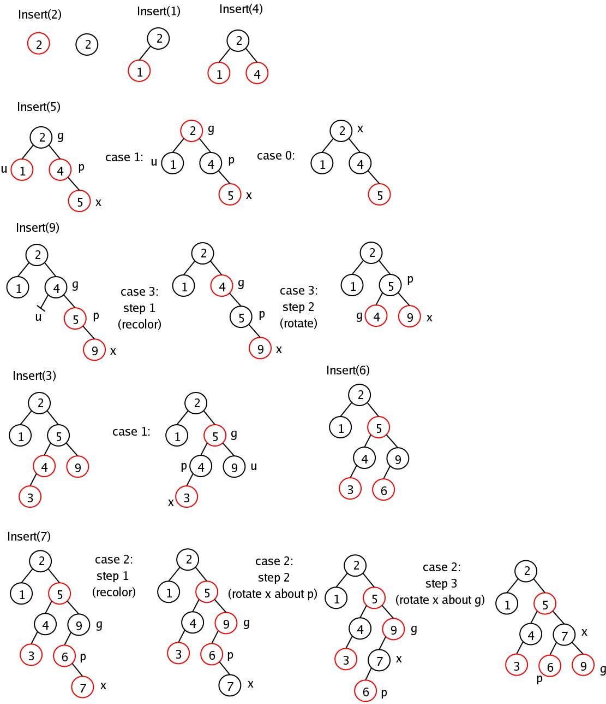

## RED Black Tree의 삭제

1. 일반적인 이진 탐색 트리의 삭제 과정과 같이 원소를 삭제한다.
2. 삭제된 노드의 자식 노드가 둘 다 RED이면, 균형 상태를 유지하기 위해 추가 작업을 수행하지 않는다.
3. 삭제된 노드의 자식 노드 중 하나만 RED이면, 해당 자식 노드를 삭제된 노드의 위치로 옮기고 BLACK으로 변경한다.
4. 삭제된 노드의 자식 노드가 모두 BLACK인 경우, 해당 자식 노드를 삭제된 노드의 위치로 옮긴 후, DOUBLE BLACK 노드로 변경한다.
5. DOUBLE BLACK 노드를 해결하기 위해 다음과 같은 작업을 수행한다.
    1. DOUBLE BLACK 노드의 형제 노드가 BLACK이고, 형제 노드의 자식 노드 중 하나 이상이 RED인 경우
        1. 형제 노드와 형제 노드의 자식 노드 중 RED 노드를 기준으로 회전을 수행한다.
        2. DOUBLE BLACK 노드와 형제 노드를 BLACK으로 변경하고, 형제 노드의 자식 노드를 RED로 변경한다.
        3. DOUBLE BLACK 노드의 부모 노드를 기준으로 회전을 수행한다.
    2. DOUBLE BLACK 노드의 형제 노드가 BLACK이고, 형제 노드의 자식 노드가 모두 BLACK인 경우
        1. 형제 노드를 RED로 변경한다.
        2. DOUBLE BLACK 노드의 부모 노드를 새로운 DOUBLE BLACK 노드로 변경하고, 문제를 해결하기 위해 다시 재귀적으로 수행한다.
    3. DOUBLE BLACK 노드의 형제 노드가 RED인 경우
        1. 형제 노드를 BLACK으로 변경하고, 부모 노드를 RED로 변경한다.
        2. 부모 노드를 기준으로 회전을 수행한다.
        3. 문제를 해결하기 위해 다시 재귀적으로 수행한다.

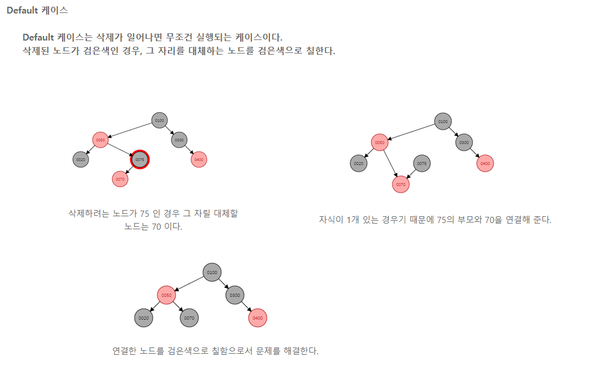

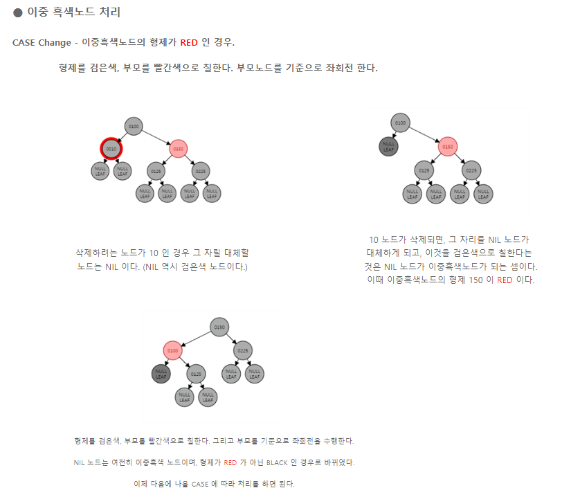

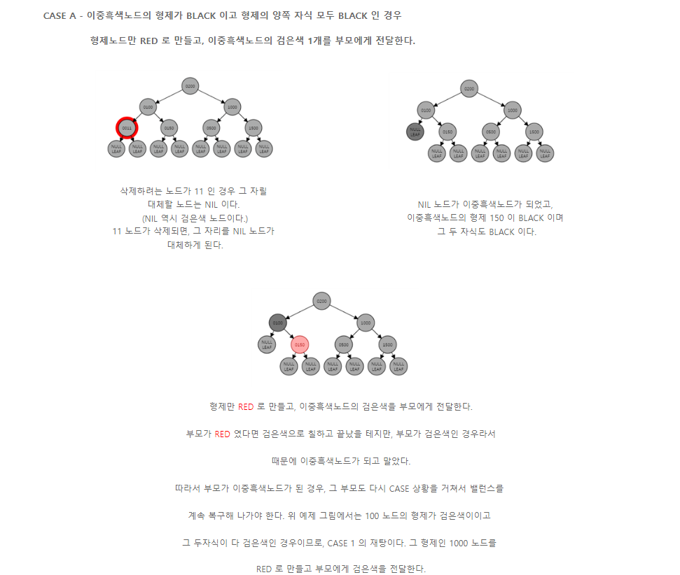

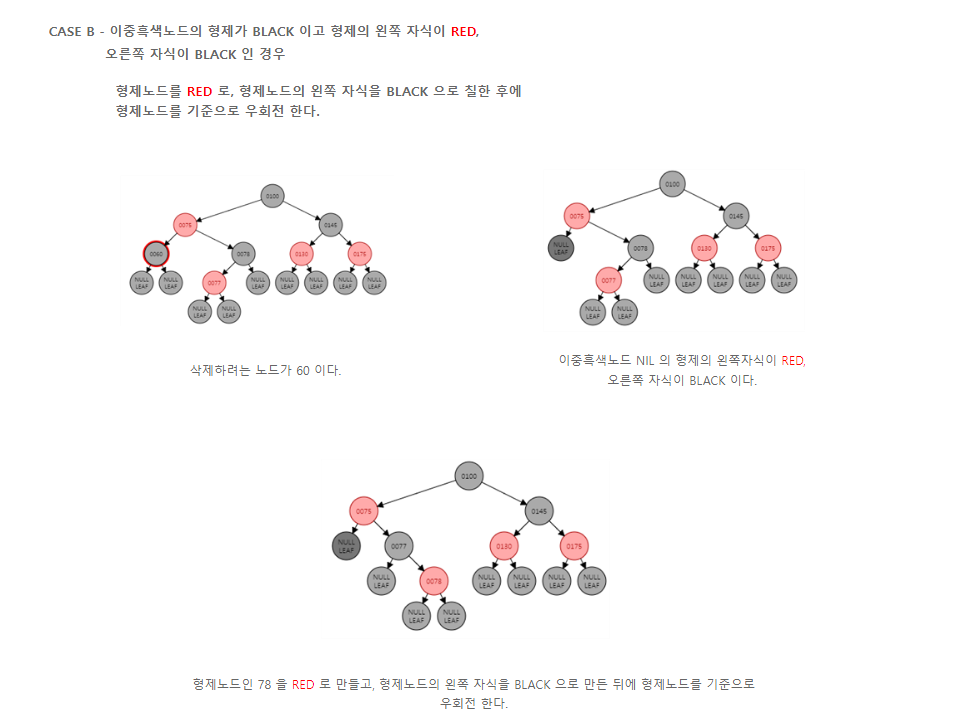

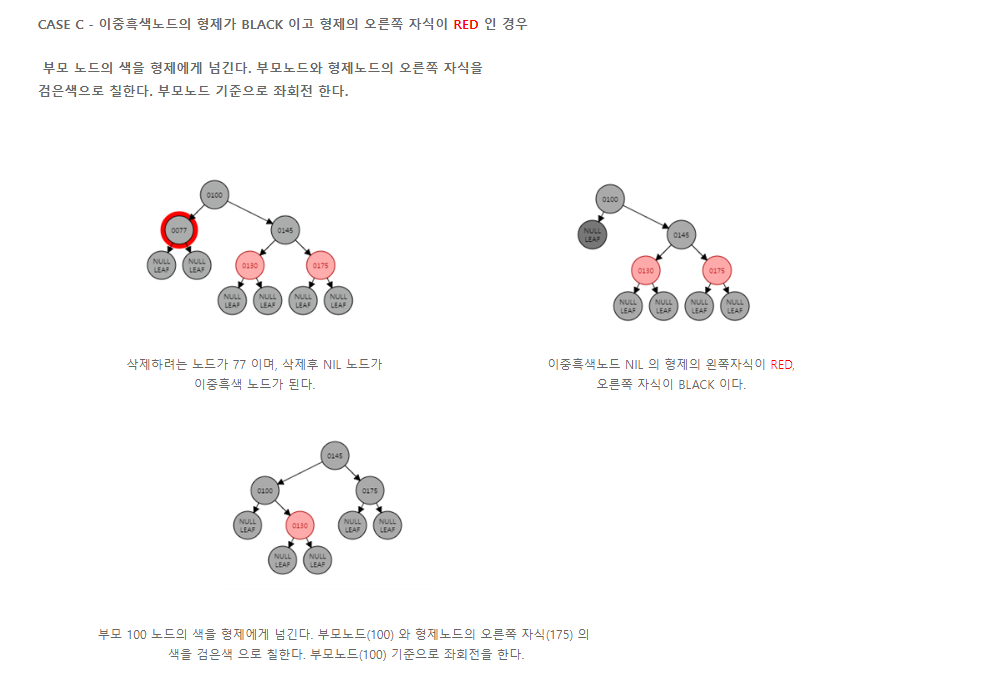

RED Black Tree 코드 예시는 다음과 같다.

```python
class Node:
    def __init__(self, value):
        self.value = value
        self.color = "RED"  # 색상 초기값은 RED
        self.left_child = None
        self.right_child = None
        self.parent = None

class RedBlackTree:
    def __init__(self):
        self.root = None

    # 노드 삽입 메소드
    def insert(self, value):
        new_node = Node(value)
        new_node.color = "RED"  # 새로운 노드의 색상을 RED로 초기화
        if not self.root:  # 루트 노드가 없으면, 새로운 노드를 루트 노드로 지정하고 그 색상을 BLACK으로 변경
            self.root = new_node
            new_node.color = "BLACK"
        else:
            current_node = self.root
            while True:
                if value < current_node.value:
                    if not current_node.left_child:
                        current_node.left_child = new_node
                        new_node.parent = current_node
                        break
                    current_node = current_node.left_child
                else:
                    if not current_node.right_child:
                        current_node.right_child = new_node
                        new_node.parent = current_node
                        break
                    current_node = current_node.right_child

            self.balance(new_node)  # 노드 삽입 후, 균형을 맞춰주기 위한 balance() 메소드 호출

    # 노드 삭제 메소드
    def delete(self, value):
        pass

    # 노드 균형 조정 메소드
    def balance(self, node):
        while node != self.root and node.parent.color == "RED":  # 균형이 깨질 경우, 부모 노드와 할아버지 노드의 색상에 따라 균형 조정
            parent = node.parent
            grandparent = parent.parent
            if parent == grandparent.left_child:  # 부모 노드가 할아버지 노드의 왼쪽 자식일 경우
                uncle = grandparent.right_child
                if uncle and uncle.color == "RED":  # Case 1: uncle 노드가 RED인 경우
                    grandparent.color, uncle.color, parent.color = "RED", "BLACK", "BLACK"
                    node = grandparent
                else:
                    if node == parent.right_child:  # Case 2: uncle 노드가 BLACK이고, 노드가 부모의 오른쪽 자식인 경우
                        self.rotate_left(parent)  # 부모 노드를 기준으로 left-rotation 수행
                        node = parent
                        parent = node.parent
                    self.rotate_right(grandparent)  # Case 3: uncle 노드가 BLACK이고, 노드가 부모의 왼쪽 자식이거나 오른쪽 자식일 경우
                    parent.color, grandparent.color = "BLACK", "RED"
                    node = parent
            else:  # parent == grandparent.right_child:  # 부모 노드가 할아버지 노드의 오른쪽 자식일 경우
                uncle = grandparent.left_child
                if uncle and uncle.color == "RED":  # Case 1: uncle 노드가 RED인 경우
                    grandparent.color, uncle.color, parent.color = "RED", "BLACK", "BLACK"
                    node = grandparent
                else:
                    if node == parent.left_child:  # Case 2: uncle 노드가 BLACK이고, 노드가 부모의 왼쪽 자식인 경우
                        self.rotate_right(parent)  # 부모 노드를 기준으로 right-rotation 수행
                        node = parent
                        parent = node.parent
                    self.rotate_left(grandparent)  # Case 3: uncle 노드가 BLACK이고, 노드가 부모의 왼쪽 자식이거나 오른쪽 자식일 경우
                    parent.color, grandparent.color = "BLACK", "RED"
                    node = parent

        self.root.color = "BLACK"  # 루트 노드의 색상을 BLACK으로 변경

    # 노드 회전 메소드
    def rotate_left(self, node):
        temp = node.right_child
        node.right_child = temp.left_child
        if temp.left_child != None:
            temp.left_child.parent = node
        temp.parent = node.parent
        if node.parent == None:
            self.root = temp
        elif node == node.parent.left_child:
            node.parent.left_child = temp
        else:
            node.parent.right_child = temp
        temp.left_child = node
        node.parent = temp

    def rotate_right(self, node):
        temp = node.left_child
        node.left_child = temp.right_child
        if temp.right_child != None:
            temp.right_child.parent = node
        temp.parent = node.parent
        if node.parent == None:
            self.root = temp
        elif node == node.parent.right_child:
            node.parent.right_child = temp
        else:
            node.parent.left_child = temp
        temp.right_child = node
        node.parent = temp

```

## B-Tree

B-트리는 여러 개의 자식 노드를 가지며, 각 노드당 하나의 키만을 가진 트리로 이진 탐색 트리와 유사한 자료 구조이다. B-트리는 디스크와 같은 대용량 저장장치에서 사용되는 자료 구조로, 하나의 노드에 많은 키를 가지고 있기 때문에 적은 수의 노드로 대량의 데이터를 저장할 수 있다.

B-트리의 특징은 다음과 같다.

- 루트 노드는 적어도 두 개 이상의 자식 노드를 가진다.
- 모든 리프 노드는 같은 레벨에 있다.
- 루트 노드를 제외한 모든 노드는 적어도 M/2개의 키를 가진다. (M은 B-트리에서 하나의 노드가 가질 수 있는 최대 키 개수)
- B-트리에서 하나의 노드가 가질 수 있는 최대 자식 노드 개수는 M이다.
- 각 노드의 키는 정렬된 상태를 유지한다.

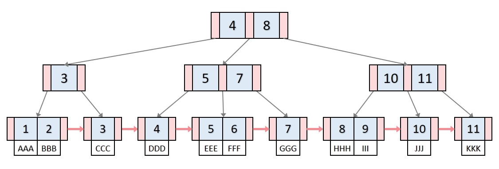

## B-Tree 삽입

1. 삽입할 위치를 찾는다.
2. 해당 위치의 노드가 가득 차있다면, 노드를 분할한다.
3. 새로운 키를 적절한 위치에 삽입한다.

### Case 1. 분할이 일어나지 않고, 삽입 위치가 리프노드의 가장 앞 key 자리가 아닌 경우

B트리와 똑같은 삽입 과정을 수행한다.

### Case 2. 분할이 일어나지 않고, 삽입 위치가 리프노드의 가장 앞 key 자리인 경우

삽입 후 **부모 key를 삽입된 key로 갱신**하고, data를 넣어준다.

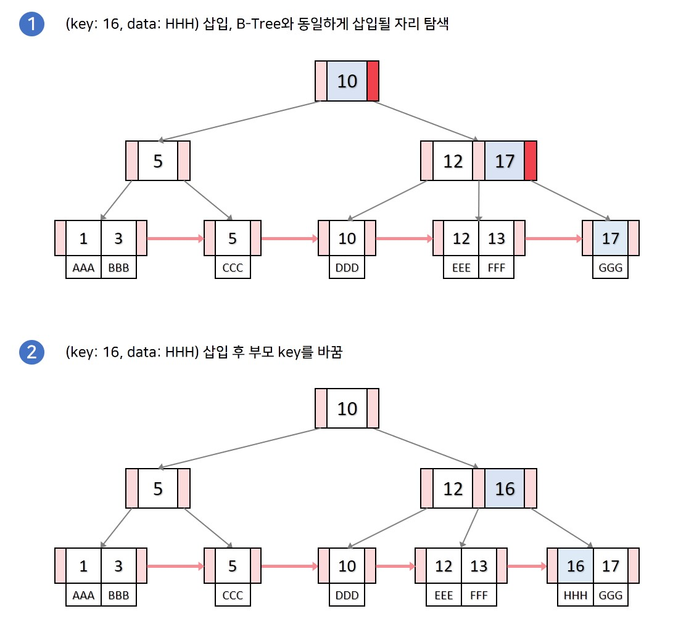

### Case 3. 분할이 일어나는 삽입과정

1. 분할이 일어나는 노드가 리프노드가 아니라면 기존 B트리와 똑같이 분할을 진행한다. 중간 key를 부모 key로 올리고, 분할한 두개의 노드를 왼쪽, 오른쪽 자식으로 설정한다.
2. 분할이 일어나는 노드가 리프노드라면 중간 key를 부모 key로 올리지만, 오른쪽 노드에 중간 key를 포함하여 분할한다. 또한 리프노드는 연결리스트이기 때문에 왼쪽 자식노드와 오른쪽 자식 노드를 이어줘 연결리스트 형태를 유지한다. 해당 부분이 B트리의 분할과 다른 점이다.

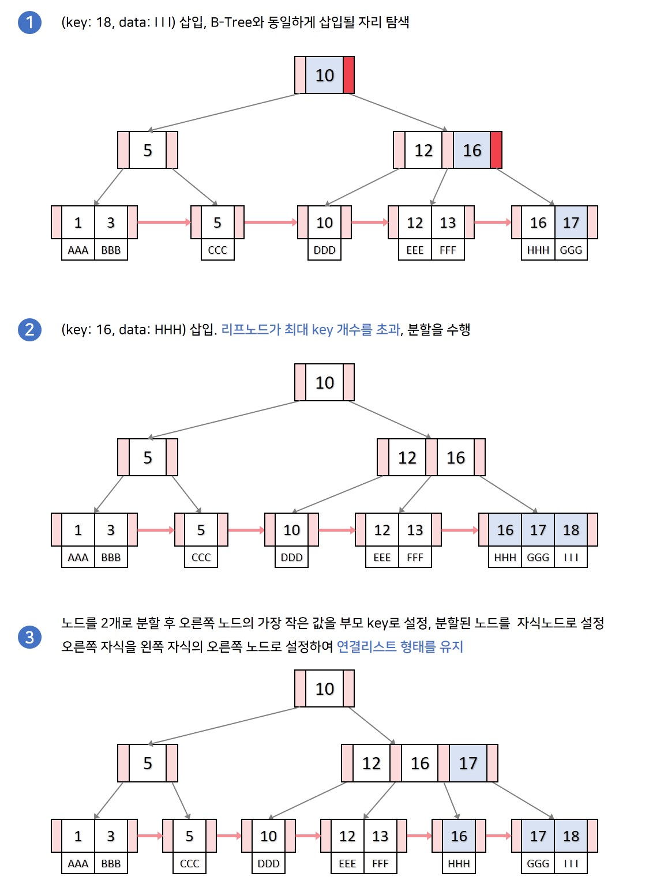

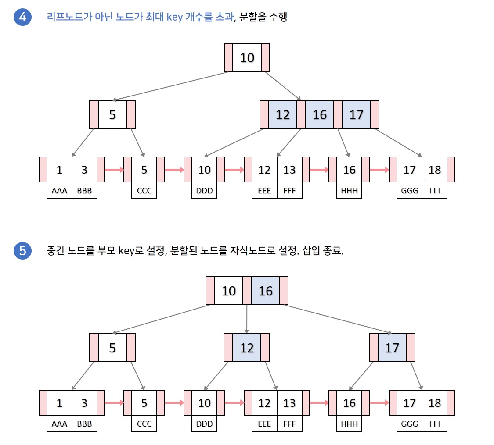

## B-Tree 삭제

1. 삭제할 키를 찾는다.
2. 해당 키를 가지고 있는 노드가 리프 노드인 경우, 키를 삭제한다.
3. 해당 키를 가지고 있는 노드가 리프 노드가 아닌 경우, 키를 삭제하고, 해당 키의 바로 다음 노드에서 가장 작은 값을 찾아서 삭제할 키를 대체한다. 만약, 그 노드가 가득 찬 경우, 노드를 분할한다.
4. 삭제 후, 노드가 너무 적게 차 있을 경우, 형제 노드와 병합한다. 만약, 형제 노드도 너무 적게 차 있을 경우, 부모 노드와 병합한다.

### Case 1. 삭제할 key k가 index에 없고, 리프노드의 가장 처음 key가 k가 아닌경우

기존의 B트리 삭제과정과 동일하다.

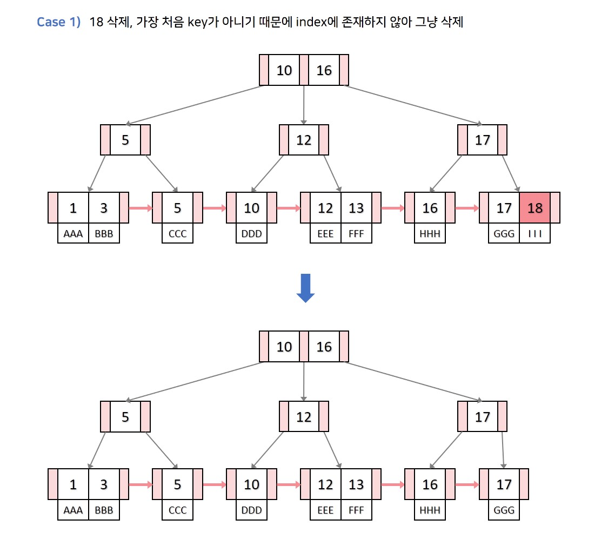

### Case 2. 삭제할 key k가 리프노드의 가장 처음 key인 경우

삭제할 key *k*가 리프노드의 가장 처음 key인 경우에는 항상 *k*가 index 내에 존재한다.

1. 먼저 리프노드의 *k*를 삭제하는 과정을 수행한다. key의 개수가 최소 key의 개수라면 B트리의 삭제 과정 중 형제노드의 key를 빌려오는 경우나 부모key와 병합하는 등 과정들은 동일하게 수행한다. 단, 리프노드가 병합할 때는 부모key와 오른쪽 자식의 처음 key가 동일하기 때문에 부모key를 가져오는 과정만 생략하고 왼쪽 자식과 오른쪽 자식을 병합만 하면 된다.
2. 리프노드의 k를 삭제한 후, index내의 *k*를 **`inorder successor`**로 변경한다.

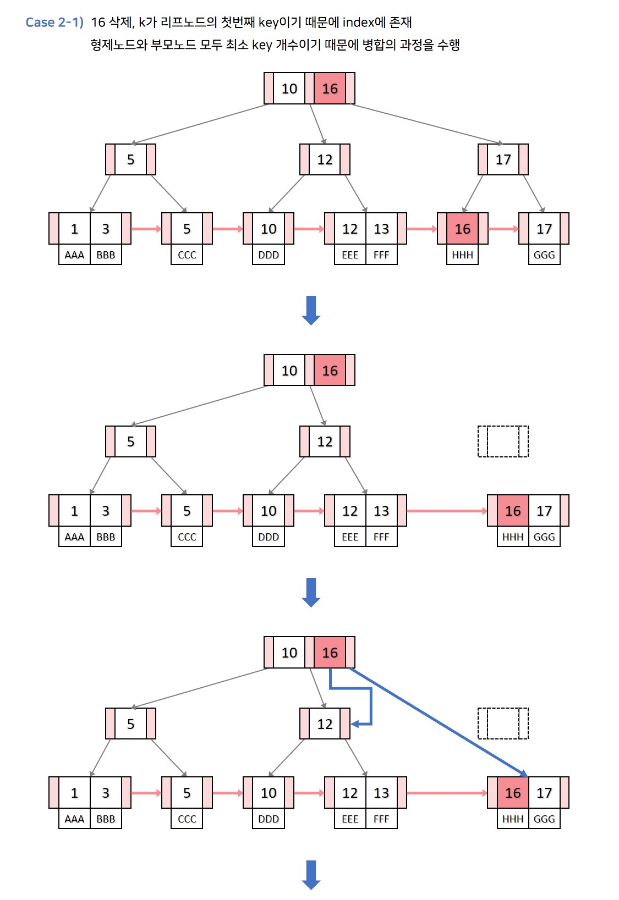

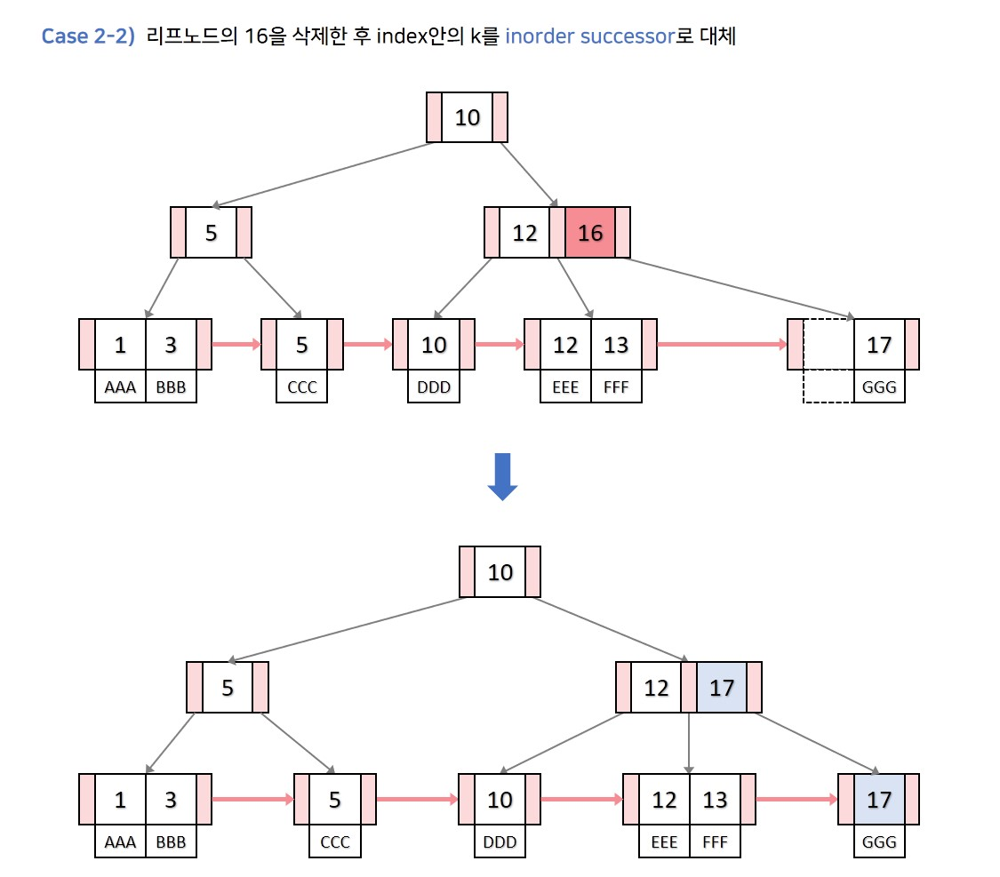

B-트리 코드 예시는 다음과 같다.

```python
class BTreeNode:
    def __init__(self, leaf=False):
        self.leaf = leaf
        self.keys = []
        self.child = []

class BTree:
    def __init__(self, t):
        self.root = BTreeNode(True)
        self.t = t

    # 노드 삽입 메소드
    def insert(self, k):
        root = self.root
        if len(root.keys) == (2 * self.t) - 1:  # 루트 노드가 가득 찬 경우, 새로운 루트 노드 생성
            new_root = BTreeNode()
            self.root = new_root
            new_root.child.append(root)
            self.split_child(new_root, 0)
            self.insert_into_nonfull(new_root, k)
        else:
            self.insert_into_nonfull(root, k)

    # 노드 분할 메소드
    def split_child(self, x, i):
        t = self.t
        y = x.child[i]
        z = BTreeNode(leaf=y.leaf)
        x.child.insert(i + 1, z)
        x.keys.insert(i, y.keys[t - 1])
        z.keys = y.keys[t:(2 * t - 1)]
        y.keys = y.keys[0:(t - 1)]

        if not y.leaf:
            z.child = y.child[t:(2 * t)]
            y.child = y.child[0:(t - 1)]

    # 노드 삽입 메소드 (노드가 가득 차지 않은 경우)
    def insert_into_nonfull(self, x, k):
        i = len(x.keys) - 1
        if x.leaf:
            x.keys.append(0)
            while i >= 0 and k < x.keys[i]:
                x.keys[i + 1] = x.keys[i]
                i -= 1
            x.keys[i + 1] = k
        else:
            while i >= 0 and k < x.keys[i]:
                i -= 1
            i += 1
            if len(x.child[i].keys) == (2 * self.t) - 1:
                self.split_child(x, i)
                if k > x.keys[i]:
                    i += 1
            self.insert_into_nonfull(x.child[i], k)
```

## 파이썬 트리 라이브러리

**bisect 라이브러리**
