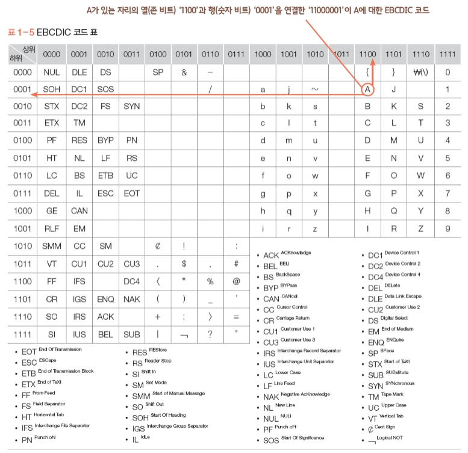
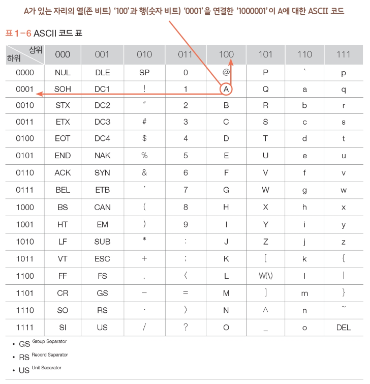
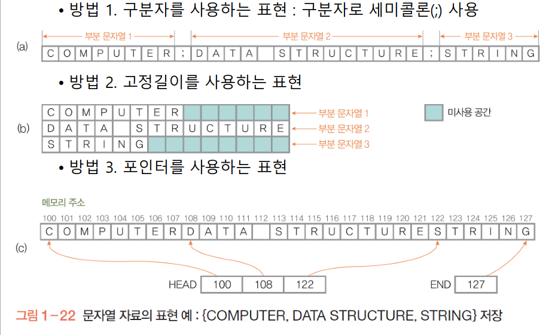
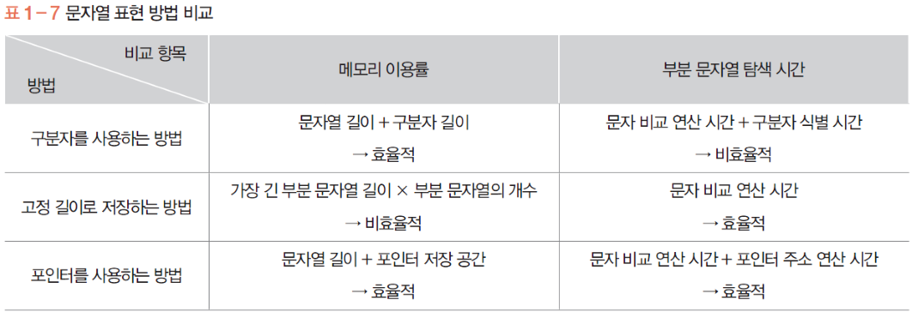

[상위 페이지 · 알고리즘](/study/algorithms/)

자료구조는 프로그래밍에서 사용되는 데이터를 효율적으로 저장하고 처리할 수 있도록 정리하는 방법이다. 이를 통해 데이터를 빠르게 검색하고 조작할 수 있어 프로그램의 효율성이 크게 향상된다. 배열, 스택, 큐, 연결 리스트, 해시 테이블 등이 대표적인 자료구조이며, 프로그래밍의 목적에 따라 적합한 자료구조를 선택하여 사용하는 것이 중요하다.

## 자료 형태에 따른 분류

1. 단순 구조
    - 정수, 실수, 문자, 문자열 등의 기본 자료형
2. 선형 구조
    - 자료들 사이의 관계가 1:1 관계
    - 순차 리스트, 연결 리스트, 스택, 큐, 데크 등
    
    - [List](/study/algorithms/data-structure/list/)
    
    - [Stack](/study/algorithms/data-structure/stack/)
    
    - [Queue](/study/algorithms/data-structure/queue/)
    
    - [Priority Queue](/study/algorithms/data-structure/priority-queue/)
    
3. 비선형 구조
    - 자료들 사이의 관계가 1:다, 또는 다:다 관계
    
    - [기본적인 트리](/study/algorithms/data-structure/gibonjeogin-teuri/)
    
    - [Heap](/study/algorithms/data-structure/heap/)
    
    - [**Segment Tree**](/study/algorithms/data-structure/segment-tree/)
    
    - [Trie](/study/algorithms/data-structure/trie/)
    
    - [Top Tree](/study/algorithms/data-structure/top-tree/)
    
    - [Splay Tree](/study/algorithms/data-structure/splay-tree/)
    
4. 파일 구조
    - 서로 관련 있는 필드로 구성된 레코드의 집합인 파일에 대한 구조
    - 순차 파일, 색인 파일, 직접 파일 등

## 컴퓨터에서의 자료 표현

컴퓨터에서의 자료 표현은 모든 형식의 자료를 2진수 코드로 변환하여 저장하고 처리한다. 이는 컴퓨터가 이해할 수 있는 유일한 형식이기 때문이다. 2진수 코드는 0과 1로만 이루어져 있으며, 컴퓨터는 이를 읽고 처리한다. 예를 들어, 숫자 5는 이진수로 101이 되고, 문자 'A'는 01000001이 된다. 2진수 코드는 컴퓨터가 효율적으로 처리할 수 있도록 설계되어 있어 빠른 연산이 가능하다.

## 10진수의 표현

### 존 형식의 표현

- 10진수 한 자리를 표현하기 위해서 1바이트를 사용하는 형식
- 존 영역
    - 상위 4비트
    - 1111로 표현
- 수치 영역
    - 하위 4비트
    - 표현하고자 하는 10진수 한 자리 값에 대한 2진수 값을 표시

| 존 영역 | 수치 영역 | 10진수 |
| --- | --- | --- |
| 1111 | 0000 | 0 |
| 1111 | 0001 | 1 |
| 1111 | 0010 | 2 |
| 1111 | 0011 | 3 |
| 1111 | 0100 | 4 |
| 1111 | 0101 | 5 |
| 1111 | 0110 | 6 |
| 1111 | 0111 | 7 |
| 1111 | 1000 | 8 |
| 1111 | 1001 | 9 |

음수표현은 마지막에 1101을 넣으며 음수를 표현하고 양수표현은 1100을 넣으며 양수를 표현한다

### 팩 형식의 표현

10진수 한자리를 표현하기 위해서 존 영역 없이 4비트를 사용하는 형식

최하위 4비트에 부호를 표시하게 된다

+213

| 2 | 1 | 3  | C(+) |
| --- | --- | --- | --- |
| 0010 | 0001 | 0011 | 1100 |

-213

| 2 | 1 | 3  | D(-) |
| --- | --- | --- | --- |
| 0010 | 0001 | 0011 | 1101 |

## 2진수의 정수 표현

### n비트의 부호 절대값 형식

최상위 1비트는 부호를 표시한다

- 양수 (+) : 0
- 음수 (-) : 1

나머지 n-1 비트 : 이진수 표시

+21

| 부호 | 절대값 정수 = 21 |
| --- | --- |
| 0 | 0010101 |

-21

| 부호 | 절대값 정수 = 21 |
| --- | --- |
| 1 | 0010101 |

### 1의 보수 형식

음수 표현에서 부호 비트를 사용하는 대신 1의 보수를 사용하는 방법

음수를 n비트의 1의 보수로 만드는 방법

1. $$(2^n-1)$$에서 음수 x (-x)의 절대값을 뺀다.
2. n비트를 모두 1로 만든 이진수에서 음수x (-x)의 절대값 이진수 |-x|를 뻄
3. 음수x (-x)의 절대값 이진수의 각 비트를 반대값으로 변환

+21 - > -21

|  | 11111111 |
| --- | --- |
| - | 00010101 (21)  |
| = | 11101010 (21 - 1의 보수 = -21) |

### 2의 보수 형식

음수 표현에서 부호 비트를 사용하는 대신 2의 보수를 사용하는 방법

음수를 n비트의 2의 보수로 만드는 방법은

1의 보수에서 + 1을 한다

|  | 11111111 |
| --- | --- |
| - | 00010101 (21) |
| = | 11101010  (21 - 1의 보수) |
| + | 00000001 |
| = | 11101011 (21 - 2의 보수 = -21) |

---

부호 절대값 형식과 1의 보수 형식을 쓰지 못하는 이유는 0때문이다. 0이 두가지로 표현되기 때문에 예상치 못한 오류가 발생할 수 있다.

## 2진수의 실수 표현

### 고정 소수점 표현

소수점이 항상 최상위 비트의 왼쪽 밖에 고정되어 있는 것으로 취급하는 방법

10진수를 2진수로 변환하는 방법은 다음과 같다.

1. 정수부분을 2진수로 변환한다.
2. 소수부분을 2진수로 변환한다.
3. 정수부분과 소수부분을 합한다.

예를 들어, 10진수 42.75를 2진수로 변환하려면 다음과 같은 과정을 거친다.

1. 42를 2진수로 변환한다.
    - 42 / 2 = 21 ... 0
    - 21 / 2 = 10 ... 1
    - 10 / 2 = 5 ... 0
    - 5 / 2 = 2 ... 1
    - 2 / 2 = 1 ... 0
    - 1 / 2 = 0 ... 1
    - 따라서 42의 2진수는 101010
2. 0.75를 2진수로 변환한다.
    - 0.75 * 2 = 1.5 ... 1
    - 0.5 * 2 = 1.0 ... 1
    - 따라서 0.75의 2진수는 0.11
3. 정수부분과 소수부분을 합친다.
    - 101010.11가 된다.

따라서 10진수 42.75의 2진수 고정 소수점 표현은 101010.11이다.

### 부동 소수점 표현

고정 소수점 형식에 비해서 표현 가능한 값의 범위가 넣다

부동 소수점은 실수를 구분하여 표현하는 방법이다

10진수를 2진수 부동 소수점으로 바꾸는 과정은 다음과 같다.

1. 정수 부분을 2진수로 변환한다.
2. 소수 부분을 2진수로 변환한다.
3. 소수점 이하 부분을 2진수로 변환한다.
4. 정규화(normalization)한다.
    - 소수점을 왼쪽으로 이동하여 가수의 가장 왼쪽에 위치시킨다.
    - 이때, 소수점을 이동하는 만큼 지수를 증가시킨다.
    - 이때, 지수는 2진수로 변환하여 저장한다.
5. 부호, 지수, 가수를 결합하여 부동 소수점 수를 생성한다.

예를 들어, 10진수 42.75를 2진수 부동 소수점으로 변환하려면 다음과 같은 과정을 거친다.

1. 42를 2진수로 변환한다.
    - 42 / 2 = 21 ... 0
    - 21 / 2 = 10 ... 1
    - 10 / 2 = 5 ... 0
    - 5 / 2 = 2 ... 1
    - 2 / 2 = 1 ... 0
    - 1 / 2 = 0 ... 1
    - 따라서 42의 2진수는 101010
2. 0.75를 2진수로 변환한다.
    - 0.75 * 2 = 1.5 ... 1
    - 0.5 * 2 = 1.0 ... 1
    - 따라서 0.75의 2진수는 0.11
3. 소수점 이하 부분을 2진수로 변환한다.
    - 0.11을 10진수로 변환하면 0.75가 된다.
    - 0.75를 2진수로 변환하면 0.11이 된다.
4. 정규화한다.
    - 101010.11을 정규화하면 1.0101011 x 2^5가 된다.
    - 지수 5를 2진수로 변환하면 101이 된다.

부호, 지수, 가수를 결합하여 부동 소수점 수를 생성한다.

- 부호는 0(양수)이다.
- 지수는 5를 2진수로 변환한 101이다.
- 가수는 정규화한 결과에서 소수점 이하 부분인 0101011이다.
- 따라서 10진수 42.75의 2진수 부동 소수점 표현은

| 부호 | 지수부 | 가수부 |
| --- | --- | --- |
| 0 | 101 | 0101011 |

## 부동 소수점 바이어스(Bias)

지수부를 저장할 때, 부호 비트를 제외한 나머지 비트들은 2진수로 표현되어 있다. 이때, 지수의 부호를 나타내는 비트를 더해준 값이 지수부가 된다. 이를 부동 소수점 바이어스라고 한다. 바이어스를 사용하면 지수를 부호화하지 않고도 양수와 음수의 지수를 표현할 수 있다.

예를 들어, 8비트 부동 소수점에서 지수부는 3비트로 표현된다. 이때, 바이어스는 $$2^{(3-1)}-1=3$$이 된다. 따라서, 000(2)은 -3의 지수, 001(2)은 -2의 지수, 010(2)은 -1의 지수, 011(2)은 0의 지수, 100(2)은 1의 지수, 101(2)은 2의 지수, 110(2)은 3의 지수, 111(2)은 예약된 값이 된다.

따라서, 이전 예제에서 사용한 10진수 42.75의 경우, 부호 비트는 0(양수)이 되고, 지수부는 5 + 3 = 8(2진수 1000)이 된다. 가수부는 0101011이 된다. 이를 결합하여 0 1000 0101011(2)가 된다.

## 문자 자료의 표현

문자에 대한 이진수 코드를 정의하여 사용한다

### BCD 코드

6비트를 사용하여 문자를 표현한다

상위 2비트는 존 비트 하위 4비트는 2진수 비트이다

존비트와 2진수 비트를 조합하여 10진수 0~9와 영어 대문자, 특수문자를 표현할 수 있다.

$존\space비트 \ AB의\space값 = \begin{cases}
   00 &\text{: } 숫자\ 0,1\backsim9 \\
    01 &\text{: } 문자\ A\backsim I \\
 10 &\text{: } 문자\ J\backsim R \\
 11 &\text{: } 문자\ S\backsim Z \\
\end{cases}$

- BCD 코드 표
    
    
    | 존 비트 | 2진수 비트 | 10진수 |
    | --- | --- | --- |
    | 00 | 0000 | 0 |
    | 00 | 0001 | 1 |
    | 00 | 0010 | 2 |
    | 00 | 0011 | 3 |
    | 00 | 0100 | 4 |
    | 00 | 0101 | 5 |
    | 00 | 0110 | 6 |
    | 00 | 0111 | 7 |
    | 00 | 1000 | 8 |
    | 00 | 1001 | 9 |
    | 01 | 0001 | A |
    | 01 | 0010 | B |
    | 01 | 0011 | C |
    | 01 | 0100 | D |
    | 01 | 0101 | E |
    | 01 | 0110 | F |
    | 01 | 1110 | U |
    | 10 | 0001 | G |
    | 10 | 0010 | H |
    | 10 | 0011 | I |
    | 10 | 0100 | J |
    | 10 | 0101 | K |
    | 10 | 0110 | L |
    | 10 | 1110 | Y |
    | 11 | 0001 | M |
    | 11 | 0010 | N |
    | 11 | 0011 | O |
    | 11 | 0100 | P |
    | 11 | 0101 | Q |
    | 11 | 0110 | R |
    | 11 | 1110 | Z |

### EBCDIC 코드

8비트를 사용하여 문자 표현

상위 4비트는 존비트 하위 4비트는 2진수비트이다

존비트와 2진수 비트를 조합하여 10진수 0~9와 영어 대문자/소문자와 특수문자를 표

$존\space비트 \ AB의\space값 = \begin{cases}
00 &\text{: } 여분 \\
01 &\text{: } 특수문자 \\
10 &\text{: } 영어 \ 소문자 \\
11 &\text{: } 영어 \ 대문자 \\
\end{cases}$

$존\space비트 \ CD의\space값 = \begin{cases}
00 &\text{: } 문자\ A\backsim I \\
01 &\text{: } 문자\ J\backsim R \\
10 &\text{: } 문자\ S\backsim Z \\
11 &\text{: } 숫자\ 0\backsim9 \\
\end{cases}$

### ASCII 코드

7비트를 사용하여 문자 표현

상위 3비트는 존비트 하위 4비트는 2진수 비트

존 비트와 2진수 비트를 조합하여 10진수 0~9와 영어 대문자/소문자, 특수문자를 표현

### **유니코드**

EBCDIC 코드나 ASCII 코드는 최대 8비트로 숫자, 몇 가지 특수문자, 알파벳 정의하므로 문자 코드 표에 정의되어 있지 않은 문자 표현 불가능

이런 문제 해결 위해 세계 여러 나라의 언어를 통일된 방법으로 표현할 수 있도록 정의한 국제 표준 코드(ISO/IEC 10646)

2바이트를 조합하여 하나의 글자를 표현하기 때문에 1바이트 코드로 표현할 수 없었던 다양한 언어를 표현.

유니코드 표는 http://www.unicode.org/에서 확인 가능

초기 IBM 컴퓨터 시스템에서는 BCD 코드를 사용하다가 더 많은 문자 코드를 표현할 수 있는 EBCDIC코드로 대체, 그러다 미국 표준 코드인 ASCII 코드 일반화, 현재는 표현의 한계를 극복한 유니코드가 일반화

XML, Java, CORBA 3.0, WML 등 인터넷 기반 프로그램과 제품에 사용

## 논리 자료 표현

논리 값을 표현하기 위한 자료 형식

1바이트를 사용하여 논리 자료를 표현 하는 방법

- 방법 1)
    - 참: 최하위 비트를 1로 표시 : 00000001
    - 거짓 : 최하위 비트를 0으로 표시 : 00000001
- 방법 2)
    - 참: 전체 비트를 1로 표시 : 111111111
    - 거짓 : 전체 비트를 0으로 표시 : 00000000
- 방법 3)
    - 참: 하나 이상의 비트를 1로 표시 : 01000000 or 00000001
    - 거짓 : 전체 비트를 0으로 표시 : 00000000

## 포인터 자료

메모리의 주소를 표현하기 위한 자료 형식

변수의 주소나 메모리의 특정 위치에 대한 주소를 저장하고 주소연산하기 위해 사용

## **문자열String자료**

여러 문자로 이루어진 문자의 그룹을 하나의 자료로 취급하여메모리에 연속적으로 저장하는 자료 형식

하나의 문자열 자료에 포함된 부분문자열을 표현하는 방법

- 방법 1 : 부분 문자열 사이에 구분자를 사용하여 저장한다.
- 방법 2 : 가장 긴 문자열의 길이에 맞춰 고정 길이로 저장한다.
- 방법 3 : 부분 문자열을 연속하여 저장하고 각 부분 문자열에 대한 포인터를 사용한다.

## 문제 풀이

- [루비](/study/algorithms/data-structure/ruby/)

- [다이아](/study/algorithms/data-structure/diamond/)

- [플래티넘](/study/algorithms/data-structure/platinum/)

- [골드](/study/algorithms/data-structure/gold/)

- [실버](/study/algorithms/data-structure/silver/)
