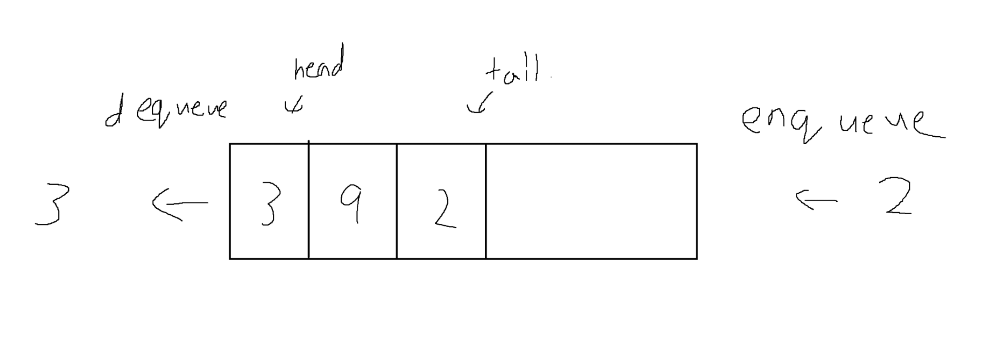

[상위 페이지 · Data Structure](/study/algorithms/data-structure/)

큐(Queue)는 컴퓨터 과학에서 가장 기본적인 자료구조 중 하나로, 선입선출(FIFO: First In First Out) 방식으로 작동한다. 즉, 먼저 들어온 데이터가 먼저 나가는 형태의 자료구조이다. 대기열이라고도 불리며, 현실 세계의 줄서기와 유사한 개념이다.



## 큐의 기본 연산

큐는 다음과 같은 기본 요소를 가지고 있다:

- **front(head)**: 큐의 맨 앞 위치로, 데이터가 삭제되는 곳이다.
- **rear(tail)**: 큐의 맨 뒤 위치로, 새로운 데이터가 삽입되는 곳이다.
- **enqueue**: 큐의 rear에 새로운 데이터를 추가하는 연산이다.
- **dequeue**: 큐의 front에서 데이터를 제거하고 반환하는 연산이다.
- **peek**: 큐의 front에 있는 데이터를 제거하지 않고 확인하는 연산이다.
- **isEmpty**: 큐가 비어있는지 확인하는 연산이다.
- **isFull**: 큐가 가득 찼는지 확인하는 연산이다(배열 기반 구현에서 사용).

## 큐의 종류

큐는 구현 방식에 따라 여러 유형이 있다:

- **선형 큐(Linear Queue)**: 배열을 이용한 기본적인 큐 구현 방식으로, 데이터가 삭제되면 앞쪽에 빈 공간이 생기는 단점이 있다.
- **원형 큐(Circular Queue)**: 선형 큐의 단점을 보완한 구현 방식으로, 배열의 처음과 끝이 연결되어 있는 형태이다.
- **링크드 리스트 큐(Linked List Queue)**: 연결 리스트를 이용한 구현 방식으로, 크기 제한 없이 동적으로 메모리를 할당한다.
- **우선순위 큐(Priority Queue)**: 각 요소에 우선순위가 부여되어, FIFO 방식이 아닌 우선순위에 따라 데이터가 처리되는 큐이다. 이번 페이지에서는 구현방법을 설명하지 않는다
- **덱(Deque, Double-Ended Queue)**: 양쪽 끝에서 삽입과 삭제가 모두 가능한 큐이다. 이번 페이지에서는 구현방법을 설명하지 않는다

## 배열을 이용한 선형 큐 구현

### 1. 큐의 구조체 정의

```c
#define MAX_QUEUE_SIZE 100

typedef struct {
    int data[MAX_QUEUE_SIZE];
    int front;
    int rear;
} Queue;

// 큐 초기화 함수
void initQueue(Queue *q) {
    q->front = -1;
    q->rear = -1;
}

```

### 2. isEmpty 메서드

큐가 비어있는지 확인하는 함수이다. front와 rear가 같으면 큐는 비어있다고 판단한다.

```c
int isEmpty(Queue *q) {
    return (q->front == q->rear);
}

```

### 3. isFull 메서드

큐가 가득 찼는지 확인하는 함수이다. rear가 배열의 마지막 인덱스(MAX_QUEUE_SIZE-1)와 같으면 큐는 가득 찬 상태이다.

```c
int isFull(Queue *q) {
    return (q->rear == MAX_QUEUE_SIZE - 1);
}

```

### 4. enqueue 메서드

큐에 새로운 데이터를 추가하는 함수이다. rear를 증가시키고 해당 위치에 데이터를 저장한다.

```c
void enqueue(Queue *q, int item) {
    if (isFull(q)) {
        printf("큐가 가득 찼습니다\n");
        return;
    }
    q->data[++(q->rear)] = item;
}

```

### 5. dequeue 메서드

큐에서 데이터를 제거하고 반환하는 함수이다. front를 증가시키고 해당 위치의 데이터를 반환한다.

```c
int dequeue(Queue *q) {
    if (isEmpty(q)) {
        printf("큐가 비어있습니다\n");
        return -1; // 오류 값 반환
    }
    return q->data[++(q->front)];
}

```

### 6. peek 메서드

큐의 맨 앞 데이터를 제거하지 않고 반환하는 함수이다.

```c
int peek(Queue *q) {
    if (isEmpty(q)) {
        printf("큐가 비어있습니다\n");
        return -1; // 오류 값 반환
    }
    return q->data[q->front + 1];
}

```

## 원형 큐(Circular Queue) 구현

선형 큐의 문제점은 dequeue 연산이 실행될 때마다 앞부분에 빈 공간이 생기지만 사용할 수 없다는 점이다. 원형 큐는 이 문제를 해결하기 위해 배열의 처음과 끝을 연결한다.

### 1. 원형 큐 구조체 정의

```c
#define MAX_QUEUE_SIZE 100

typedef struct {
    int data[MAX_QUEUE_SIZE];
    int front;
    int rear;
} CircularQueue;

// 원형 큐 초기화 함수
void initCircularQueue(CircularQueue *q) {
    q->front = 0;
    q->rear = 0;
}

```

### 2. isEmpty 메서드

원형 큐에서는 front와 rear가 같으면 큐가 비어있다고 판단한다.

```c
int isEmpty(CircularQueue *q) {
    return (q->front == q->rear);
}

```

### 3. isFull 메서드

원형 큐에서는 (rear+1) % MAX_QUEUE_SIZE가 front와 같으면 큐가 가득 찬 것으로 판단한다.

```c
int isFull(CircularQueue *q) {
    return ((q->rear + 1) % MAX_QUEUE_SIZE == q->front);
}

```

### 4. enqueue 메서드

원형 큐에 데이터를 추가하는 함수이다. rear를 (rear+1) % MAX_QUEUE_SIZE로 갱신하고 해당 위치에 데이터를 저장한다.

```c
void enqueue(CircularQueue *q, int item) {
    if (isFull(q)) {
        printf("큐가 가득 찼습니다\n");
        return;
    }
    q->rear = (q->rear + 1) % MAX_QUEUE_SIZE;
    q->data[q->rear] = item;
}

```

### 5. dequeue 메서드

원형 큐에서 데이터를 제거하고 반환하는 함수이다. front를 (front+1) % MAX_QUEUE_SIZE로 갱신하고 해당 위치의 데이터를 반환한다.

```c
int dequeue(CircularQueue *q) {
    if (isEmpty(q)) {
        printf("큐가 비어있습니다\n");
        return -1; // 오류 값 반환
    }
    q->front = (q->front + 1) % MAX_QUEUE_SIZE;
    return q->data[q->front];
}

```

### 6. peek 메서드

원형 큐의 맨 앞 데이터를 제거하지 않고 반환하는 함수이다.

```c
int peek(CircularQueue *q) {
    if (isEmpty(q)) {
        printf("큐가 비어있습니다\n");
        return -1; // 오류 값 반환
    }
    return q->data[(q->front + 1) % MAX_QUEUE_SIZE];
}

```

## 연결 리스트를 이용한 큐 구현

연결 리스트로 큐를 구현하면 크기 제한 없이 동적으로 메모리를 할당할 수 있다.

### 1. 노드 및 큐 구조체 정의

```c
typedef struct Node {
    int data;
    struct Node *next;
} Node;

typedef struct {
    Node *front;
    Node *rear;
} LinkedQueue;

// 연결 큐 초기화 함수
void initLinkedQueue(LinkedQueue *q) {
    q->front = NULL;
    q->rear = NULL;
}

```

### 2. isEmpty 메서드

연결 리스트로 구현한 큐에서 front가 NULL이면 큐가 비어있다고 판단한다.

```c
int isEmpty(LinkedQueue *q) {
    return (q->front == NULL);
}

```

### 3. enqueue 메서드

연결 리스트로 구현한 큐에 데이터를 추가하는 함수이다. 새 노드를 생성하여 rear에 연결한다.

```c
void enqueue(LinkedQueue *q, int item) {
    Node *newNode = (Node*)malloc(sizeof(Node));
    if (newNode == NULL) {
        printf("메모리 할당 실패\n");
        return;
    }
    
    newNode->data = item;
    newNode->next = NULL;
    
    if (isEmpty(q)) {
        q->front = newNode;
    } else {
        q->rear->next = newNode;
    }
    q->rear = newNode;
}

```

### 4. dequeue 메서드

연결 리스트로 구현한 큐에서 데이터를 제거하고 반환하는 함수이다. front 노드를 제거하고 그 다음 노드를 front로 설정한다.

```c
int dequeue(LinkedQueue *q) {
    if (isEmpty(q)) {
        printf("큐가 비어있습니다\n");
        return -1; // 오류 값 반환
    }
    
    Node *temp = q->front;
    int item = temp->data;
    
    q->front = q->front->next;
    
    // 큐에 노드가 없는 경우 rear도 NULL로 설정
    if (q->front == NULL) {
        q->rear = NULL;
    }
    
    free(temp);
    return item;
}

```

### 5. peek 메서드

연결 리스트로 구현한 큐의 맨 앞 데이터를 제거하지 않고 반환하는 함수이다.

```c
int peek(LinkedQueue *q) {
    if (isEmpty(q)) {
        printf("큐가 비어있습니다\n");
        return -1; // 오류 값 반환
    }
    return q->front->data;
}

```

## 큐의 활용 분야

큐는 다양한 분야에서 활용된다:

- **프린터 대기열**: 여러 문서가 동시에 인쇄 요청을 할 경우, 먼저 요청된 문서부터 순서대로 인쇄한다.
- **CPU 스케줄링**: 운영체제에서 프로세스 실행 순서를 관리할 때 사용된다.
- **네트워크 패킷 관리**: 패킷이 도착한 순서대로 처리하기 위해 사용된다.
- **너비 우선 탐색(BFS)**: 그래프 알고리즘에서 노드를 탐색할 때 사용된다.
- **캐시(Cache)**: 메모리 관리 시스템에서 데이터를 임시로 저장할 때 사용된다.

## 시간 복잡도

큐의 기본 연산들의 시간 복잡도는 다음과 같다:

| **연산** | **시간 복잡도** | **구현 방식** |
| --- | --- | --- |
| Enqueue | O(1) | 배열 및 연결 리스트 구현 모두 |
| Dequeue | O(1) | 배열 및 연결 리스트 구현 모두 |
| Peek | O(1) | 배열 및 연결 리스트 구현 모두 |
| IsEmpty/IsFull | O(1) | 배열 및 연결 리스트 구현 모두 |

## 큐 구현 시 주의사항

큐를 구현할 때 다음과 같은 사항들을 주의해야 한다:

- **배열 기반 구현**: 선형 큐에서는 메모리 낭비 문제가 발생할 수 있으므로, 가능하면 원형 큐를 사용하는 것이 좋다.
- **연결 리스트 기반 구현**: 동적 메모리 할당과 해제를 신경써야 하며, 메모리 누수(Memory Leak)가 발생하지 않도록 해야 한다.
- **예외 처리**: 큐가 비어있거나 가득 찬 경우에 대한 예외 처리를 반드시 구현해야 한다.
- **포인터 관리**: 연결 리스트 기반 구현에서는 front와 rear 포인터를 올바르게 관리해야 한다.
