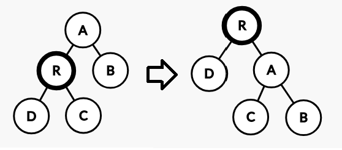
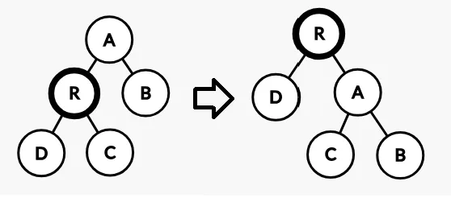

[상위 페이지 · Data Structure](/study/algorithms/data-structure/)

Splay 트리는 이진 탐색 트리의 한 종류로, 자주 접근하는 노드를 루트에 가깝게 재배치하는 자가 조정(self-adjusting) 자료구조이다. 기본적인 아이디어는 접근한 노드를 일정한 규칙의 “rotate” 연산인 "splay" 연산을 통해 루트로 끌어올리는 것이다.

## Splay 트리의 특징

- **자가 최적화:** 자주 접근하는 요소는 트리의 상단에 위치하게 되어 빠른 접근이 가능하다.
- **단순한 구현:** 복잡한 색상 태그(Red-Black 트리)나 높이 정보(AVL 트리)가 필요 없다.
- **비대칭 연산:** 최악의 경우 시간복잡도는 O(n)이지만, 평균적(amortized)으로는 O(log n)이다.
- **캐싱 효과:** 최근에 접근한 데이터에 다시 접근할 가능성이 높은 경우 효율적이다.

## AVL 트리와 레드-블랙 트리와의 비교

| **특성** | **Splay 트리** | **AVL 트리** | **Red-Black 트리** |
| --- | --- | --- | --- |
| 균형 유지 | 자가 조정 (엄격한 균형 보장 없음) | 엄격한 높이 균형 | 느슨한 높이 균형 |
| 최악의 경우 시간복잡도 | O(n) | O(log n) | O(log n) |
| amortized  | O(log n) | O(log n) | O(log n) |
| 추가 저장 공간 | 없음 | 노드당 높이 정보 | 노드당 색상 정보 |
| 구현 복잡도 | 비교적 간단 | 복잡 | 매우 복잡 |
| 적합한 상황 | 자주 접근하는 요소가 일정한 패턴을 가질 때 | 검색이 많고 삽입/삭제가 적을 때 | 삽입/삭제가 빈번할 때 |

## Splay 트리의 기본 연산

### Rotate

- rotate 함수는 특정 노드를 자신의 부모 위치로 옮기는 기능을 함
- 예시)



- 코드
    
    ```python
    def _rotate(self, node):
        # 회전할 노드의 부모와 조부모를 가져온다.
        parent = node.parent
        grand_parent = parent.parent
    
        # node가 parent의 왼쪽 자식인 경우 (Right Rotation)
        if parent.left == node:
            # 1. parent의 왼쪽 자식을 node의 오른쪽 서브트리로 만든다.
            parent.left = node.right
            # 2. node의 오른쪽 서브트리가 존재한다면, 그 서브트리의 부모를 parent로 설정한다.
            if node.right:
                node.right.parent = parent
            # 3. node의 오른쪽 자식을 parent로 만든다.
            node.right = parent
        # node가 parent의 오른쪽 자식인 경우 (Left Rotation)
        else:
            # 1. parent의 오른쪽 자식을 node의 왼쪽 서브트리로 만든다.
            parent.right = node.left
            # 2. node의 왼쪽 서브트리가 존재한다면, 그 서브트리의 부모를 parent로 설정한다.
            if node.left:
                node.left.parent = parent
            # 3. node의 왼쪽 자식을 parent로 만든다.
            node.left = parent
    
        # parent의 새로운 부모는 node가 된다.
        parent.parent = node
        # node의 새로운 부모는 기존의 grand_parent가 된다.
        node.parent = grand_parent
        
        # grand_parent가 존재하는 경우, 즉 parent가 루트가 아니었던 경우
        if grand_parent:
            # grand_parent와 node를 연결한다.
            if grand_parent.left == parent:
                grand_parent.left = node
            else:
                grand_parent.right = node
        # grand_parent가 없는 경우, 즉 parent가 루트였던 경우
        else:
            # node가 새로운 루트가 된다.
            self.root = node
    ```
    
- 회전에는 두 가지 유형이 있다: 오른쪽 회전과 왼쪽 회전.
- Right Rotate
    - **Right Rotate**는 특정 노드(x)를 기준으로 그 노드의 **왼쪽 자식(y)을 위로 올리는** 작업이다.
    - 결과적으로 x는 y의 오른쪽 자식이 된다.
    - 과정:
        1. 노드 x의 왼쪽 자식을 y라고 정의한다.
        2. y를 x의 자리로 올린다. 즉, y가 새로운 부모가 된다.
        3. x는 y의 오른쪽 자식이 된다.
        4. 이때 원래 y의 오른쪽 서브트리는 갈 곳을 잃게 되는데, 이 서브트리는 y보다는 크지만 x보다는 작으므로 x의 새로운 왼쪽 자식으로 완벽히 들어맞게 된다.
- Left Rotate
    - Left Rotate는 Right Rotate 연산과 대칭적으로 구현되며, 특정 노드(y)를 기준으로 그 노드의 오른쪽 자식을 위로 올리는 작업이다.
    - 과정은 Right Rotate와 대칭적으로 구현되므로 생략한다.

### Splay



- Splay연산은 특정 노드를 루트로 만드는 연산으로 좌우 균형을 맞춰 amortized O(log n)의 연산을 가능토록한다
    
    ```python
    def _splay(self, node):
        # splay할 노드가 없으면 즉시 종료한다.
        if not node:
            return
            
        # 노드가 루트가 될 때까지 반복한다.
        while node.parent:
            parent = node.parent
            grand_parent = parent.parent
            
            # 부모가 루트인 경우 (Zig step)
            if not grand_parent:
                # node를 한 번만 회전시켜 루트로 만든다.
                self._rotate(node)
            # 조부모가 존재하는 경우
            else:
                # node와 parent가 같은 방향으로 연결된 경우 (Zig-Zig step)
                # (둘 다 왼쪽 자식이거나, 둘 다 오른쪽 자식)
                if (parent.left == node) == (grand_parent.left == parent):
                    # 1. parent를 먼저 회전시킨다.
                    self._rotate(parent)
                    # 2. 그 다음 node를 회전시킨다.
                    self._rotate(node)
                # node와 parent가 다른 방향으로 연결된 경우 (Zig-Zag step)
                else:
                    # 1. node를 회전시킨다.
                    self._rotate(node)
                    # 2. node를 한 번 더 회전시킨다.
                    self._rotate(node)
                    
        # splay가 완료된 후, node를 트리의 새로운 루트로 설정한다.
        self.root = node
    ```
    
- 과정:
    - 노드 R이 루트라면 종료
    - R의 부모 A가 루트이면 Rotate(R)을 행하고 종료 (Zig Step)
    - R의 조부모를 g라고 하고 경우에 따라 연산을 진행한다
        - g→A의 방향과 A→R의 방향이 같을 경우 Rotate(A) → Rotate(R)을 행한다 (Zig-Zig Step)
        - g→A의 방향과 A→R의 방향이 다를 경우 Rotate(R) → Rotate(R)을 행한다 (Zig-Zag Step)

## Lazy Propagation

update는 bottom-up으로 집계하는 함수이므로 구조 변경이 모두 일어난 후에 호출된다. 즉, 노드의 자식들이 변경된 후에 해당 노드의 정보(크기, 합계 등)를 갱신하는 역할을 한다. 반면 push_down은 부모에 걸려있는 lazy 태그를 자식으로 전파하기 때문에 구조 변경이 일어나기 전에 함수를 호출한다. 이는 지연된 연산(lazy operation)을 실제로 적용해야 할 시점에 수행하는 것이다.

Splay tree에서는 이러한 작업들이 주로 Rotate 함수에서 일어난다. 왜냐하면 rotate 연산은 트리의 구조를 변경하는 핵심 연산이기 때문이다. 구조 변경 전에 lazy 태그를 전파하고 변경 후에 영향받은 노드들의 정보를 갱신하는 과정이 필요하다.

```python
def _rotate(self, y):
    x = y.parent
    p = x.parent

    # 구조를 변경하기 전, 관련된 노드들의 lazy 값을 자식에게 전파한다.
    self._push_down(x)
    self._push_down(y)

    if y == x.left:
        x.left = y.right
        if y.right:
            y.right.parent = x
        y.right = x
    else:
        x.right = y.left
        if y.left:
            y.left.parent = x
        y.left = x

    y.parent = p
    if not p:
        self.root = y
    elif x == p.left:
        p.left = y
    else:
        p.right = y
    x.parent = y

    # 구조가 변경된 후, 영향을 받은 노드들의 정보를 갱신한다.
    # 자식이 된 x부터, 그 다음에 부모가 된 y 순서로 갱신해야 한다.
    self._update(x)
    self._update(y)
```

## Splay 트리로 가능한 연산

### Insert

```python
def insert(self, value):
    # 트리가 비어있는 경우, 새로운 노드를 루트로 만든다.
    if not self.root:
        self.root = Node(value)
        return

    # 루트부터 시작하여 삽입할 위치를 찾는다.
    node = self.root
    while True:
        # 삽입할 값이 현재 노드의 값보다 작은 경우, 왼쪽으로 이동한다.
        if value < node.value:
            # 왼쪽 자식이 비어있으면 그 자리에 새 노드를 삽입한다.
            if not node.left:
                node.left = Node(value)
                node.left.parent = node
                # 삽입된 새 노드를 루트로 splay한다.
                self._splay(node.left)
                return
            # 왼쪽 자식이 있으면 계속 탐색을 진행한다.
            node = node.left
        # 삽입할 값이 현재 노드의 값보다 크거나 같은 경우, 오른쪽으로 이동한다.
        else:
            # 오른쪽 자식이 비어있으면 그 자리에 새 노드를 삽입한다.
            if not node.right:
                node.right = Node(value)
                node.right.parent = node
                # 삽입된 새 노드를 루트로 splay한다.
                self._splay(node.right)
                return
            # 오른쪽 자식이 있으면 계속 탐색을 진행한다.
            node = node.right
```

Insert 연산은 기본적으로 BST 삽입 연산과 동일하다. 다만 BST 삽입 연산과 다른 점은 삽입 후 splay 연산을 수행한다는 것이다.

### Find

```python
def find(self, value):
    # 탐색은 루트부터 시작한다.
    node = self.root
    # 마지막으로 방문한 노드를 추적하기 위한 변수이다.
    last_node = None
    
    # node가 None이 아닐 때까지, 즉 트리의 끝에 도달할 때까지 반복한다.
    while node:
        # 마지막으로 방문한 노드를 현재 노드로 갱신한다.
        last_node = node
        
        # 찾으려는 값이 현재 노드의 값보다 작으면 왼쪽으로 이동한다.
        if value < node.value:
            node = node.left
        # 찾으려는 값이 현재 노드의 값보다 크면 오른쪽으로 이동한다.
        elif value > node.value:
            node = node.right
        # 값을 찾은 경우
        else:
            # 찾은 노드를 루트로 splay한다.
            self._splay(node)
            # 찾은 노드를 반환한다. (이때 node는 새로운 루트가 되어 있다)
            return node
            
    # while 루프가 끝났다는 것은 값을 찾지 못했다는 의미이다.
    # 이 경우, 탐색 과정에서 마지막으로 방문했던 노드를 splay한다.
    if last_node:
        self._splay(last_node)
    
    # 결국 값을 찾지 못했으므로 None을 반환한다.
    return None
```

Find 연산 역시 Insert와 마찬가지로 BST의 Find와 동일한 과정을 거치지만, 마지막에 splay 연산을 해주는 점만 다르다.

BST와 다르게 값을 찾지 못하더라도 찾으려는 값과 가까운 노드가 루트로 올라오기 때문에 이후 유사한 값의 조회 속도가 빨라진다.

### Delete

```python
def delete(self, value):
    # 1. 삭제할 노드를 찾아 루트로 splay한다.
    node = self.find(value)
    # 노드가 트리에 없으면 아무것도 하지 않고 종료한다.
    if not node:
        return

    # 이제 node는 트리의 루트이다.
    
    # Case 1: 삭제할 노드(루트)에 왼쪽 서브트리가 없는 경우
    if not node.left:
        # 오른쪽 서브트리를 새로운 루트로 만든다.
        self.root = node.right
        # 새로운 루트가 존재한다면, 부모를 None으로 설정한다.
        if self.root:
            self.root.parent = None
            
    # Case 2: 삭제할 노드(루트)에 오른쪽 서브트리가 없는 경우
    elif not node.right:
        # 왼쪽 서브트리를 새로운 루트로 만든다.
        self.root = node.left
        # 새로운 루트가 존재한다면, 부모를 None으로 설정한다.
        if self.root:
            self.root.parent = None
            
    # Case 3: 삭제할 노드(루트)가 두 개의 서브트리를 모두 가진 경우
    else:
        # 왼쪽 서브트리에서 가장 큰 노드(max_node)를 찾는다.
        max_node = node.left
        while max_node.right:
            max_node = max_node.right
        
        # 찾은 max_node를 왼쪽 서브트리의 루트로 splay한다.
        # 이 작업 후 max_node는 오른쪽 자식을 갖지 않는다.
        self._splay(max_node)
        
        # 기존 루트의 오른쪽 서브트리를 max_node의 오른쪽 자식으로 붙인다.
        max_node.right = node.right
        if node.right:
            node.right.parent = max_node
            
        # max_node를 전체 트리의 새로운 루트로 설정한다.
        self.root = max_node
```

Delete 연산은 먼저 삭제할 노드를 splay 연산을 통해 루트로 만드는 것으로 시작한다. 이렇게 하면 위치를 알 수 없는 노드를 삭제하는 복잡한 문제가 아닌,루트를 삭제하는 더 간단한 문제로 변환된다.

루트를 제거한 후에는 왼쪽 서브트리와 오른쪽 서브트리를 병합해야 한다. 이를 위해 왼쪽 서브트리에서 가장 큰 노드를 찾고 이 노드를 splay를 통해 루트로 만든다. 가장 큰 값이므로 splay 연산 후에 이 루트는 오른쪽 자식을 갖지 않게 되며, 여기에 기존 오른쪽 서브트리를 그대로 연결한다.

### Kth element

```python
def find_kth(self, k):
    # k가 유효한 범위(1부터 트리 전체 크기까지)에 있는지 확인한다.
    if k < 1 or k > self._get_size(self.root):
        return None

    # 루트에서부터 탐색을 시작한다.
    node = self.root
    while node:
        # Lazy Propagation: 현재 노드에 지연된 연산이 있다면 자식 노드로 전파한다.
        # 이 과정은 자식 노드의 size 정보에 의존하기 전에 반드시 필요하다.
        self._push_down(node)
        
        # 현재 노드의 왼쪽 서브트리의 크기를 계산한다.
        left_size = self._get_size(node.left)
        
        # 현재 노드의 순위는 (왼쪽 서브트리 크기 + 1)이다.
        # k가 이 순위와 일치하면 노드를 찾은 것이다.
        if k == left_size + 1:
            break
            
        # k가 현재 노드의 순위보다 작으면, k번째 노드는 왼쪽 서브트리에 있다.
        elif k <= left_size:
            node = node.left
            
        # k가 현재 노드의 순위보다 크면, k번째 노드는 오른쪽 서브트리에 있다.
        else:
            # 왼쪽 서브트리와 현재 노드를 건너뛰므로 k 값을 갱신한다.
            k -= left_size + 1
            node = node.right

    # 노드를 찾았다면 해당 노드를 루트로 splay한다.
    if node:
        self._splay(node)
    
    # 찾은 노드를 반환한다.
    return node
```

우선 kth element를 찾기 위해서는 각 노드가 자신의 서브트리 size를 알고 있어야 한다.

각 노드가 서브트리 size 정보를 가지고 있다면 탐색은 루트에서 시작하며, 각 노드를 방문할 때마다 **왼쪽 서브트리의 크기 left_size**를 확인한다.

- node의 순위(rank)는 left_size + 1이다. (왼쪽 서브트리의 모든 노드 다음 순서)
- 찾으려는 순위 k를 node의 순위와 비교한다.
    - k == left_size + 1: k가 node의 순위와 일치하면 현재 node가 찾던 k번째 원소이므로 탐색을 종료한다.
    - k ≤ left_size: k가 node보다 앞에 있으므로, k번째 원소는 **왼쪽 서브트리**에 있다. 왼쪽 자식으로 이동하여 탐색을 계속한다.
    - k > left_size + 1: k가 node보다 뒤에 있으므로, k번째 원소는 **오른쪽 서브트리**에 있다. 왼쪽 서브트리와 node 자신(left_size + 1개)을 건너뛰었으므로, k를 k - (left_size + 1)로 갱신한 후 오른쪽 자식으로 이동한다.

위 과정으로 k번째 노드를 찾았다면, 마지막으로 **찾은 노드에 _splay 연산을 수행**하여 트리의 루트로 만든다.

### Prefix sum

```python
class Node:
    def __init__(self, value):
        self.value = value # 노드가 가진 고유 값이다
        self.sum = value # 자신을 포함한 서브트리 전체의 합이다
        self.size = 1 # 자신을 포함한 서브트리의 노드 개수이다
        self.lazy = 0 # Lazy Propagation을 위한 값이다
        self.left = None # 왼쪽 자식 노드 포인터이다
        self.right = None # 오른쪽 자식 노드 포인터이다
        self.parent = None # 부모 노드 포인터이다

class SplayTree:
    def __init__(self):
        self.root = None # 트리의 루트 노드이다

    def _get_size(self, node):
        # 노드가 None일 경우를 대비해 안전하게 size를 가져온다
        return node.size if node else 0

    def _get_sum(self, node):
        # 노드가 None일 경우를 대비해 안전하게 sum을 가져온다
        return node.sum if node else 0

    def _update(self, node):
        # 노드의 size와 sum 값을 자식 노드들을 기반으로 갱신한다
        if node:
            node.size = 1 + self._get_size(node.left) + self._get_size(node.right)
            node.sum = self._get_sum(node.left) + node.value + self._get_sum(node.right)

    def _push_down(self, node):
        # 현재 노드의 lazy 값을 자식들에게 전파(propagate)하고 자신을 갱신한다
        if node and node.lazy != 0:
            # 자신의 value에 lazy 값을 반영한다
            node.value += node.lazy
            # 왼쪽 자식에게 lazy 값을 물려주고, 서브트리 전체 합도 갱신한다
            if node.left:
                node.left.lazy += node.lazy
                node.left.sum += node.lazy * self._get_size(node.left)
            # 오른쪽 자식에게 lazy 값을 물려주고, 서브트리 전체 합도 갱신한다
            if node.right:
                node.right.lazy += node.lazy
                node.right.sum += node.lazy * self._get_size(node.right)
            # 자신의 lazy 값은 처리 완료했으므로 0으로 초기화한다
            node.lazy = 0

    def _rotate(self, y):
        # 트리 회전 연산. y를 부모 자리로 올린다
        x = y.parent
        p = x.parent
        # 구조 변경 전, 변경될 노드들의 lazy 값을 먼저 전파한다
        self._push_down(x)
        self._push_down(y)
        if y == x.left: # Right Rotation
            x.left = y.right
            if y.right: y.right.parent = x
            y.right = x
        else: # Left Rotation
            x.right = y.left
            if y.left: y.left.parent = x
            y.left = x
        
        # 부모-자식 관계를 재설정한다
        y.parent = p
        if not p: self.root = y
        elif x == p.left: p.left = y
        else: p.right = y
        x.parent = y
        
        # 구조가 변경되었으므로 두 노드의 정보를 갱신한다
        self._update(x)
        self._update(y)

    def _splay(self, node, goal=None):
        # node를 goal의 바로 아래 자식 또는 루트까지 올린다
        if not node: return
        while node.parent != goal:
            parent = node.parent
            grand_parent = parent.parent
            if grand_parent != goal:
                # Zig-Zig 또는 Zig-Zag 스텝을 수행한다
                if (node == parent.left) == (parent == grand_parent.left):
                    self._rotate(parent)
                else:
                    self._rotate(node)
            # Zig 스텝을 수행한다
            self._rotate(node)
        
        if goal is None:
            self.root = node
        self._update(node)

    def find_kth(self, k):
        # 중위 순회 순서상 k번째 원소를 찾아 루트로 splay한다
        if k &lt; 1 or k &gt; self._get_size(self.root): return None
        node = self.root
        while node:
            self._push_down(node) # 자식으로 내려가기 전 lazy 값을 전파한다
            left_size = self._get_size(node.left)
            if k == left_size + 1: # 현재 노드가 k번째 원소이다
                break
            elif k &lt;= left_size: # k번째 원소는 왼쪽 서브트리에 있다
                node = node.left
            else: # k번째 원소는 오른쪽 서브트리에 있다
                k -= left_size + 1
                node = node.right
        if node:
            self._splay(node)
        return node

    def split(self, k):
        # k개의 원소를 가진 트리와 나머지 원소를 가진 트리로 분리한다
        if k &lt;= 0: return None, self
        if k &gt;= self._get_size(self.root): return self, None
        
        # k번째 원소를 찾아 루트로 만든 뒤, 오른쪽 연결을 끊는다
        self.find_kth(k)
        right_root = self.root.right
        if right_root: right_root.parent = None
        self.root.right = None
        self._update(self.root)
        
        # 두 개의 트리 객체로 나누어 반환한다
        left = self
        right = SplayTree()
        right.root = right_root
        return left, right

    def merge(self, other):
        # 두 트리를 순서대로 합친다 (self 뒤에 other를 붙임)
        if not self.root: return other
        if not other.root: return self
        
        # self 트리의 마지막 원소를 찾아 루트로 만든 뒤, other를 오른쪽에 붙인다
        self.find_kth(self._get_size(self.root))
        self.root.right = other.root
        if other.root: other.root.parent = self.root
        self._update(self.root)
        return self

    def insert(self, pos, value):
        # pos 위치에 value를 삽입한다 (0-indexed)
        left, right = self.split(pos)
        new_node = Node(value)
        new_tree = SplayTree()
        new_tree.root = new_node
        
        # left, new_tree, right 순서로 다시 합친다
        left = left.merge(new_tree) if left else new_tree
        self.root = left.merge(right).root if right else left.root

    def delete(self, pos):
        # pos 위치의 원소를 삭제한다 (1-indexed)
        # pos-1, pos, pos+1... 세 부분으로 나눈다
        left, midright = self.split(pos - 1)
        if not midright: return
        mid, right = midright.split(1)
        
        # 가운데 부분(삭제할 원소)을 제외하고 다시 합친다
        if left is None:
            self.root = right.root if right else None
        else:
            self.root = left.merge(right).root if right else left.root

    def range_sum(self, l, r):
        # l번째부터 r번째까지의 구간 합을 구한다 (1-indexed)
        # l-1, [l,r], r+1... 세 부분으로 나눈다
        left, midright = self.split(l - 1)
        if not midright: return 0
        mid, right = midright.split(r - (l - 1))
        
        # 가운데 트리([l,r])의 전체 합을 결과로 저장한다
        res = self._get_sum(mid.root) if mid else 0
        
        # 다시 원래대로 합친다
        midright = mid.merge(right) if mid and right else (mid if mid else right)
        full = left.merge(midright) if left and midright else (left if left else midright)
        self.root = full.root if full else None
        return res

    def range_add(self, l, r, val):
        # l번째부터 r번째까지 원소들에 val을 더한다 (1-indexed)
        # l-1, [l,r], r+1... 세 부분으로 나눈다
        left, midright = self.split(l - 1)
        if not midright: return
        mid, right = midright.split(r - (l - 1))
        
        # 가운데 트리([l,r])의 루트에 lazy 태그를 적용한다
        if mid and mid.root:
            node = mid.root
            self._push_down(node)
            node.lazy += val
            node.sum += val * self._get_size(node)
            
        # 다시 원래대로 합친다
        midright = mid.merge(right) if mid and right else (mid if mid else right)
        full = left.merge(midright) if left and midright else (left if left else midright)
        self.root = full.root if full else None
```

Prefix Sum을 구하는 연산은 다른 연산에 비해 상대적으로 복잡하다.

Prefix Sum은 중위순회를 활용하는데, 이는 rotate 연산과 splay 연산으로 트리 구조가 변하더라도 항상 동일한 순서로 탐색하는 특성을 이용한다.

배열의 인덱스를 키로 사용하면 배열을 효과적으로 관리할 수 있다.

구간 [S,E]를 쿼리할 때 핵심은 트리를 다음 세 부분으로 분리하는 것이다:

- 이전 부분을 담은 **left** 트리: [0:S-1]
- 쿼리 구간을 담은 **mid** 트리(우리가 원하는 구간): [S:E]
- 이후 부분을 담은 **right** 트리: [E+1:N]

예를 들어 [10,20,30,40,50]이라는 배열에서 구간 [2,4]를 쿼리해보자.

1. left, midright = tree.split(1-1)을 호출한다. 결과는 다음과 같다:
    - left: [10]
    - midright: [20,30,40,50]
2. 다시 midright를 mid, right = midright.split(r-(l-1))로 분할한다:
    - mid: [20,30,40]
    - right: [50]
3. 이 mid에 우리가 원하는 쿼리 결과가 들어있다.
4. 원하는 값을 얻었으므로 merge를 통해 트리를 다시 합쳐준다.
