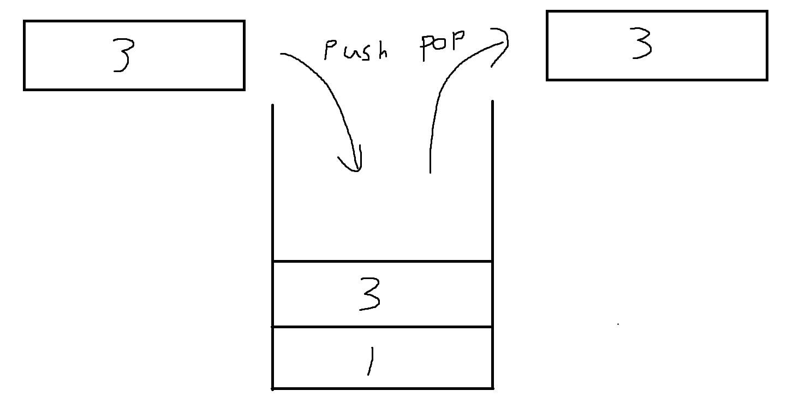

[상위 페이지 · Data Structure](/study/algorithms/data-structure/)

스택은 데이터를 저장하고 관리하는 자료구조이다. 스택은 '쌓아 올린다'는 의미를 가지고 있으며, 데이터의 삽입과 삭제가 한쪽 끝에서만 이루어지는 LIFO(Last In First Out, 후입선출) 방식으로 동작한다.



## 스택의 주요 특징

- 데이터는 스택의 맨 위(top)에서만 삽입되고 삭제된다.
- 가장 최근에 삽입된 데이터가 가장 먼저 삭제된다.
- 스택의 맨 위(top)에 있는 데이터만 접근 가능하다.
- 스택이 비어있는 상태에서 데이터를 꺼내려고 하면 언더플로우(Underflow)가 발생한다.
- 스택이 꽉 찬 상태에서 데이터를 넣으려고 하면 오버플로우(Overflow)가 발생한다.

## 스택의 주요 연산

- **push(item)**: 스택의 맨 위에 데이터를 삽입하는 연산이다.
- **pop()**: 스택의 맨 위에서 데이터를 제거하고 그 값을 반환하는 연산이다.
- **peek()**: 스택의 맨 위 데이터를 제거하지 않고 반환하는 연산이다.
- **isEmpty()**: 스택이 비어있는지 확인하는 연산이다.
- **isFull()**: 스택이 가득 찼는지 확인하는 연산이다.
- **size()**: 스택에 저장된 데이터의 개수를 반환하는 연산이다.

## 구현

### 1. 스택 구조체 정의

```c
#include <stdio.h>
#include <stdlib.h>
#include <stdbool.h>

#define MAX_SIZE 100

// 스택 구조체 정의
typedef struct {
    int items[MAX_SIZE];  // 데이터를 저장할 배열
    int top;              // 스택의 맨 위를 가리키는 인덱스
} Stack;
```

위 코드는 C언어로 스택을 구현하기 위한 기본 구조체를 정의한다. 스택은 MAX_SIZE 크기의 배열과 스택의 맨 위를 가리키는 top 인덱스로 구성된다. top 변수는 항상 스택의 맨 위 요소를 가리킨다.

### 2. 스택 초기화 함수

```c
// 스택 초기화 함수
void initializeStack(Stack *s) {
    s->top = -1;  // 스택이 비어있음을 나타내는 값으로 초기화
}
```

initializeStack 함수는 스택을 사용하기 전에 초기화하는 함수이다. top을 -1로 설정하여 스택이 비어있음을 나타낸다. 스택을 처음 생성할 때 반드시 호출해야 하는 함수이다.

### 3. 스택이 비어있는지 확인하는 함수

```c
// 스택이 비어있는지 확인하는 함수
bool isEmpty(Stack *s) {
    return s->top == -1;
}
```

isEmpty 함수는 스택이 비어있는지 여부를 확인하는 함수이다. top이 -1이면 스택이 비어있는 것으로 판단하고 true를 반환한다. 이 함수는 pop이나 peek 연산을 수행하기 전에 스택이 비어있는지 확인하는 데 사용된다.

### 4. 스택이 가득 찼는지 확인하는 함수

```c
// 스택이 가득 찼는지 확인하는 함수
bool isFull(Stack *s) {
    return s->top == MAX_SIZE - 1;
}
```

isFull 함수는 스택이 가득 찼는지 여부를 확인하는 함수이다. top이 MAX_SIZE - 1과 같으면 스택이 가득 찬 것으로 판단하고 true를 반환한다. 이 함수는 push 연산을 수행하기 전에 스택이 가득 찼는지 확인하는 데 사용된다.

### 5. 스택에 데이터를 삽입하는 함수 (push)

```c
// 스택에 데이터를 삽입하는 함수
bool push(Stack *s, int item) {
    if (isFull(s)) {
        printf("스택 오버플로우 발생! 데이터를 삽입할 수 없습니다.\n");
        return false;
    }
    
    s->top++;             // top 인덱스 증가
    s->items[s->top] = item;  // 데이터 삽입
    return true;
}
```

push 함수는 스택의 맨 위에 새로운 데이터를 삽입하는 함수이다. 먼저 isFull 함수를 호출하여 스택이 가득 찼는지 확인한 후, 가득 차지 않았다면 top을 증가시키고 해당 위치에 데이터를 삽입한다. 함수가 성공적으로 실행되면 true를, 오버플로우가 발생하면 false를 반환한다.

### 6. 스택에서 데이터를 제거하고 반환하는 함수 (pop)

```c
// 스택에서 데이터를 제거하고 반환하는 함수
int pop(Stack *s) {
    if (isEmpty(s)) {
        printf("스택 언더플로우 발생! 데이터를 꺼낼 수 없습니다.\n");
        return -1;  // 오류 값 반환
    }
    
    int poppedItem = s->items[s->top];  // 맨 위 데이터 저장
    s->top--;                           // top 인덱스 감소
    return poppedItem;                  // 제거된 데이터 반환
}
```

pop 함수는 스택의 맨 위에 있는 데이터를 제거하고 그 값을 반환하는 함수이다. 먼저 isEmpty 함수를 호출하여 스택이 비어있는지 확인한 후, 비어있지 않다면 맨 위 데이터를 저장하고 top을 감소시킨 다음 저장된 데이터를 반환한다. 스택이 비어있으면 오류 메시지를 출력하고 오류 값(-1)을 반환한다.

### 7. 스택의 맨 위 데이터를 반환하는 함수 (peek)

```c
// 스택의 맨 위 데이터를 제거하지 않고 반환하는 함수
int peek(Stack *s) {
    if (isEmpty(s)) {
        printf("스택이 비어있습니다! 데이터를 확인할 수 없습니다.\n");
        return -1;  // 오류 값 반환
    }
    
    return s->items[s->top];  // 맨 위 데이터 반환
}
```

peek 함수는 스택의 맨 위에 있는 데이터를 제거하지 않고 그 값을 반환하는 함수이다. pop 함수와 유사하지만 top을 감소시키지 않는다는 차이가 있다. 스택이 비어있는 경우 오류 메시지를 출력하고 오류 값(-1)을 반환한다.

### 8. 스택의 크기를 반환하는 함수

```c
// 스택에 저장된 데이터의 개수를 반환하는 함수
int size(Stack *s) {
    return s->top + 1;  // top은 인덱스이므로 +1을 해서 개수 반환
}
```

size 함수는 스택에 저장된 데이터의 개수를 반환하는 함수이다. top은 0부터 시작하는 인덱스이므로 실제 데이터 개수는 top + 1이 된다.

### 9. 스택을 출력하는 함수

```c
// 스택의 모든 요소를 출력하는 함수
void printStack(Stack *s) {
    if (isEmpty(s)) {
        printf("스택이 비어있습니다.\n");
        return;
    }
    
    printf("스택 내용: ");
    for (int i = 0; i <= s->top; i++) {
        printf("%d ", s->items[i]);
    }
    printf("\n");
}
```

printStack 함수는 스택의 모든 요소를 출력하는 함수이다. 스택이 비어있는 경우 메시지를 출력하고, 그렇지 않은 경우 스택의 요소를 순서대로 출력한다. 이 함수는 디버깅 목적이나 스택의 상태를 확인하기 위해 사용된다.

### 10. 예제 프로그램

```c
// 스택 사용 예제
int main() {
    Stack s;
    initializeStack(&s);
    
    push(&s, 10);
    push(&s, 20);
    push(&s, 30);
    
    printf("스택 크기: %d\n", size(&s));
    printStack(&s);
    
    printf("맨 위 요소: %d\n", peek(&s));
    
    printf("제거된 요소: %d\n", pop(&s));
    printf("제거된 요소: %d\n", pop(&s));
    
    printf("스택 크기: %d\n", size(&s));
    printStack(&s);
    
    return 0;
}
```

위의 main 함수는 앞서 구현한 스택 연산들을 사용하는 예제 프로그램이다. 스택을 초기화하고 push, pop, peek, size 등의 연산을 수행하여 스택의 동작을 보여준다. 이 프로그램을 실행하면 스택에 데이터를 삽입하고 제거하는 과정을 확인할 수 있다.

### 전체 코드

```c
#include <stdio.h>
#include <stdlib.h>
#include <stdbool.h>

#define MAX_SIZE 100

// 스택 구조체 정의
typedef struct {
    int items[MAX_SIZE];
    int top;
} Stack;

// 스택 초기화 함수
void initializeStack(Stack *s) {
    s->top = -1;
}

// 스택이 비어있는지 확인하는 함수
bool isEmpty(Stack *s) {
    return s->top == -1;
}

// 스택이 가득 찼는지 확인하는 함수
bool isFull(Stack *s) {
    return s->top == MAX_SIZE - 1;
}

// 스택에 데이터를 삽입하는 함수
bool push(Stack *s, int item) {
    if (isFull(s)) {
        printf("스택 오버플로우 발생! 데이터를 삽입할 수 없습니다.\n");
        return false;
    }
    
    s->top++;
    s->items[s->top] = item;
    return true;
}

// 스택에서 데이터를 제거하고 반환하는 함수
int pop(Stack *s) {
    if (isEmpty(s)) {
        printf("스택 언더플로우 발생! 데이터를 꺼낼 수 없습니다.\n");
        return -1;
    }
    
    int poppedItem = s->items[s->top];
    s->top--;
    return poppedItem;
}

// 스택의 맨 위 데이터를 제거하지 않고 반환하는 함수
int peek(Stack *s) {
    if (isEmpty(s)) {
        printf("스택이 비어있습니다! 데이터를 확인할 수 없습니다.\n");
        return -1;
    }
    
    return s->items[s->top];
}

// 스택에 저장된 데이터의 개수를 반환하는 함수
int size(Stack *s) {
    return s->top + 1;
}

// 스택의 모든 요소를 출력하는 함수
void printStack(Stack *s) {
    if (isEmpty(s)) {
        printf("스택이 비어있습니다.\n");
        return;
    }
    
    printf("스택 내용: ");
    for (int i = 0; i <= s->top; i++) {
        printf("%d ", s->items[i]);
    }
    printf("\n");
}

// 메인 함수
int main() {
    Stack s;
    initializeStack(&s);
    
    push(&s, 10);
    push(&s, 20);
    push(&s, 30);
    
    printf("스택 크기: %d\n", size(&s));
    printStack(&s);
    
    printf("맨 위 요소: %d\n", peek(&s));
    
    printf("제거된 요소: %d\n", pop(&s));
    printf("제거된 요소: %d\n", pop(&s));
    
    printf("스택 크기: %d\n", size(&s));
    printStack(&s);
    
    return 0;
}
```

위의 코드는 C언어로 구현한 스택의 전체 코드이다. 스택의 모든 기본 연산(초기화, 삽입, 삭제, 조회 등)이 구현되어 있으며, 메인 함수에서 이러한 연산들을 사용하는 예제를 보여준다.

## 스택의 활용 사례

- **함수 호출 관리**: 프로그래밍에서 함수 호출 시 함수의 매개변수, 지역 변수, 복귀 주소 등을 스택에 저장한다.
- **괄호 검사**: 프로그램에서 괄호의 짝이 맞는지 검사할 때 스택을 사용한다.
- **수식의 후위 표기법 변환 및 계산**: 중위 표기법을 후위 표기법으로 변환하거나, 후위 표기법을 계산할 때 스택을 사용한다.
- **웹 브라우저의 뒤로가기/앞으로가기 기능**: 방문한 페이지를 스택에 저장하여 관리한다.
- **깊이 우선 탐색(DFS)**: 그래프나 트리의 깊이 우선 탐색에서 스택을 사용한다.
- **백트래킹**: 퍼즐 해결, 미로 찾기 등의 문제에서 백트래킹 알고리즘에 스택이 활용된다.

### 괄호 검사 예제

```python
def is_balanced(expression):
    """
    괄호의 짝이 맞는지 검사하는 함수
    
    매개변수:
        expression (str): 검사할 수식 문자열
    
    반환값:
        bool: 모든 괄호의 짝이 맞으면 True, 아니면 False
    """
    stack = []
    opening = "({["
    closing = ")}]"
    
    for char in expression:
        # 여는 괄호인 경우 스택에 추가
        if char in opening:
            stack.append(char)
        # 닫는 괄호인 경우
        elif char in closing:
            # 스택이 비어있으면 짝이 맞지 않음
            if not stack:
                return False
            
            # 스택의 맨 위 요소를 꺼냄
            last_opening = stack.pop()
            
            # 괄호의 짝이 맞는지 확인
            if (char == ')' and last_opening != '(') or \
               (char == '}' and last_opening != '{') or \
               (char == ']' and last_opening != '['):
                return False
    
    # 스택이 비어있어야 모든 괄호의 짝이 맞음
    return len(stack) == 0

# 사용 예시
print(is_balanced("()"))  # True
print(is_balanced("({[]})"))  # True
print(is_balanced("({[})"))  # False

```

## 시간 복잡도

스택 연산의 시간 복잡도는 다음과 같다.

| **연산** | **배열 기반 스택** | **연결 리스트 기반 스택** |
| --- | --- | --- |
| push() | O(1) | O(1) |
| pop() | O(1) | O(1) |
| peek() | O(1) | O(1) |
| is_empty() | O(1) | O(1) |
| size() | O(1) | O(1) |

스택은 모든 기본 연산이 O(1)의 시간 복잡도를 가지는 효율적인 자료구조이다. 이는 항상 스택의 맨 위에서만 작업이 이루어지기 때문이다.

## 장단점

### 장점

- 구현이 간단하고 이해하기 쉽다.
- 모든 연산의 시간 복잡도가 O(1)로 매우 효율적이다.
- LIFO 특성이 필요한 많은 알고리즘에 유용하다.
- 메모리를 효율적으로 관리할 수 있다.

### 단점

- 데이터의 접근이 맨 위 요소로 제한된다.
- 배열 기반 스택은 크기가 고정되어 있을 수 있다.
- 중간 위치의 데이터를 조작하는 것이 어렵다.
- 데이터 검색이 O(n)의 시간 복잡도를 가진다.
