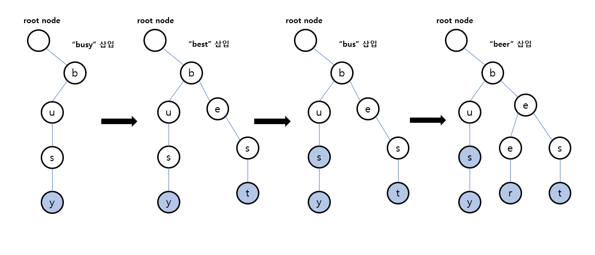
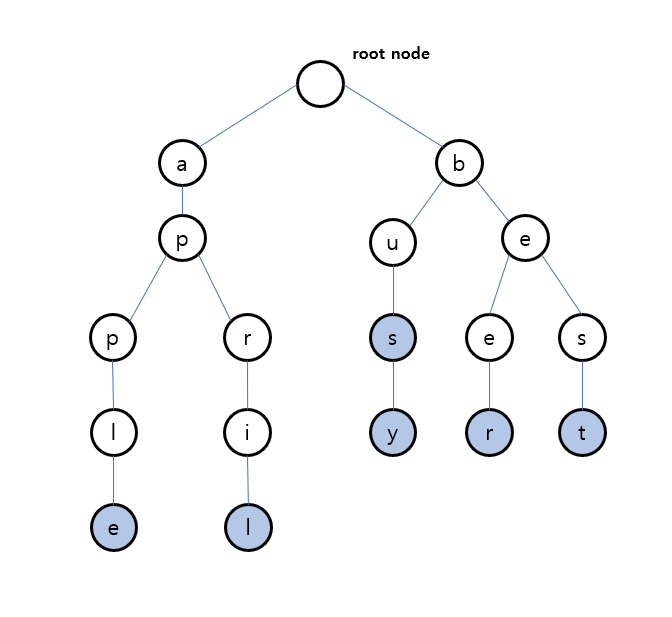

[상위 페이지 · Data Structure](/study/algorithms/data-structure/)

트라이는 문자열을 저장하고 효율적으로 탐색하기 위한 트리 형태의 자료구조이다. 문자열의 접두사를 공통으로 가지는 문자열들을 하나의 노드에 모아서 저장하는 방식으로 구성된다.

## 특징

- 각 노드는 문자 하나를 저장한다.
- 루트 노드는 비어있다.
- 각 간선(edge)은 추가될 문자를 나타낸다.
- 한 노드의 모든 자식 노드들은 서로 다른 문자를 가진다.

## 장점

- 문자열 검색이 매우 빠르다 - O(M) 시간 복잡도 (M은 문자열의 길이)
- 접두사를 이용한 검색이 효율적이다.
- 자동완성, 사전 검색 등에 적합하다.
- 문자열 집합을 효과적으로 표현할 수 있다.

## 단점

- 메모리 사용량이 많다 - 각 노드가 모든 가능한 문자에 대한 포인터를 가져야 한다.
- 구현이 상대적으로 복잡하다.
- 삽입과 삭제 연산이 해시 테이블보다 느릴 수 있다.

## 구현 방법

```python
class TrieNode:
    def __init__(self):
        self.children = {}  # 딕셔너리 사용으로 더 유연한 문자 처리
        self.is_end_of_word = False

class Trie:
    def __init__(self):
        self.root = TrieNode()
    
    # 문자열 삽입
    def insert(self, word: str) -> None:
        current = self.root
        for char in word:
            if char not in current.children:
                current.children[char] = TrieNode()
            current = current.children[char]
        current.is_end_of_word = True
    
    # 문자열 검색
    def search(self, word: str) -> bool:
        current = self.root
        for char in word:
            if char not in current.children:
                return False
            current = current.children[char]
        return current.is_end_of_word
    
    # 문자열 삭제
    def delete(self, word: str) -> bool:
        def _delete_helper(node: TrieNode, word: str, depth: int = 0) -> bool:
            # 문자열의 끝에 도달했을 때
            if depth == len(word):
                # 해당 노드가 단어의 끝이 아니면 False 반환
                if not node.is_end_of_word:
                    return False
                
                # 단어의 끝 표시 제거
                node.is_end_of_word = False
                
                # 자식이 없으면 노드를 삭제할 수 있음을 알림
                return len(node.children) == 0
            
            char = word[depth]
            if char not in node.children:
                return False
            
            # 재귀적으로 자식 노드 삭제 시도
            should_delete_current = _delete_helper(node.children[char], word, depth + 1)
            
            # 자식 노드를 삭제해야 하면
            if should_delete_current:
                del node.children[char]
                # 현재 노드가 다른 단어의 끝이 아니고 자식이 없으면 삭제 가능
                return len(node.children) == 0 and not node.is_end_of_word
            
            return False
        
        return _delete_helper(self.root, word)
```

## 삽입



루트 노드부터 시작하여 자식 노드들이 저장된 딕셔너리에서 삽입할 문자열을 한 문자씩 확인한다. 해당 문자가 없으면 새로운 노드를 추가하고, 있으면 그 노드로 이동한다.

문자열의 마지막 문자에 도달하면 해당 노드를 단어의 끝으로 표시한다.

이는 그림에서는 파란색으로 표시되며, 코드에서는 endOfWord = true로 설정된다.

## 찾기



**Trie에서 "best"라는 단어를 찾는 과정을 살펴보자.**

탐색 중 필요한 문자를 찾지 못하면 즉시 실패로 판단하고, 해당 단어가 트라이에 없다고 결론 내린다.

1. 루트 노드의 자식 중 'b'를 찾고 해당 노드로 이동한다.
2. 'b' 노드의 자식 중 'e'를 찾고 해당 노드로 이동한다.
3. 'e' 노드의 자식 중 's'를 찾고 해당 노드로 이동한다.
4. 's' 노드의 자식 중 't'를 찾고 해당 노드로 이동한다.
5. 't'는 "best"의 마지막 문자이므로, 이 노드의 **endOfWord**가 true이면 탐색 성공이다.
6. 만약 't' 노드의 **endOfWord**가 false라면 탐색 실패이다. (트라이에 "best"가 존재하지 않음)

## 삭제


이번에는 "apple"을 삭제해보자.

1. 위의 탐색 방법으로 "apple"을 탐색하여 **"apple"의 마지막 노드로 이동**한다.
2. 'e'의 **endOfWord를 확인하여 true**이면 삭제를 진행한다. 'e'의 **endOfWord를 false로 변경**한다. (삭제란 해당 문자열을 트라이에서 더 이상 찾을 수 없게 만드는 것이다.)
3. 'e'의 자식 노드가 있는지 확인한다. 자식 노드가 없다면 상위 노드로 거슬러 올라가며 노드들을 삭제한다.
4. 'l' 노드에 'e'를 제외한 다른 자식 노드가 있는지 확인한 후, 없다면 'l' 노드를 삭제한다.
5. 마지막으로 a**pp**le까지 올라왔다. **p** 노드에 다른 자식 노드('r')가 존재하므로 **p**는 삭제하지 않는다.

## 시간 복잡도

| 연산 | 시간 복잡도 |
| --- | --- |
| 삽입 | O(M) - M은 문자열 길이 |
| 검색 | O(M) - M은 문자열 길이 |
| 삭제 | O(M) - M은 문자열 길이 |

## 메모리 복잡도

트라이의 공간 복잡도는 O(ALPHABET_SIZE * M * N)이다. 여기서 ALPHABET_SIZE는 사용되는 문자의 종류, M은 문자열의 평균 길이, N은 문자열의 개수이다.

## 참고

[https://innovation123.tistory.com/116](https://innovation123.tistory.com/116)
