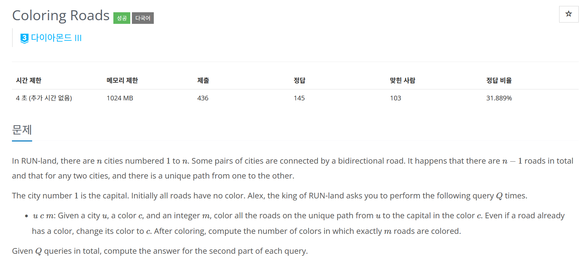
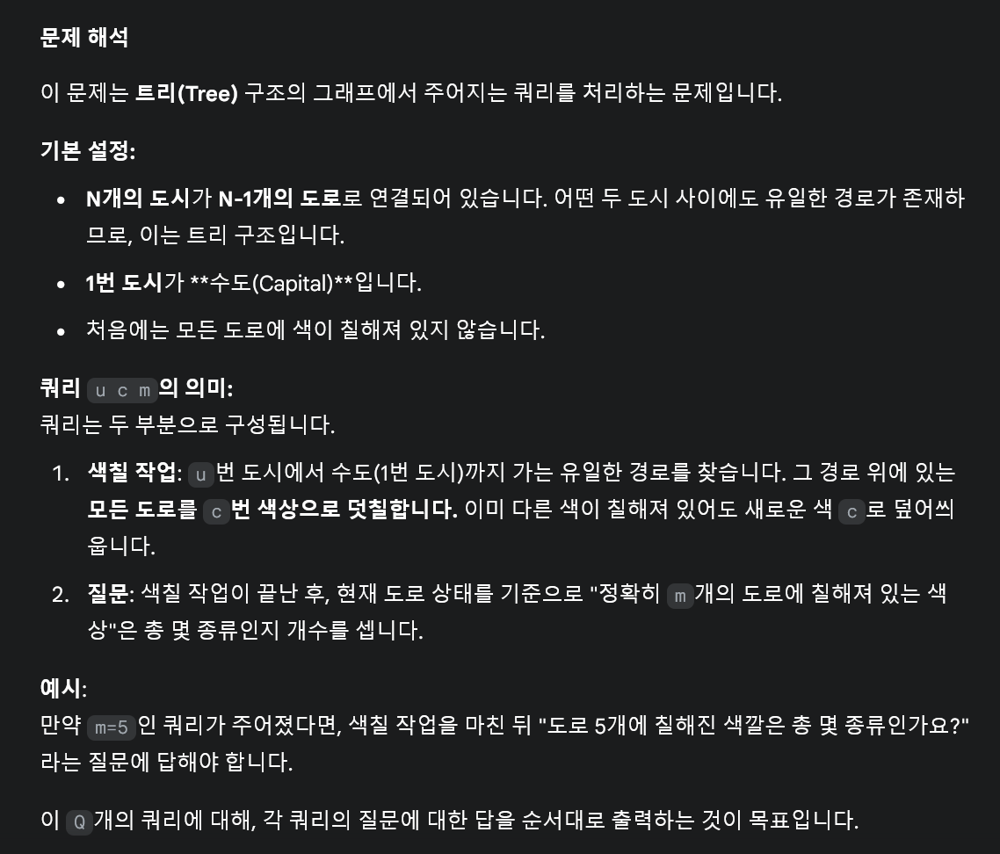

[상위 페이지 · 다이아](/study/algorithms/data-structure/diamond/)



## 문제 해석



## 문제 태그

- 자료구조
- 트리
- 스택
- HLD

## 아이디어

- 트리에서 루트까지의 경로에 대한 반복적인 업데이트와 전체 상태에 대한 질의를 처리하는 문제이기에 HLD를 적용한다
- 각 체인마다 스택을 하나씩 할당하여 색상 정보를 관리힘
    - 스택에는 (색상, 연속된 길이) 형태의 튜플로 저장하며 이는 일종의 압축 저장 방식임
- 전역으로 c번 색상으로 칠해진 도로의 총 개수와 k개의 도로를 차지하는 색상의 종류를 관리한다
- 업데이트
    - u에서 루트까지의 경로를 HLD로 여러 체인 조각으로 나눔
    - 해당 체인의 스택에서 칠할 길이만큼 원소를 pop함
    - pop과정에서의 원래 색상들의 전역 정보를 갱신
    - pop이후 새로운 색상 정보를 push하며 마찬가지로 전역정보를 갱신한다.

## 정답

```python
import sys
sys.setrecursionlimit(10**5)
input = sys.stdin.readline

class HeavyLightDecomposition:
    class Node:
        def __init__(self):
            self.par = None
            self.depth = None
            self.size = None
            self.pos_segbase = None
            self.chain = None

    class Edge:
        def __init__(self):
            self.deeper_end = None

    def __init__(self, n, C):
        self.N = n
        self.C = C
        self.adj = [[] for _ in range(n)]
        self.node = [self.Node() for _ in range(n)]
        self.edge = [self.Edge() for _ in range(n)]
        self.chain_heads = [-1] * n
        self.chains = [[] for _ in range(n)]
        self.color_stacks = [[] for _ in range(n)]
        self.freq = [0] * (C + 2)
        self.cnt = [0] * (n + 1)
        self.cnt[0] = C

    def add_edge(self, e, u, v):
        self.adj[u].append((v, e))
        self.adj[v].append((u, e))

    def dfs(self, curr, prev, dep):
        self.node[curr].par = prev
        self.node[curr].depth = dep
        self.node[curr].size = 1
        for neigh, eid in self.adj[curr]:
            if neigh != prev:
                self.edge[eid].deeper_end = neigh
                self.dfs(neigh, curr, dep + 1)
                self.node[curr].size += self.node[neigh].size

    def hld(self, curr_node, id, edge_counted, curr_chain):
        if self.chain_heads[curr_chain[0]] == -1:
            self.chain_heads[curr_chain[0]] = curr_node
        self.node[curr_node].chain = curr_chain[0]
        self.node[curr_node].pos_segbase = edge_counted[0]
        self.chains[curr_chain[0]].append(curr_node)
        edge_counted[0] += 1
        spcl_chld = -1
        spcl_edg_id = -1
        max_size = -1
        for neigh, eid in self.adj[curr_node]:
            if neigh != self.node[curr_node].par:
                if spcl_chld == -1 or self.node[neigh].size > max_size:
                    spcl_chld = neigh
                    spcl_edg_id = eid
                    max_size = self.node[neigh].size
        if spcl_chld != -1:
            self.hld(spcl_chld, spcl_edg_id, edge_counted, curr_chain)
        for neigh, eid in self.adj[curr_node]:
            if neigh != self.node[curr_node].par and neigh != spcl_chld:
                curr_chain[0] += 1
                self.hld(neigh, eid, edge_counted, curr_chain)

    def build(self):
        self.dfs(0, 0, 0)
        edge_counted = [0]
        curr_chain = [0]
        self.hld(0, -1, edge_counted, curr_chain)
        for ci in range(curr_chain[0] + 1):
            chn = self.chains[ci]
            num_edges = len(chn) - 1 if self.chain_heads[ci] == 0 else len(chn)
            if num_edges > 0:
                self.color_stacks[ci].append((0, num_edges))

    def update_chain(self, ch, L, c):
        if L == 0:
            return
        stack = self.color_stacks[ch]
        popped_len = 0
        deltas = []
        while popped_len < L:
            if not stack:
                break
            col, leng = stack.pop()
            if popped_len + leng <= L:
                deltas.append((col, leng))
                popped_len += leng
            else:
                need = L - popped_len
                deltas.append((col, need))
                stack.append((col, leng - need))
                popped_len += need
        for col, leng in deltas:
            if col != 0:
                self.cnt[self.freq[col]] -= 1
                self.freq[col] -= leng
                self.cnt[self.freq[col]] += 1
        if L > 0:
            if stack and stack[-1][0] == c:
                pl = stack[-1][1]
                stack.pop()
                stack.append((c, pl + L))
            else:
                stack.append((c, L))
            self.cnt[self.freq[c]] -= 1
            self.freq[c] += L
            self.cnt[self.freq[c]] += 1

    def update_path(self, u, c):
        while True:
            ch = self.node[u].chain
            head = self.chain_heads[ch]
            L = self.node[u].depth - self.node[head].depth
            if head != 0:
                L += 1
            self.update_chain(ch, L, c)
            if self.node[head].par == head:
                break
            u = self.node[head].par

if __name__ == "__main__":
    n, C, Q = map(int, input().split())
    hld = HeavyLightDecomposition(n, C)
    for i in range(n - 1):
        u, v = map(int, input().split())
        u -= 1
        v -= 1
        hld.add_edge(i, u, v)
    hld.build()
    for _ in range(Q):
        u, c, m = map(int, input().split())
        u -= 1
        hld.update_path(u, c)
        print(hld.cnt[m])
```
