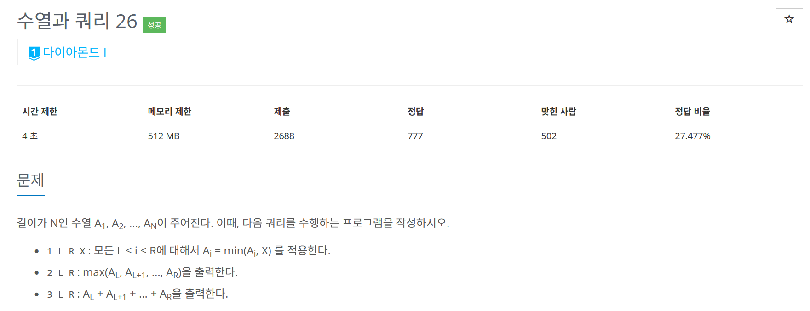
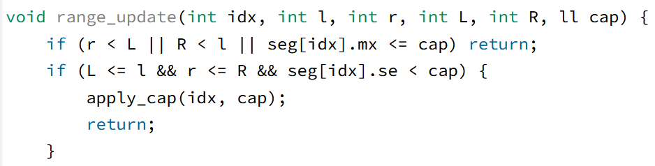
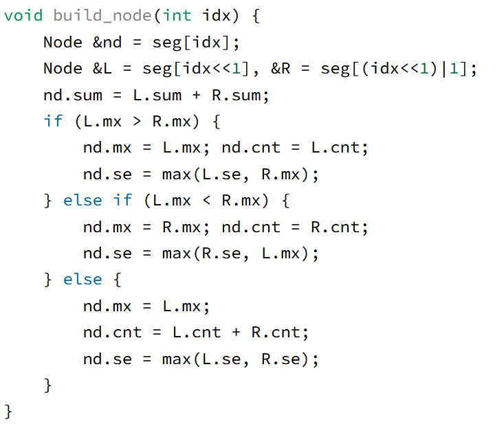

[상위 페이지 · Data Structure](/study/algorithms/data-structure/)



## 문제 태그

- 자료구조
- 세그먼트 트리
- 느리게 갱신되는 세그먼트 트리
- 세그먼트 트리 비트

## 아이디어

1. 파이썬 개 쓰레기 언어
2. 전형적인 세그먼트 트리 비트를 구현한다
3. break condition과 tag condition을 다음과 같이 잡는다
    
    
    
    - se < cap < mx이라면 구간을 업데이트 해도 됨이 성립이 됨
    - se가 필요한 이유는 두 번째로 큰 값 정보를 모르면, cap이 구간의 다른 값들(최댓값이 아닌 값)과 비교해도 안전한지 판단할 수 없어서



노드 구성은 이렇게

1. 합산 변경은 차이 * 하위 노드 개수

## 정답

```cpp
#include <bits/stdc++.h>
using namespace std;
typedef long long ll;
const ll INF = LLONG_MAX;

struct Node {
    ll mx, se, sum;
    int cnt;
    ll lazy;
};

int N, M;
vector<ll> arr;
vector<Node> seg;

void build_node(int idx) {
    Node &nd = seg[idx];
    Node &L = seg[idx<<1], &R = seg[(idx<<1)|1];
    nd.sum = L.sum + R.sum;
    if (L.mx > R.mx) {
        nd.mx = L.mx; nd.cnt = L.cnt;
        nd.se = max(L.se, R.mx);
    } else if (L.mx < R.mx) {
        nd.mx = R.mx; nd.cnt = R.cnt;
        nd.se = max(R.se, L.mx);
    } else {
        nd.mx = L.mx;
        nd.cnt = L.cnt + R.cnt;
        nd.se = max(L.se, R.se);
    }
}

void apply_cap(int idx, ll cap) {
    Node &nd = seg[idx];
    ll diff = nd.mx - cap;
    nd.sum -= diff * nd.cnt;
    nd.mx = cap;
    nd.lazy = cap;
}

void build_tree(int idx, int l, int r) {
    seg[idx].lazy = INF;
    if (l == r) {
        seg[idx].mx = seg[idx].sum = arr[l];
        seg[idx].se = LLONG_MIN;
        seg[idx].cnt = 1;
        return;
    }
    int mid = (l + r) >> 1;
    build_tree(idx<<1, l, mid);
    build_tree((idx<<1)|1, mid+1, r);
    build_node(idx);
}

void push_down(int idx) {
    ll cap = seg[idx].lazy;
    if (cap == INF) return;
    for (int c : {idx<<1, (idx<<1)|1}) {
        if (seg[c].mx > cap) {
            apply_cap(c, cap);
        }
    }
    seg[idx].lazy = INF;
}

void range_update(int idx, int l, int r, int L, int R, ll cap) {
    if (r < L || R < l || seg[idx].mx <= cap) return;
    if (L <= l && r <= R && seg[idx].se < cap) {
        apply_cap(idx, cap);
        return;
    }
    push_down(idx);
    int mid = (l + r) >> 1;
    range_update(idx<<1, l, mid, L, R, cap);
    range_update((idx<<1)|1, mid+1, r, L, R, cap);
    build_node(idx);
}

ll range_query_max(int idx, int l, int r, int L, int R) {
    if (r < L || R < l) return LLONG_MIN;
    if (L <= l && r <= R) return seg[idx].mx;
    push_down(idx);
    int mid = (l + r) >> 1;
    return max(
        range_query_max(idx<<1, l, mid, L, R),
        range_query_max((idx<<1)|1, mid+1, r, L, R)
    );
}

ll range_query_sum(int idx, int l, int r, int L, int R) {
    if (r < L || R < l) return 0;
    if (L <= l && r <= R) return seg[idx].sum;
    push_down(idx);
    int mid = (l + r) >> 1;
    return range_query_sum(idx<<1, l, mid, L, R)
         + range_query_sum((idx<<1)|1, mid+1, r, L, R);
}

int main() {
    ios::sync_with_stdio(false);
    cin.tie(NULL);

    cin >> N;
    arr.resize(N);
    for (int i = 0; i < N; i++) cin >> arr[i];
    seg.assign(4*N, Node());

    build_tree(1, 0, N-1);

    cin >> M;
    int t, L, R; ll x;
    while (M--) {
        cin >> t >> L >> R;
        L--; R--;
        if (t == 1) {
            cin >> x;
            range_update(1, 0, N-1, L, R, x);
        } else if (t == 2) {
            cout << range_query_max(1, 0, N-1, L, R) << '\n';
        } else {
            cout << range_query_sum(1, 0, N-1, L, R) << '\n';
        }
    }
    return 0;
}
```
