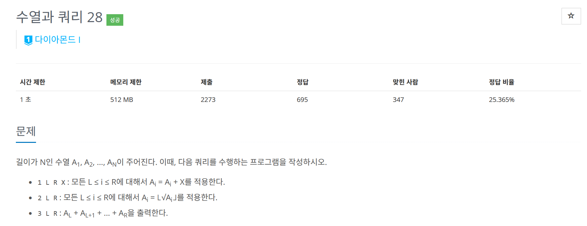

[상위 페이지 · Data Structure](/study/algorithms/data-structure/)



## 문제 태그

- 자료구조
- 세그먼트 트리
- 느리게 갱신되는 세그먼트 트리
- 세그먼트 트리 비츠

## 아이디어

- break-condition
    1. max가 1이하면 sqrt를 적용하는 의미가 없음
- tag-condition
    1. 구간 [L:R]에서 $$\lfloor\sqrt(min([L:R]))\rfloor == \lfloor\sqrt(max([L:R]))\rfloor$$ 라면 더 이상 깊이 내려갈 필요 없이 전파 하면 됨
    2. 만약 1번이 아니고 min과 max의 차가 1밖에 나지 않는다면 이는 서로 경계에 있는 값들임으로 $$\lfloor\sqrt(min([L:R]))\rfloor$$ - min의 값으로 구간에 더해주면 min이였던 값은 $$\lfloor\sqrt(min([L:R]))\rfloor$$로 max였던 값은 k1+1이 됨

## 정답

```cpp
import sys, math

input = sys.stdin.readline
sys.setrecursionlimit(10 ** 7)

N = int(input())
arr = [0] + list(map(int, input().split()))
M = int(input())

h = 1
while h < N:
    h <<= 1
size = 4 * h + 5

sum_ = [0] * size
mx = [0] * size
mn = [0] * size
lazy_add = [0] * size
lazy_set = [None] * size

def pull(idx):
    lc, rc = idx * 2, idx * 2 + 1
    sum_[idx] = sum_[lc] + sum_[rc]
    mx[idx] = max(mx[lc], mx[rc])
    mn[idx] = min(mn[lc], mn[rc])

def apply_set(idx, l, r, v):
    sum_[idx] = v * (r - l + 1)
    mx[idx] = mn[idx] = v
    lazy_set[idx] = v
    lazy_add[idx] = 0

def apply_add(idx, l, r, v):
    sum_[idx] += v * (r - l + 1)
    mx[idx] += v
    mn[idx] += v
    if lazy_set[idx] is not None:
        lazy_set[idx] += v
    else:
        lazy_add[idx] += v

def push(idx, l, r):
    if lazy_set[idx] is not None or lazy_add[idx] != 0:
        lc, rc = idx * 2, idx * 2 + 1
        m = (l + r) // 2
        if lazy_set[idx] is not None:
            apply_set(lc, l, m, lazy_set[idx])
            apply_set(rc, m + 1, r, lazy_set[idx])
            lazy_set[idx] = None
        if lazy_add[idx] != 0:
            apply_add(lc, l, m, lazy_add[idx])
            apply_add(rc, m + 1, r, lazy_add[idx])
            lazy_add[idx] = 0

def build(idx, l, r):
    lazy_add[idx] = 0
    lazy_set[idx] = None
    if l == r:
        sum_[idx] = mx[idx] = mn[idx] = arr[l]
        return
    m = (l + r) // 2
    build(idx * 2, l, m)
    build(idx * 2 + 1, m + 1, r)
    pull(idx)

def range_add(idx, l, r, L, R, v):
    if r < L or R < l:
        return
    if L <= l and r <= R:
        apply_add(idx, l, r, v)
        return
    push(idx, l, r)
    m = (l + r) // 2
    range_add(idx * 2, l, m, L, R, v)
    range_add(idx * 2 + 1, m + 1, r, L, R, v)
    pull(idx)

def range_sqrt(idx, l, r, L, R):
    if r < L or R < l or mx[idx] <= 1:
        return
    if L <= l and r <= R:
        k1 = math.isqrt(mn[idx])
        k2 = math.isqrt(mx[idx])
        if k1 == k2:
            apply_set(idx, l, r, k1)
            return
        if mn[idx] + 1 == mx[idx]:
            diff = k1 - mn[idx]
            apply_add(idx, l, r, diff)
            return
    if l == r:
        v = math.isqrt(mx[idx])
        apply_set(idx, l, r, v)
        return
    push(idx, l, r)
    m = (l + r) // 2
    range_sqrt(idx * 2, l, m, L, R)
    range_sqrt(idx * 2 + 1, m + 1, r, L, R)
    pull(idx)

def range_sum(idx, l, r, L, R):
    if r < L or R < l:
        return 0
    if L <= l and r <= R:
        return sum_[idx]
    push(idx, l, r)
    m = (l + r) // 2
    return (range_sum(idx * 2, l, m, L, R) +
            range_sum(idx * 2 + 1, m + 1, r, L, R))

build(1, 1, N)
out = []
for _ in range(M):
    q = list(map(int, input().split()))
    t, L, R = q[0], q[1], q[2]
    if t == 1:
        X = q[3]
        range_add(1, 1, N, L, R, X)
    elif t == 2:
        range_sqrt(1, 1, N, L, R)
    else:
        out.append(str(range_sum(1, 1, N, L, R)))
print("\n".join(out))

```
