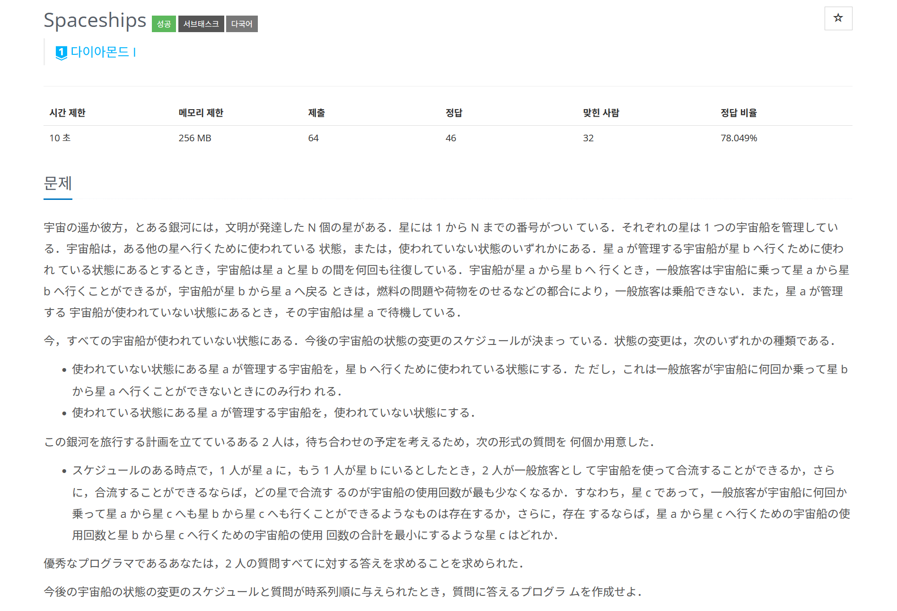
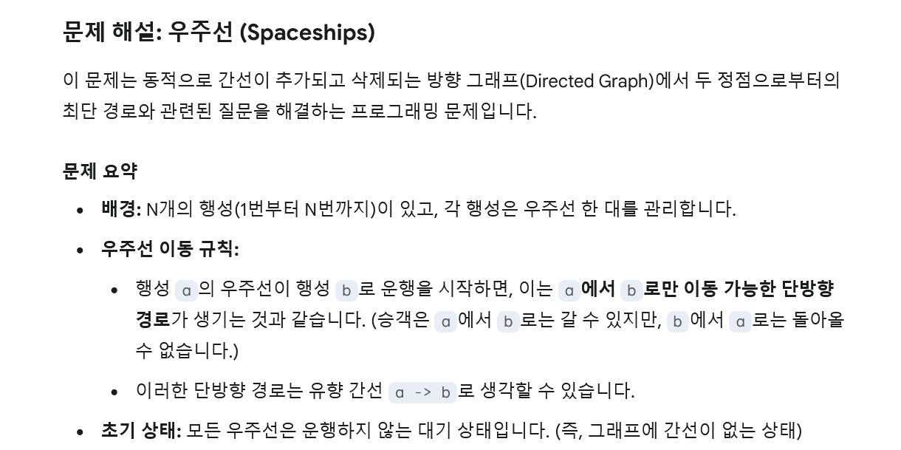
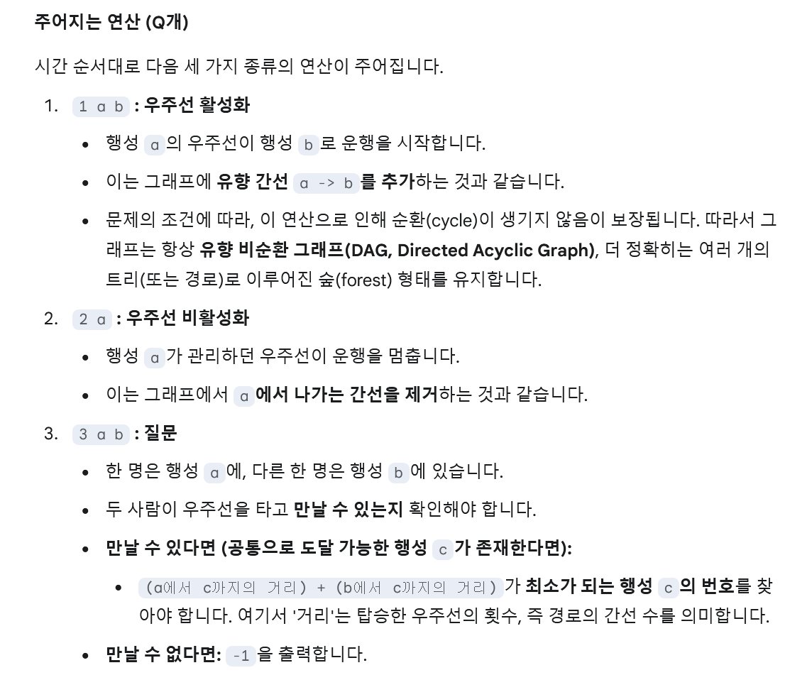

[상위 페이지 · 다이아](/study/algorithms/data-structure/diamond/)



## 문제 해석





## 문제 태그

- 트리
- 링크 컷 트리

## 아이디어

- a→b는 b가 a의 부모가 되는 것으로 링크 순서 link(a,b)를 정확히 고려하여 연결한다
- a,b의 최적 만남 장소는 a,b의 최소 공통 조상(LCA)이므로 LCA를 구해준다

## 정답

```python
import sys

sys.setrecursionlimit(200000)
input = sys.stdin.readline

class LinkCutNode:

    def __init__(self, val=0):
        self.left = None
        self.right = None
        self.parent = None
        self.path_parent = None
        self.rev = False
        self.val = val
        self.sum = val
        self.size = 1

    def _is_root(self):
        return not self.parent or (self.parent.left is not self and self.parent.right is not self)

    def _update(self):
        self.sum = self.val
        self.size = 1
        if self.left:
            self.sum += self.left.sum
            self.size += self.left.size
        if self.right:
            self.sum += self.right.sum
            self.size += self.right.size

    def _push(self):
        if self.rev:
            self.left, self.right = self.right, self.left
            if self.left:
                self.left.rev ^= True
            if self.right:
                self.right.rev ^= True
            self.rev = False

    def _rotate(self):
        p = self.parent
        g = p.parent
        if not p._is_root():
            if g.left is p:
                g.left = self
            else:
                g.right = self
        self.parent = g
        if p.left is self:
            p.left = self.right
            if self.right:
                self.right.parent = p
            self.right = p
        else:
            p.right = self.left
            if self.left:
                self.left.parent = p
            self.left = p
        p.parent = self
        self.path_parent = p.path_parent
        p.path_parent = None
        p._update()
        self._update()

    def splay(self):
        stack = []
        node = self
        while True:
            stack.append(node)
            if node._is_root():
                break
            node = node.parent
        for n in reversed(stack):
            n._push()
        while not self._is_root():
            p = self.parent
            g = p.parent
            if not p._is_root():
                if (p.left is self) == (g.left is p):
                    p._rotate()
                else:
                    self._rotate()
            self._rotate()

    def access(self):
        last = None
        x = self
        while x:
            x.splay()
            if x.right:
                x.right.path_parent = x
                x.right.parent = None
            x.right = last
            if last:
                last.parent = x
            x._update()
            last = x
            x = x.path_parent
        self.splay()
        return last

    def make_root(self):
        self.access()
        self.rev ^= True
        self._push()

    def find_root(self):
        self.access()
        x = self
        while True:
            x._push()
            if x.left:
                x = x.left
            else:
                break
        x.splay()
        return x

    def connected(self, other):
        if self is other: return True
        self.access()
        other.access()
        return self.parent is not None or self is other

    def link(self, other):
        self.make_root()
        if self.find_root() is not other.find_root():
            self.path_parent = other

    def cut_parent(self):
        self.access()
        if self.left:
            self.left.parent = None
            self.left = None
            self._update()

    def get_LCA(self, other):
        if self.find_root() != other.find_root():
            return None
        self.access()
        return other.access()

def solve():
    N, Q = map(int, input().split())

    nodes = [LinkCutNode(i) for i in range(N + 1)]

    for _ in range(Q):
        k, *args = list(map(int, input().split()))

        if k == 1:
            a, b = args
            nodes[a].link(nodes[b])
        elif k == 2:
            a = args[0]
            nodes[a].cut_parent()

        elif k == 3:
            a, b = args
            lca_node = nodes[a].get_LCA(nodes[b])

            if lca_node:
                print(lca_node.val)
            else:
                print(-1)

solve()

```
