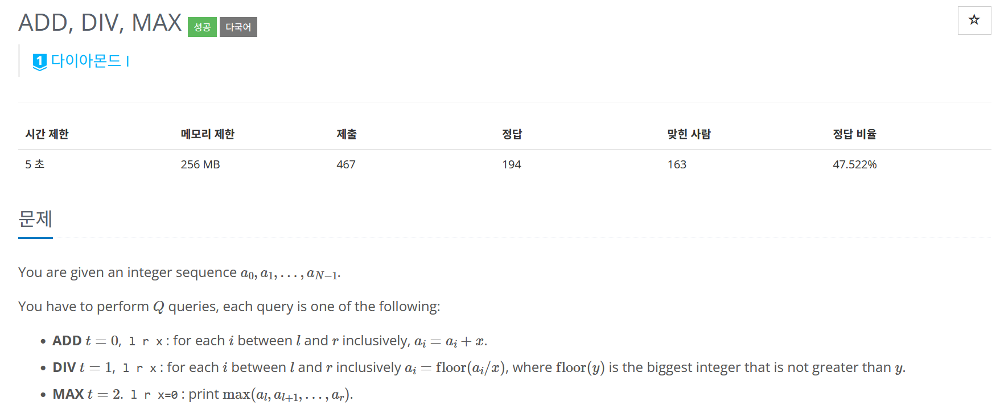

[상위 페이지 · 다이아](/study/algorithms/data-structure/diamond/)



## 문제 태그

- 자료구조
- 세그먼트 트리
- 느리게 갱신되는 세그먼트 트리
- 세그먼트 트리 비츠

## 아이디어

- 이 문제에서 가장 중요한 점은 div 연산의 tag condition이다.
1. $$\left\lfloor 구간\ min /d  \right\rfloor == \left\lfloor 구간\ max /d  \right\rfloor$$
    - min ≤ ai ≤ max이고floor(min/d) = floor(max/d)이면 중간 값들의 floor도 모두 같다는 의미이다.
    - 이 경우 전체 구간을 lazy_assign으로 해당 floor 값으로 설정(set)한다.
2. min + 1 == max
    - 이 조건은 구간 내 값이 정확히 두 개의 연속된 정수 {min, min+1}만 존재한다는 의미이다 (예: 5와 6만 있음).
    - 나눗셈 후 값은 floor(min/d) 또는 floor((min+1)/d)가 된다. 이 두 값이 다르면 (조건1 불만족) 덧셈(add) 연산으로 전체를 shift시켜 맞춘다.
    - lazy_add += floor(min/d) - min을 적용한다. 이렇게 하면 min → floor(min/d), max → floor(min/d) + (max - min) = floor(min/d) + 1이 되고, floor(max/d) = floor(min/d) + 1이 보장된다.
    - 이 개념을 이해하기 위한 예시:
        
        예시: d=3, 구간 min=5, max=6.
        
        - 5//3 = 1, 6//3 = 2 (조건1 불만족, 하지만 min+1==max는 만족).
        - add = 1 - 5 = -4.
        - 결과: 5 + (-4) = 1, 6 + (-4) = 2

## 정답

```python
import sys
sys.setrecursionlimit(10 ** 5)
input = sys.stdin.readline

class SegmentTreeBeats:
    def __init__(self, n, a):
        self.n = n
        self.tree = [None] * (4 * n)
        self.INF = 10 ** 18
        self.neg_inf = -self.INF
        self.build(1, 1, n, a)

    class Node:
        def __init__(self):
            self.min_val = 0
            self.max_val = 0
            self.lazy_add = 0
            self.lazy_assign = None

    def build(self, node, l, r, a):
        self.tree[node] = self.Node()
        if l == r:
            self.tree[node].min_val = a[l]
            self.tree[node].max_val = a[l]
            return
        mid = (l + r) // 2
        self.build(2 * node, l, mid, a)
        self.build(2 * node + 1, mid + 1, r, a)
        self.pushup(node)

    def pushup(self, node):
        le = self.tree[2 * node]
        ri = self.tree[2 * node + 1]
        self.tree[node].min_val = min(le.min_val, ri.min_val)
        self.tree[node].max_val = max(le.max_val, ri.max_val)

    def propagate(self, node, l, r):
        if self.tree[node].lazy_assign is not None:
            assign_val = self.tree[node].lazy_assign
            self.tree[node].min_val = assign_val
            self.tree[node].max_val = assign_val
            if l != r:
                self.tree[2 * node].lazy_assign = assign_val
                self.tree[2 * node].lazy_add = 0
                self.tree[2 * node + 1].lazy_assign = assign_val
                self.tree[2 * node + 1].lazy_add = 0
                self.tree[2 * node].min_val = assign_val
                self.tree[2 * node].max_val = assign_val
                self.tree[2 * node + 1].min_val = assign_val
                self.tree[2 * node + 1].max_val = assign_val
            self.tree[node].lazy_assign = None
        if self.tree[node].lazy_add != 0:
            add_val = self.tree[node].lazy_add
            self.tree[node].min_val += add_val
            self.tree[node].max_val += add_val
            if l != r:
                self.tree[2 * node].lazy_add += add_val
                self.tree[2 * node + 1].lazy_add += add_val
            self.tree[node].lazy_add = 0

    def _update_div(self, node, l, r, start, end, x):
        self.propagate(node, l, r)
        if start > r or end < l:
            return
        minv = self.tree[node].min_val
        maxv = self.tree[node].max_val
        if start <= l and r <= end:
            if minv // x == maxv // x:
                floor_v = minv // x
                self.tree[node].lazy_assign = floor_v
                self.tree[node].lazy_add = 0
                self.propagate(node, l, r)
                return
            if minv + 1 == maxv:
                add_val = (minv // x) - minv
                self.tree[node].lazy_add += add_val
                self.propagate(node, l, r)
                return
        mid = (l + r) // 2
        self._update_div(2 * node, l, mid, start, end, x)
        self._update_div(2 * node + 1, mid + 1, r, start, end, x)
        self.pushup(node)

    def update_div(self, start, end, x):
        if x == 1:
            return
        self._update_div(1, 1, self.n, start, end, x)

    def _update_add(self, node, l, r, start, end, val):
        self.propagate(node, l, r)
        if start > r or end < l:
            return
        if start <= l and r <= end:
            self.tree[node].lazy_add += val
            self.propagate(node, l, r)
            return
        mid = (l + r) // 2
        self._update_add(2 * node, l, mid, start, end, val)
        self._update_add(2 * node + 1, mid + 1, r, start, end, val)
        self.pushup(node)

    def update_add(self, start, end, val):
        self._update_add(1, 1, self.n, start, end, val)

    def _query_max(self, node, l, r, start, end):
        self.propagate(node, l, r)
        if start > r or end < l:
            return self.neg_inf
        if start <= l and r <= end:
            return self.tree[node].max_val
        mid = (l + r) // 2
        left_max = self._query_max(2 * node, l, mid, start, end)
        right_max = self._query_max(2 * node + 1, mid + 1, r, start, end)
        return max(left_max, right_max)

    def query_max(self, start, end):
        return self._query_max(1, 1, self.n, start, end)

def main():
    N, Q = map(int, input().split())
    a = [0] + list(map(int, input().split()))
    st = SegmentTreeBeats(N, a)
    for _ in range(Q):
        query = list(map(int, input().split()))
        t = query[0]
        if t == 0:
            l, r, x = query[1], query[2], query[3]
            st.update_add(l + 1, r + 1, x)
        elif t == 1:
            l, r, x = query[1], query[2], query[3]
            st.update_div(l + 1, r + 1, x)
        elif t == 2:
            l, r = query[1], query[2]
            print(st.query_max(l + 1, r + 1))

if __name__ == "__main__":
    main()
```
