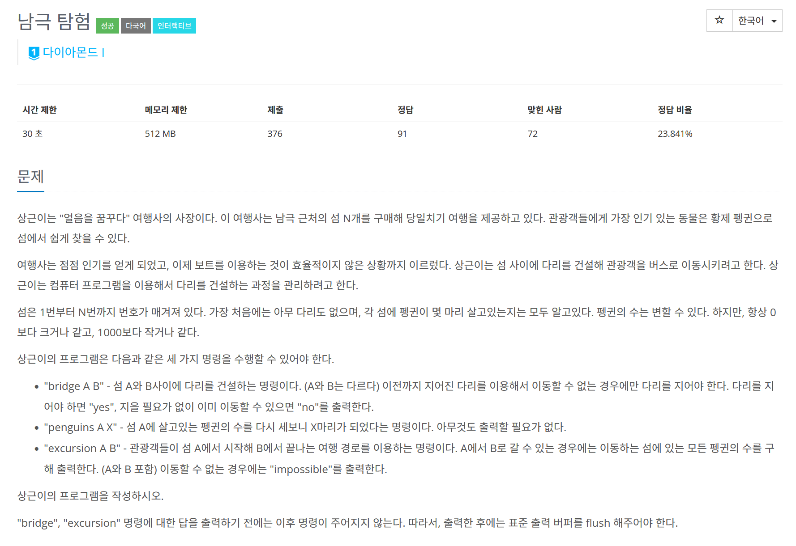

[상위 페이지 · Data Structure](/study/algorithms/data-structure/)



## 문제 태그

- 자료구조
- 트리
- 링크/컷 트리
- HLD

## 아이디어

두 문제 다 [Link-Cut Tree (링크 컷 트리)](/study/algorithms/unsorted/link-cut-tree-ringkeu-keos-teuri/) 로 구현하면 된다.

### 쿼리

- bridge는 link
- penguins는 update
- excursion은 connected로 확인 후 query

쿼리 처리하면 된다.

### 2927번의 다른 풀이

2927번 문제는 다른 정석적인 풀이가 존재하는데, 여기에는 아이디어만 남기겠다.

2927번 문제는 HLD 문제이다. HLD는 완성된 트리에서 적용해야 하기 때문에 오프라인 쿼리로 처리한다.

우선 bridge 쿼리만 모두 수행한다. 이 bridge 쿼리는 분리 집합을 이용하여 구현하고 bridge 쿼리를 수행하면서 만나는 excursion 명령어는 모두 가능/불가능으로만 기록해둔다.

모든 bridge 쿼리가 끝난 후에는 다시 앞에서부터 excursion과 penguins 쿼리를 실행한다.

앞서 bridge 쿼리를 실행하며 기록해둔 excursion 데이터로 가능/불가능을 출력하고 가능하다면 HLD를 통해 쿼리를 수행한다.

### 왜 21973번은 이렇게 못푸는가?

> "bridge", "excursion" 명령에 대한 답을 출력하기 전에는 이후 명령이 주어지지 않는다. 따라서, 출력한 후에는 표준 출력 버퍼를 flush 해주어야 한다.
> 

위 제한 때문에 오프라인 쿼리가 불가능하다. 순수 온라인 쿼리만 되는것.

## 정답

```python
import sys

sys.setrecursionlimit(200000)
input = sys.stdin.readline

class LinkCutNode:
    def __init__(self, val=0):
        self.left = self.right = self.parent = None
        self.rev = False
        self.val = val
        self.sum = val

    def _is_root(self):
        return not self.parent or (self.parent.left is not self and self.parent.right is not self)

    def _update(self):
        self.sum = self.val
        if self.left:
            self.sum += self.left.sum
        if self.right:
            self.sum += self.right.sum

    def _push(self):
        if self.rev:
            self.left, self.right = self.right, self.left
            if self.left:
                self.left.rev ^= True
            if self.right:
                self.right.rev ^= True
            self.rev = False

    def _rotate(self):
        p = self.parent
        g = p.parent
        if not p._is_root():
            if g.left is p:
                g.left = self
            else:
                g.right = self
        self.parent = g
        if p.left is self:
            p.left = self.right
            if self.right:
                self.right.parent = p
            self.right = p
        else:
            p.right = self.left
            if self.left:
                self.left.parent = p
            self.left = p
        p.parent = self
        p._update()
        self._update()

    def splay(self):
        stk, node = [], self
        while True:
            stk.append(node)
            if node._is_root():
                break
            node = node.parent
        for x in reversed(stk):
            x._push()
        while not self._is_root():
            p = self.parent
            g = p.parent
            if not p._is_root():
                if (p.left is self) == (g.left is p):
                    p._rotate()
                else:
                    self._rotate()
            self._rotate()

    def access(self):
        last, x = None, self
        while x:
            x.splay()
            x.right = last
            x._update()
            last = x
            x = x.parent
        self.splay()
        return last

    def make_root(self):
        self.access()
        self.rev ^= True
        self._push()

    def find_root(self):
        self.access()
        x = self
        while True:
            x._push()
            if x.left:
                x = x.left
            else:
                break
        x.splay()
        return x

    def connected(self, other):
        return self.find_root() is other.find_root()

    def link(self, other):
        self.make_root()
        if self.find_root() is not other.find_root():
            self.parent = other
            return True
        return False

    def cut(self, other):
        self.make_root()
        other.access()
        if other.left is self and not self.right:
            other.left.parent = None
            other.left = None
            other._update()

    def query(self, other):
        self.make_root()
        other.access()
        return other.sum

    def update(self, value):
        self.access()
        self.val = value
        self._update()

n = int(input())
vals = list(map(int, input().split()))
nodes = [None] + [LinkCutNode(v) for v in vals]
q = int(input())

out = sys.stdout
for _ in range(q):
    s = input().split()
    if s[0] == "bridge":
        a, b = map(int, s[1:])
        res = "yes" if nodes[a].link(nodes[b]) else "no"
        out.write(res + "\n")
        out.flush()
    elif s[0] == "penguins":
        a, x = map(int, s[1:])
        nodes[a].update(x)
    else:
        a, b = map(int, s[1:])
        if nodes[a].connected(nodes[b]):
            out.write(str(nodes[a].query(nodes[b])) + "\n")
        else:
            out.write("impossible\n")
        out.flush()

```
