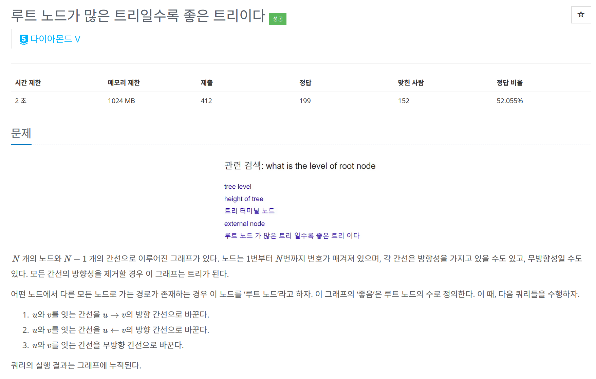
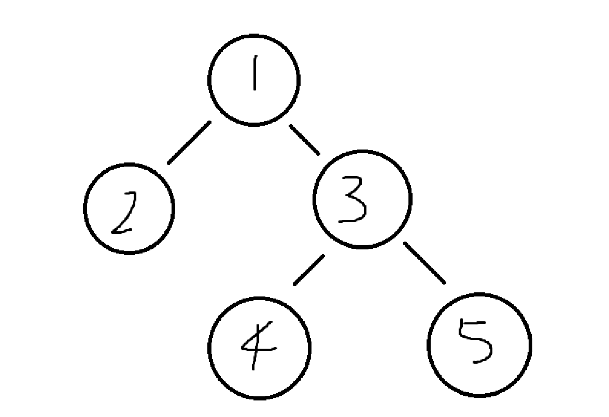
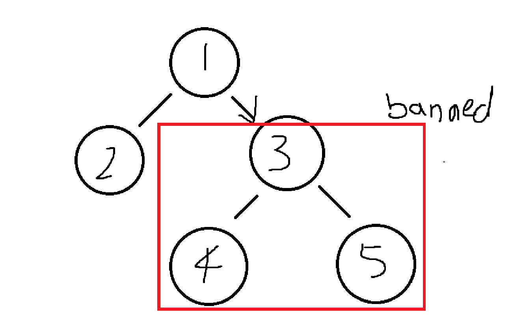
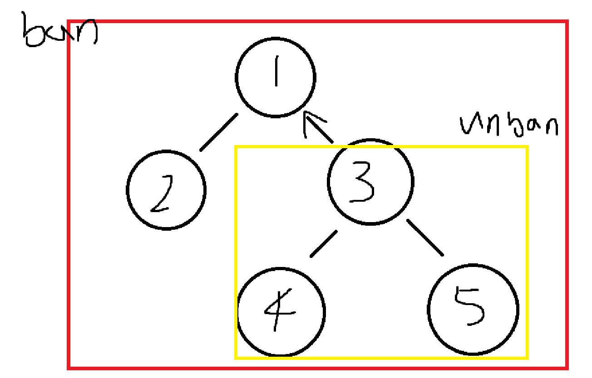

[상위 페이지 · Data Structure](/study/algorithms/data-structure/)



## 문제 태그

- 자료구조
- 트리
- 세그먼트 트리
- 느리게 갱신되는 세그먼트 트리
- 오일러 경로 테크닉

## 아이디어

- 트리를 1번 기준으로 DFS 해  각 간선의 얕은 쪽, 깊은 쪽과 서브트리 구간을 만든다. (오일러 경로 테크닉)
- 간선 상태별 제약:
    - → : 해당 child 서브트리 금지
    - ← : 전체 금지 후 child 서브트리 해제
    - — : 제약 X
- 모든 간선 제약을 ban 카운태 배열로 누적하고 구간 덧셈으로 갱신
- 세그먼트 트리에서 전체 최소값과 그 개수를 유지하여 min == 0인 노드수는 “좋은” 노드이다
- 간선 갱신시 반드시 이전 상태를 역연산하고 새 상태로 갱신해주어야 함

### 그림 설명



**1→3**



**1←3**



## 정답

```python
import sys

sys.setrecursionlimit(1_000_000)
input = sys.stdin.readline

NONE = 0
PARENT_TO_CHILD = 1
CHILD_TO_PARENT = 2

n = int(input())
adj = [[] for _ in range(n + 1)]
edges = [None] * (n - 1)
edge_dir_tokens = [None] * (n - 1)
edge_id_map = {}

for i in range(n - 1):
    u_str, dir_str, v_str = input().split()
    u = int(u_str)
    v = int(v_str)
    adj[u].append((v, i))
    adj[v].append((u, i))
    edges[i] = (u, v)
    edge_dir_tokens[i] = dir_str
    edge_id_map[(u, v)] = i
    edge_id_map[(v, u)] = i

tin = [0] * (n + 1)
tout = [0] * (n + 1)
depth = [0] * (n + 1)
parent = [0] * (n + 1)
dfs_order = []
stack = [1]
parent[1] = 0
while stack:
    x = stack.pop()
    if x > 0:
        dfs_order.append(x)
        tin[x] = len(dfs_order) - 1
        stack.append(-x)
        for y, _ in adj[x]:
            if y == parent[x]:
                continue
            parent[y] = x
            depth[y] = depth[x] + 1
            stack.append(y)
    else:
        x = -x
        tout[x] = len(dfs_order)

size = 1
while size < n:
    size <<= 1

min = [0] * (2 * size)
lazy = [0] * (2 * size)
cnt = [0] * (2 * size)
for i in range(n):
    cnt[size + i] = 1
for i in range(size - 1, 0, -1):
    cnt[i] = cnt[2 * i] + cnt[2 * i + 1]

def _apply(node, add_val):
    min[node] += add_val
    lazy[node] += add_val

def _push(node):
    if lazy[node]:
        v = lazy[node]
        _apply(2 * node, v)
        _apply(2 * node + 1, v)
        lazy[node] = 0

def _pull(node):
    l = 2 * node
    r = l + 1
    if min[l] < min[r]:
        min[node] = min[l]
        cnt[node] = cnt[l]
    elif min[l] > min[r]:
        min[node] = min[r]
        cnt[node] = cnt[r]
    else:
        min[node] = min[l]
        cnt[node] = cnt[l] + cnt[r]

def update(l, r, val, node=1, nl=0, nr=size):
    if r <= nl or nr <= l:
        return
    if l <= nl and nr <= r:
        _apply(node, val)
        return
    _push(node)
    mid = (nl + nr) // 2
    update(l, r, val, 2 * node, nl, mid)
    update(l, r, val, 2 * node + 1, mid, nr)
    _pull(node)

edge_state = [NONE] * (n - 1)

def mapping(u, v, token):
    if token == '--':
        return NONE
    eid = edge_id_map[(u, v)]
    a, b = edges[eid]
    if depth[a] < depth[b]:
        p, c = a, b
    else:
        p, c = b, a
    if token == '->':
        frm, to = u, v
    else:
        frm, to = v, u
    return PARENT_TO_CHILD if (frm == p and to == c) else CHILD_TO_PARENT

def apply_state(eid, new_state):
    u, v = edges[eid]
    if depth[u] < depth[v]:
        p, c = u, v
    else:
        p, c = v, u
    old_state = edge_state[eid]
    if old_state == PARENT_TO_CHILD:
        update(tin[c], tout[c], -1)
    elif old_state == CHILD_TO_PARENT:
        update(0, n, -1)
        update(tin[c], tout[c], +1)
    if new_state == PARENT_TO_CHILD:
        update(tin[c], tout[c], +1)
    elif new_state == CHILD_TO_PARENT:
        update(0, n, +1)
        update(tin[c], tout[c], -1)
    edge_state[eid] = new_state

for eid, token in enumerate(edge_dir_tokens):
    apply_state(eid, mapping(*edges[eid], token))

q = int(input())
result = []
for _ in range(q):
    u_str, token, v_str = input().split()
    u = int(u_str)
    v = int(v_str)
    eid = edge_id_map[(u, v)]
    apply_state(eid, mapping(u, v, token))
    result.append("0" if min[1] > 0 else str(cnt[1]))
sys.stdout.write("\n".join(result))

```
