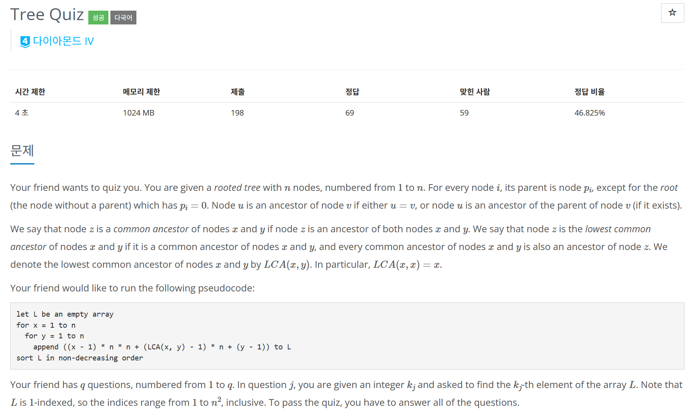
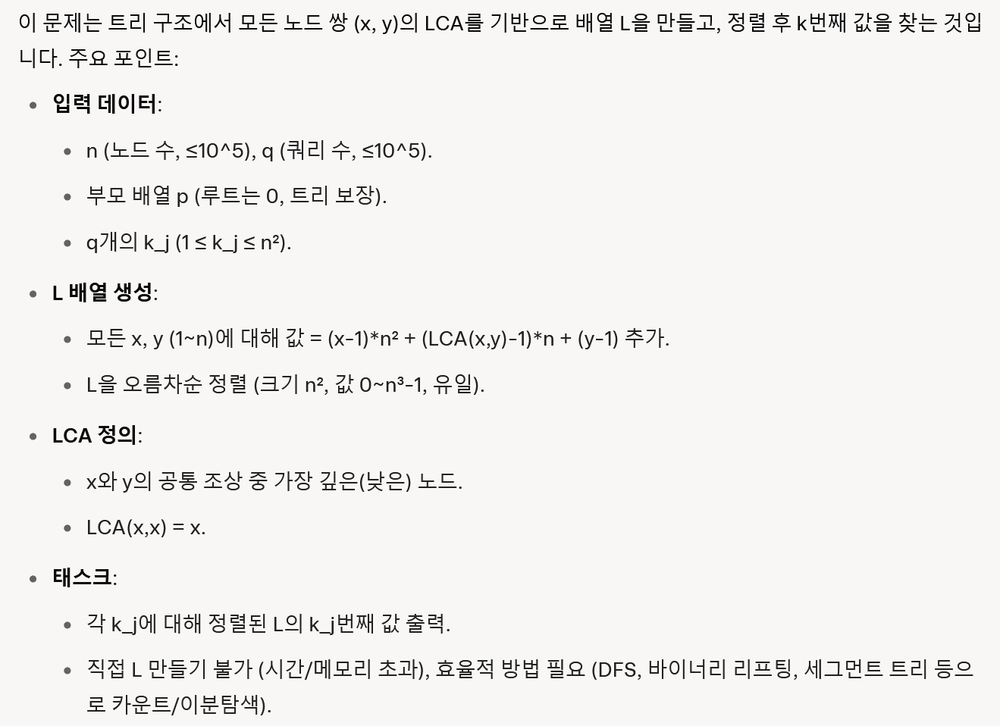

[상위 페이지 · Data Structure](/study/algorithms/data-structure/)



## 문제 해석



## 문제 태그

- 자료 구조
- 트리
- 세그먼트 트리
- 이분 탐색
- 오프라인 쿼리
- 오일러 경로 테크닉
- 퍼시스턴트 세그먼트 트리

## 아이디어

- L의 값은 (x, z=LCA(x,y), y)로 인코딩하고, x, z, y 순으로 정렬한 후 쿼리 k를 x로 고정하여 r번째로 분해
- 쿼리를 x별로 그룹화하고 DFS 중 x=u일 때 처리
- DFS로 트리를 순회하면서 펜윅트리에서 z별 LCA 기여도(y 개수)를 업데이트하고 복원
- PST로 z 서브트리 노드 목록을 관리하고 x의 z 바로 아래 자식 서브트리를 제외하여 정확한 y값 계산
- 이분탐색을 통해 z와 y 찾기

## 정답

```cpp
#include <bits/stdc++.h>
using namespace std;

typedef long long ll;

const int MAXN = 1000005;
const int MAXLOG = 20;
const int MAXNodes = 20000010;

int n, q, root;
vector<int> adj[MAXN];
int p[MAXN], depth[MAXN], subtree_size[MAXN];
int parent[MAXLOG][MAXN];
int ver[MAXN];

struct Node {
    int val, left, right;
} nodes[MAXNodes];
int node_cnt;

void init_nodes() {
    node_cnt = 0;
    nodes[0].val = 0;
    nodes[0].left = 0;
    nodes[0].right = 0;
}

int merge(int a, int b, int L, int R) {
    if (a == 0) return b;
    if (b == 0) return a;
    int cur = ++node_cnt;
    if (L == R) {
        nodes[cur].val = nodes[a].val + nodes[b].val;
        nodes[cur].left = 0;
        nodes[cur].right = 0;
        return cur;
    }
    int mid = (L + R) / 2;
    nodes[cur].left = merge(nodes[a].left, nodes[b].left, L, mid);
    nodes[cur].right = merge(nodes[a].right, nodes[b].right, mid + 1, R);
    nodes[cur].val = nodes[nodes[cur].left].val + nodes[nodes[cur].right].val;
    return cur;
}

int update(int prev, int L, int R, int pos, int add) {
    int cur = ++node_cnt;
    nodes[cur] = nodes[prev];
    if (L == R) {
        nodes[cur].val += add;
        return cur;
    }
    int mid = (L + R) / 2;
    if (pos <= mid) {
        nodes[cur].left = update(nodes[prev].left, L, mid, pos, add);
    } else {
        nodes[cur].right = update(nodes[prev].right, mid + 1, R, pos, add);
    }
    nodes[cur].val = nodes[nodes[cur].left].val + nodes[nodes[cur].right].val;
    return cur;
}

int query(int idx, int L, int R, int ql, int qr) {
    if (idx == 0 || qr < L || ql > R) return 0;
    if (ql <= L && R <= qr) return nodes[idx].val;
    int mid = (L + R) / 2;
    return query(nodes[idx].left, L, mid, ql, qr) + query(nodes[idx].right, mid + 1, R, ql, qr);
}

void dfs_size(int u, int par, int dep) {
    depth[u] = dep;
    subtree_size[u] = 1;
    parent[0][u] = par;
    for (int v : adj[u]) {
        if (v != par) {
            dfs_size(v, u, dep + 1);
            subtree_size[u] += subtree_size[v];
        }
    }
}

void build_lifting() {
    for (int k = 1; k < MAXLOG; k++) {
        for (int i = 1; i <= n; i++) {
            int anc = parent[k - 1][i];
            if (anc != 0) {
                parent[k][i] = parent[k - 1][anc];
            } else {
                parent[k][i] = 0;
            }
        }
    }
}

void dfs_build_ver(int u, int par) {
    int curr = update(0, 1, n, u, 1);
    for (int v : adj[u]) {
        if (v != par) {
            dfs_build_ver(v, u);
            curr = merge(curr, ver[v], 1, n);
        }
    }
    ver[u] = curr;
}

struct Fenwick {
    vector<ll> ft;
    Fenwick(int sz) {
        ft.assign(sz + 2, 0);
    }
    void add(int pos, ll val) {
        for (; pos <= n; pos += pos & -pos) ft[pos] += val;
    }
    ll get(int pos) {
        ll sum = 0;
        for (; pos > 0; pos -= pos & -pos) sum += ft[pos];
        return sum;
    }
};

struct Qry {
    int r, idx;
};

vector<Qry> queries_per_x[MAXN];
vector<ll> ans;

void process(int u, int par, Fenwick& fen) {
    if (par != -1) {
        fen.add(par, -subtree_size[u]);
        fen.add(u, subtree_size[u]);
    } else {
        fen.add(u, subtree_size[u]);
    }

    for (auto& qry : queries_per_x[u]) {
        int r = qry.r;
        int idx = qry.idx;

        // binary search for L
        int lo = 1, hi = n;
        int L = n + 1;
        while (lo <= hi) {
            int mid = (lo + hi) / 2;
            if (fen.get(mid) >= r) {
                L = mid;
                hi = mid - 1;
            } else {
                lo = mid + 1;
            }
        }
        if (L > n) {
            // error
            continue;
        }

        ll prev_cum = (L >= 2 ? fen.get(L - 1) : 0LL);
        int local_k = r - prev_cum;

        // z = L
        int z = L;
        int sub_ver = 0;
        int dep_diff = depth[u] - depth[z] - 1;
        if (dep_diff >= 0) {
            int cx = u;
            for (int b = 0; b < MAXLOG; b++) {
                if (dep_diff & (1 << b)) {
                    cx = parent[b][cx];
                }
            }
            sub_ver = ver[cx];
        }

        // binary search for y
        int ylo = 1, yhi = n;
        int y = n + 1;
        while (ylo <= yhi) {
            int ymid = (ylo + yhi) / 2;
            ll cnt = query(ver[z], 1, n, 1, ymid) - (sub_ver ? query(sub_ver, 1, n, 1, ymid) : 0);
            if (cnt >= local_k) {
                y = ymid;
                yhi = ymid - 1;
            } else {
                ylo = ymid + 1;
            }
        }
        if (y > n) {
            // error
            continue;
        }

        ll val = (ll)(u - 1) * n * n + (ll)(z - 1) * n + (y - 1);
        ans[idx] = val;
    }

    for (int v : adj[u]) {
        if (v != par) {
            process(v, u, fen);
        }
    }

    if (par != -1) {
        fen.add(u, -subtree_size[u]);
        fen.add(par, subtree_size[u]);
    } else {
        fen.add(u, -subtree_size[u]);
    }
}

int main() {
    ios::sync_with_stdio(false);
    cin.tie(0);
    init_nodes();
    cin >> n >> q;
    for (int i = 1; i <= n; i++) {
        cin >> p[i];
        if (p[i] == 0) root = i;
        else adj[p[i]].push_back(i);
    }
    dfs_size(root, 0, 0);
    build_lifting();
    dfs_build_ver(root, 0);
    ans.resize(q);
    for (int j = 0; j < q; j++) {
        ll k;
        cin >> k;
        ll xx = (k - 1) / n + 1;
        ll rr = (k - 1) % n + 1;
        queries_per_x[xx].push_back({(int)rr, j});
    }
    Fenwick fen(n);
    process(root, -1, fen);
    for (int j = 0; j < q; j++) {
        cout << ans[j] << '\n';
    }
    return 0;
}
```
