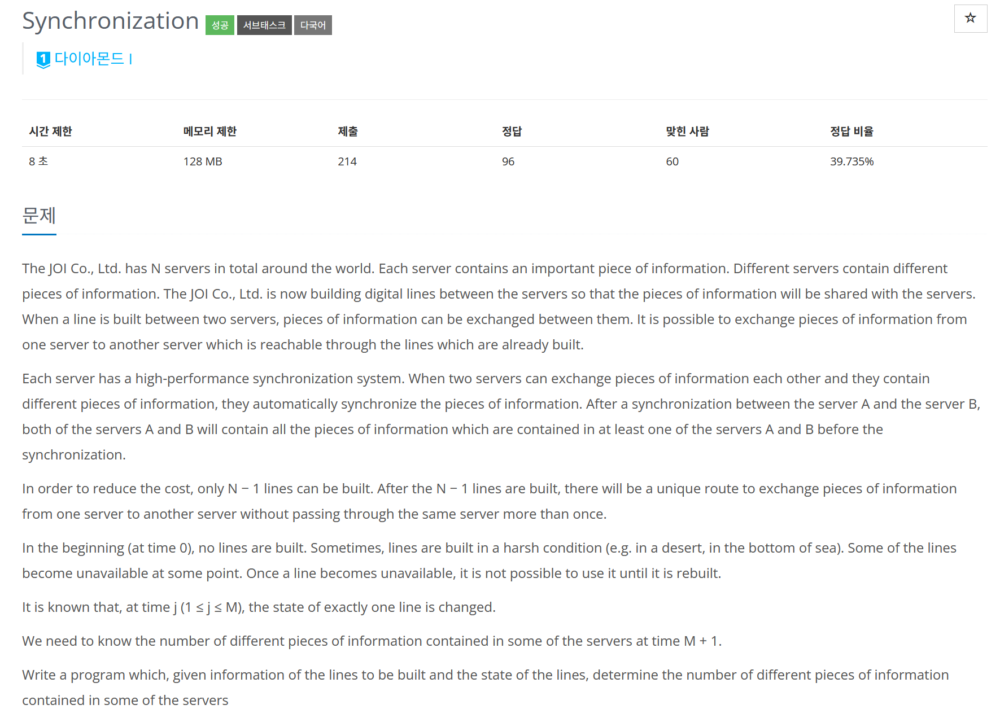
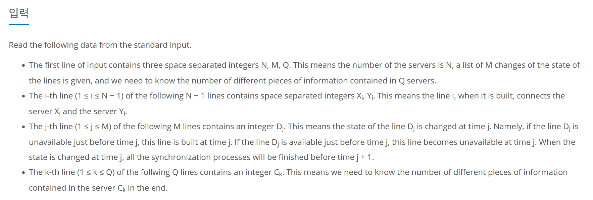
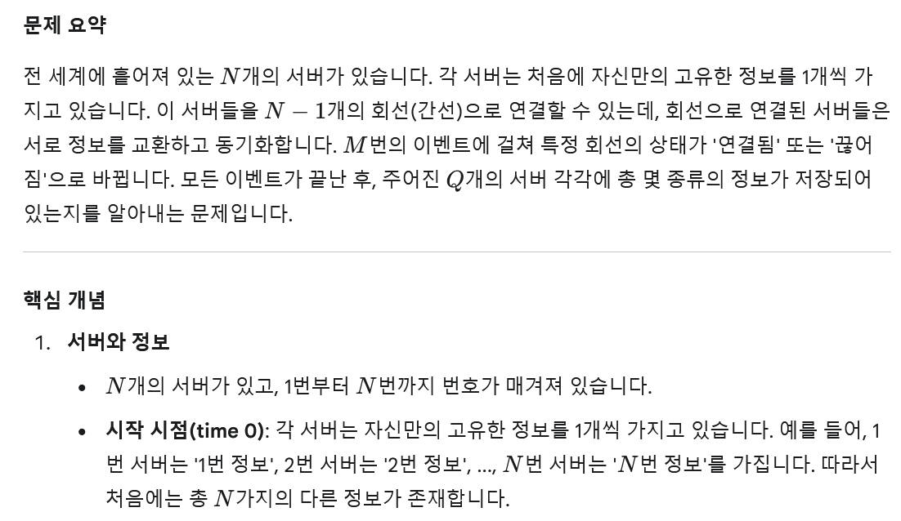
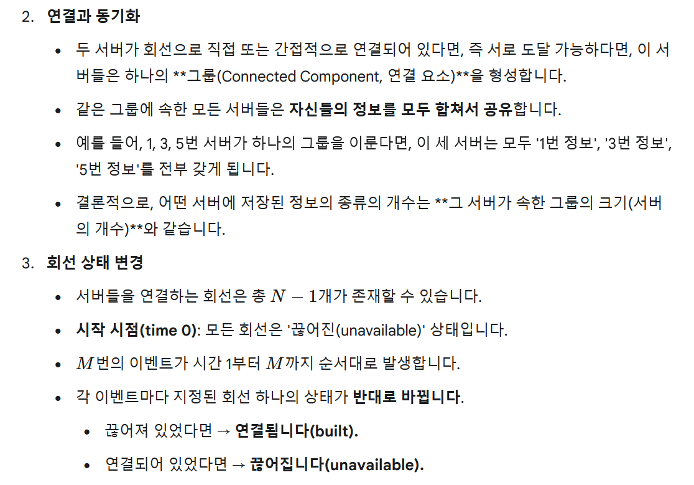
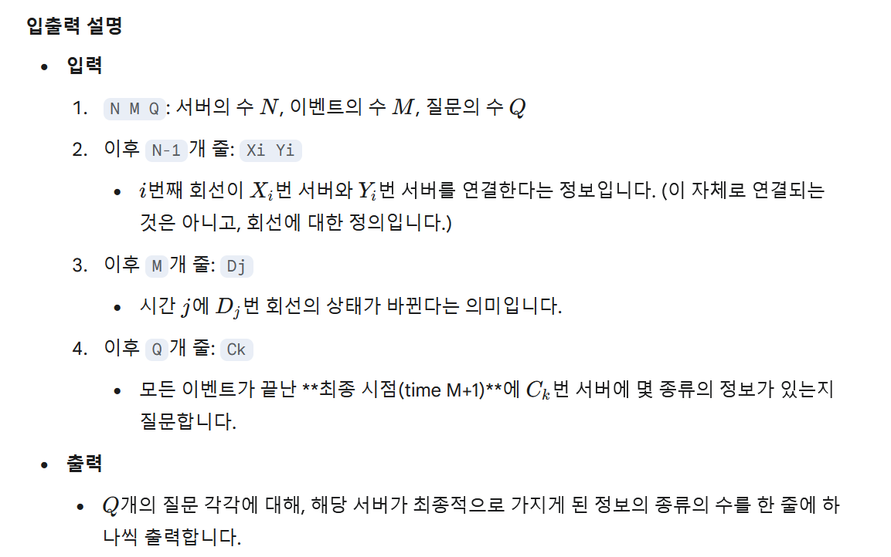

[상위 페이지 · Data Structure](/study/algorithms/data-structure/)





## 문제 해석







## 아이디어

- link
    - x,y가 서로 다른 컴퍼넌트에 존재할 때 집합의 포함배제 원리를 사용하여 "x 정보 + y 정보 - 기존 xy공통정보"로 x→y 엣지를 업데이트해준다
- cut
    - 분리될 때 x,y 공통 정보를 저장해준다. 하지만 기존 정보를 잃어서는 안 되기에 두 새 컴퍼넌트에 x,y 공통 정보를 업데이트해준다.
- 모든 연결과 컷 과정이 끝나면 질의에 대한 답을 해야 한다. 질의로 c가 들어왔다면 c 컴퍼넌트의 최종 루트가 정보를 가지고 있으므로 c의 루트를 찾아 info를 출력한다.

## 정답

```python
class LinkCutNode:
    def __init__(self, val=0):
        self.left = None
        self.right = None
        self.parent = None
        self.path_parent = None
        self.rev = False
        self.val = val
        self.sum = val
        self.size = 1
        self.info_size = 1

    def _is_root(self):
        return not self.parent or (self.parent.left is not self and self.parent.right is not self)

    def _update(self):
        self.sum = self.val
        self.size = 1
        if self.left:
            self.sum += self.left.sum
            self.size += self.left.size
        if self.right:
            self.sum += self.right.sum
            self.size += self.right.size

    def _push(self):
        if self.rev:
            self.left, self.right = self.right, self.left
            if self.left:
                self.left.rev ^= True
            if self.right:
                self.right.rev ^= True
            self.rev = False

    def _rotate(self):
        p = self.parent
        g = p.parent
        if not p._is_root():
            if g.left is p:
                g.left = self
            else:
                g.right = self
        self.parent = g
        if p.left is self:
            p.left = self.right
            if self.right:
                self.right.parent = p
            self.right = p
        else:
            p.right = self.left
            if self.left:
                self.left.parent = p
            self.left = p
        p.parent = self
        self.path_parent = p.path_parent
        p.path_parent = None
        p._update()
        self._update()

    def splay(self):
        stack = []
        node = self
        while True:
            stack.append(node)
            if node._is_root():
                break
            node = node.parent
        for n in reversed(stack):
            n._push()
        while not self._is_root():
            p = self.parent
            g = p.parent
            if not p._is_root():
                if (p.left is self) == (g.left is p):
                    p._rotate()
                else:
                    self._rotate()
            self._rotate()

    def access(self):
        last = None
        x = self
        while x:
            x.splay()
            if x.right:
                x.right.path_parent = x
                x.right.parent = None
            x.right = last
            if last:
                last.parent = x
            x._update()
            last = x
            x = x.path_parent
        self.splay()
        return last

    def make_root(self):
        self.access()
        self.rev ^= True
        self._push()

    def find_root(self):
        self.access()
        x = self
        while True:
            x._push()
            if x.left:
                x = x.left
            else:
                break
        x.splay()
        return x

    def connected(self, other):
        return self.find_root() is other.find_root()

    def link(self, other):
        self.make_root()
        if self.find_root() is not other.find_root():
            self.path_parent = other

    def cut_parent(self):
        self.access()
        if self.left:
            self.left.parent = None
            self.left = None
            self._update()

    def cut(self, other):
        self.make_root()
        other.access()
        if other.left is self and not self.right:
            other.left.parent = None
            other.left = None
            other._update()

    def query(self, other):
        self.make_root()
        other.access()
        return other.sum

    def update(self, value):
        self.access()
        self.val = value
        self._update()

    def get_parent(self):
        self.access()
        if not self.left:
            return None
        parent = self.left
        parent._push()
        while parent.right:
            parent = parent.right
            parent._push()
        parent.splay()
        return parent

    def get_depth(self):
        self.access()
        if self.left:
            return self.left.size
        return 0

    def get_LCA(self, other):
        if not self.connected(other):
            return None
        self.access()
        last = other.access()
        self.splay()
        if self == last:
            return self
        return last

N, M, Q = map(int, input().split())

edges = []
for _ in range(N - 1):
    x, y = map(int, input().split())
    edges.append((x, y))

changes = []
for _ in range(M):
    d = int(input())
    changes.append(d)

queries = []
for _ in range(Q):
    c = int(input())
    queries.append(c)

common = [0] * (N - 1)
nodes = [None] * (N + 1)
for i in range(1, N + 1):
    nodes[i] = LinkCutNode()

for d in changes:
    d -= 1
    x, y = edges[d]
    nx = nodes[x]
    ny = nodes[y]
    if nx.connected(ny):
        old_root = nx.find_root()
        old_info = old_root.info_size
        common[d] = old_info
        nx.access()
        p = nx.get_parent()
        if p == ny:
            nx.cut_parent()
        else:
            ny.access()
            p = ny.get_parent()
            if p == nx:
                ny.cut_parent()
        root1 = nodes[x].find_root()
        root2 = nodes[y].find_root()
        root1.info_size = old_info
        root2.info_size = old_info
    else:
        root1 = nx.find_root()
        root2 = ny.find_root()
        info1 = root1.info_size
        info2 = root2.info_size
        comm = common[d]
        new_info = info1 + info2 - comm
        nx.link(ny)
        new_root = nx.find_root()
        new_root.info_size = new_info

for c in queries:
    root = nodes[c].find_root()
    print(root.info_size)

```
