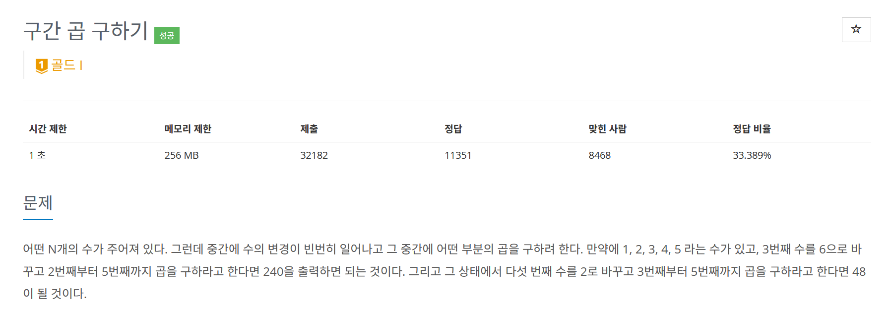
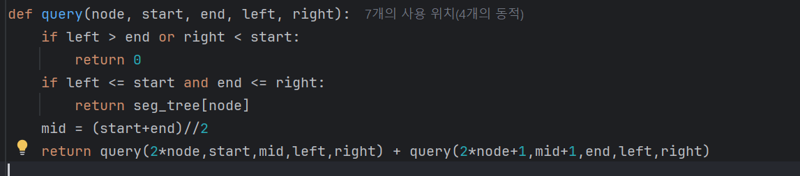
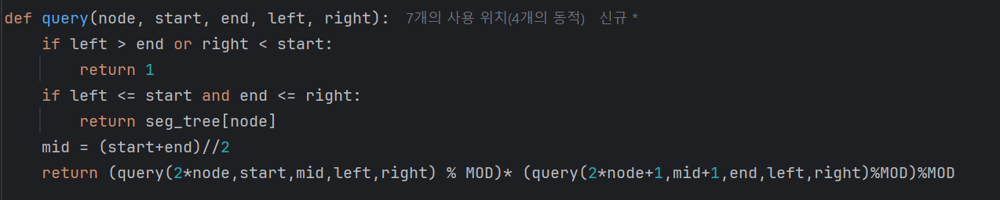

[상위 페이지 · Data Structure](/study/algorithms/data-structure/)



## 문제 태그

- 세그먼트 트리

## 아이디어

1. 큰수의 곱은 파이썬도 시간이 걸림 → 각 연산마다 계속 MOD로 나눠줘서 크기를 줄임([모듈러 연산](/study/algorithms/math/modyulreo-yeonsan/) 사용)
2. 구간 합에서는 0을 리턴해야 결과값에 영향을 끼치지 않았음
    
    
    
    하지만 구간 곱에서는 0을 리턴할시엔 모든 결과값이 0으로 바뀜으로 1을 리턴해줘야함
    
    
    

## 정답

```python
import sys
input = sys.stdin.readline

N,M,K = map(int,input().split())
arr = list()
MOD = 1000000007

for _ in range(N):
    arr.append(int(input()))

seg_tree = [0] * (4*N)

def build(node, start, end):
    if start == end:
        seg_tree[node] = arr[start]
        return
    mid = (start+end)//2
    build(2*node,start, mid)
    build(2*node + 1,mid+1, end)
    seg_tree[node] = (seg_tree[node * 2] * seg_tree[node * 2 + 1])%MOD

def query(node, start, end, left, right):
    if left > end or right < start:
        return 1
    if left <= start and end <= right:
        return seg_tree[node]
    mid = (start+end)//2
    return (query(2*node,start,mid,left,right) % MOD)* (query(2*node+1,mid+1,end,left,right)%MOD)%MOD

def update(node, start, end, index, value):
    if start == end:
        seg_tree[node] = value
        return
    mid = (start+end)//2
    if index <= mid:
        update(2*node,start,mid,index,value)
    else:
        update(2*node+1,mid+1,end,index,value)
    seg_tree[node] = (seg_tree[node * 2] * seg_tree[node * 2 + 1])%MOD

build(1,0,N-1)
for _ in range(M + K):
    query_type, a, b = map(int,input().split())
    if query_type == 1:
        update(1,0,N-1,a-1,b)
    else:
        print(query(1,0,N-1,a-1,b-1) % MOD)

```
