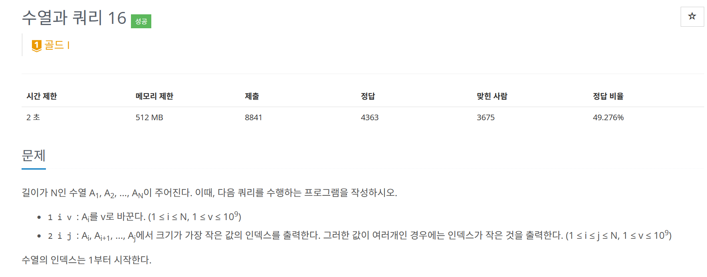

[상위 페이지 · 골드](/study/algorithms/data-structure/gold/)



## 문제 태그

- 세그먼트 트리

## 아이디어

1. 기본적으로 [2357. 최솟값과 최대값](/study/algorithms/data-structure/gold/boj-2357/) 과 동일하지만 저장할 때 인덱스도 같이 포함하여 저장하는게 포인트
2. min함수 내부적으로 최소값을 계산할 때 리스트끼리 비교하면 각 인덱스별로 비교하여 최소값을 가져옴 만약 인덱스가 더 높은걸 출력해야했다면 람다식 활용으로 key에 넣으면 될 것

## 정답

```python
N = int(input())
temp = list(map(int,input().split()))
arr = list()
for i in range(N):
    arr.append((temp[i],i))
min_seg = [0] * (4*N)

def init(arr,target_arr,node,start,end):
    if start == end:
        target_arr[node] = arr[start]
        return
    mid = start + (end-start)//2
    init(arr,target_arr,node*2,start,mid)
    init(arr, target_arr, node * 2 + 1, mid + 1, end)
    target_arr[node] = min(target_arr[node*2],target_arr[node*2+1])

def query(target_arr,node,start,end,left,right):
    if left > end or right < start:
        return -1
    if left <= start and end <= right:
        return target_arr[node]
    mid = start + (end-start)//2
    lfunc = query(target_arr,node*2,start,mid,left,right)
    rfunc = query(target_arr,node*2+1,mid+1,end,left,right)
    if lfunc == -1:
        return rfunc
    elif rfunc == -1:
        return lfunc
    else:
        return min(lfunc,rfunc)

def update(target_arr,node,start,end,index,value):
    if start == end:
        target_arr[node] = (value,index)
        return
    mid = start + (end-start)//2
    if index <= mid:
        update(target_arr,node*2,start,mid,index,value)
    else:
        update(target_arr,node*2+1,mid+1,end,index,value)
    min_seg[node] = min(min_seg[2 * node], min_seg[2 * node + 1])

init(arr,min_seg,1,0,N-1)
M = int(input())
for _ in range(M):
    a,left,right = map(int,input().split())
    if a == 1:
        update(min_seg,1,0,N-1,left-1,right)
    else:
        print(query(min_seg,1,0,N-1,left-1,right-1)[1] + 1)

```
