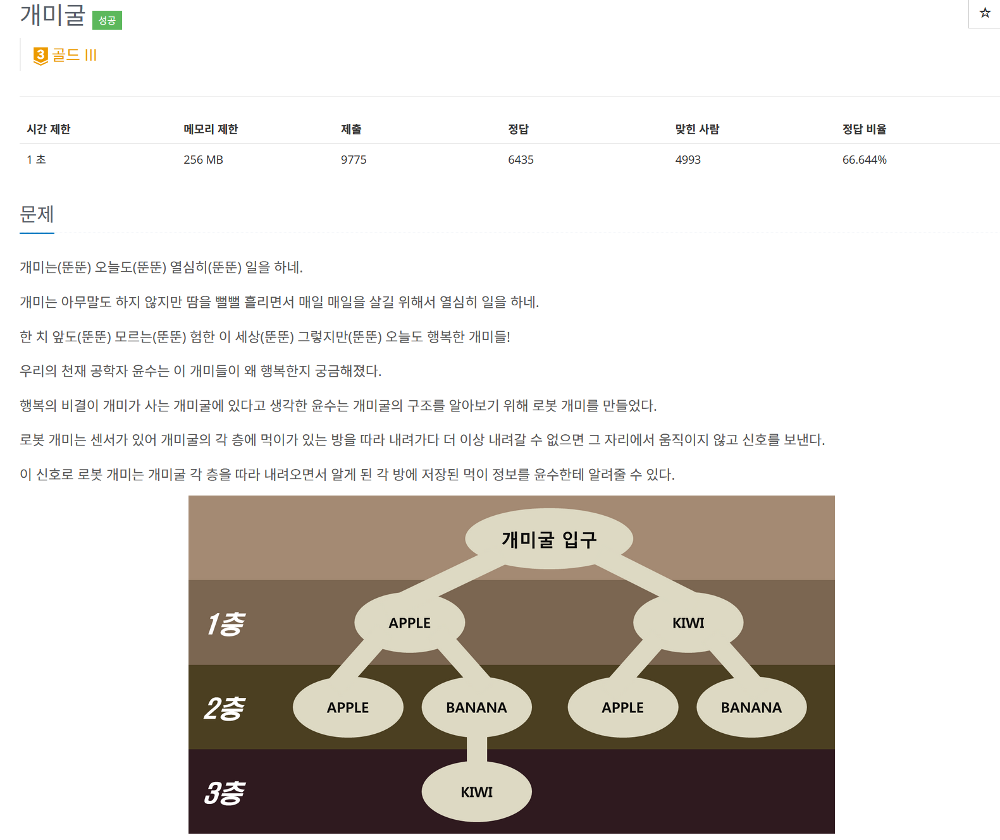
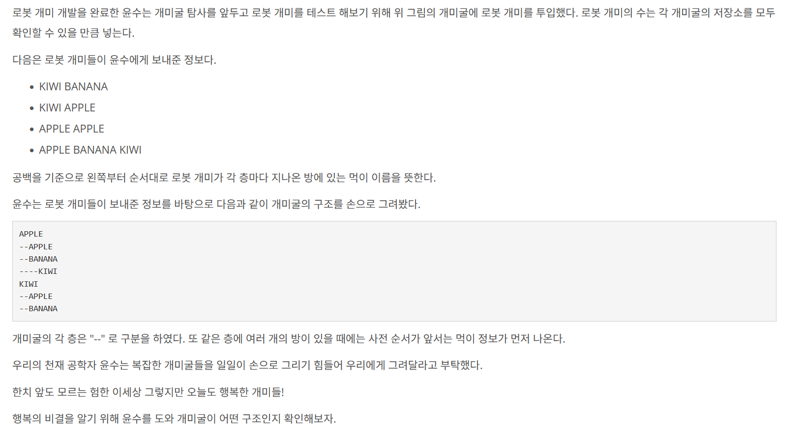

[상위 페이지 · Data Structure](/study/algorithms/data-structure/)





## 문제 태그

- 트라이

## 아이디어

1. 트라이로 문자열을 저장하고 dfs로 순회를 돔

## 정답

```python
import sys
sys.setrecursionlimit(10**6)
class Node:
    def __init__(self):
        self.child = {}

root_node = Node()

def insert(words):
    node = root_node
    for i in words:
        if i not in node.child:
            node.child[i] = Node()
        node = node.child[i]

N = int(input())
for i in range(N):
    words = input().split()
    insert(words[1:])

def dfs(node,depth):
    for key,value in sorted(node.child.items()):
        print(("--" * depth) + key)
        dfs(value,depth+1)

dfs(root_node,0)
```
