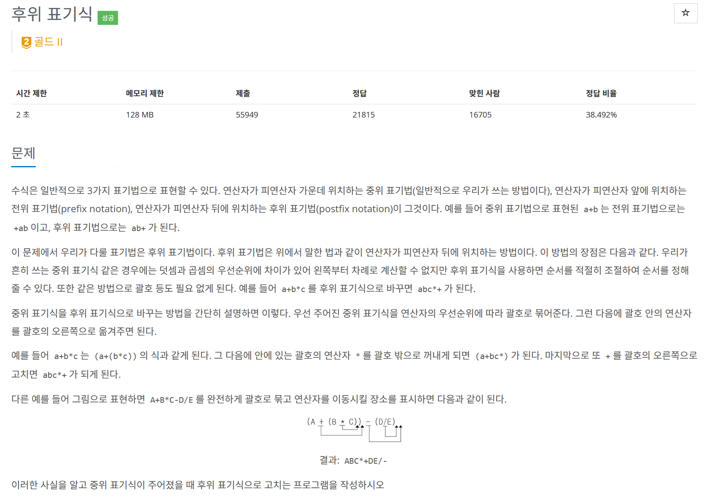

[상위 페이지 · 골드](/study/algorithms/data-structure/gold/)



## 문제 태그

- 자료구조
- 스택

## 아이디어

1. 피연산자는 순서에 영향을 못줌으로 바로바로 정답 배열에 집어넣어도 됨
2. 연산자는 우선순위에 따라 스택에 넣고 뺌
    1. 스택의 탑이 자신보다 우선순위가 낮다면 나중에 먼저 빠져야함으로 스택에 바로 집어넣기
    2. 스택의 탑이 자신보다 우선순위가 높거나 같다(같은 우선순위여도 먼저 들어온게 먼저 나가야함)면 빼서 정답 배열에 넣기
3. (,)는 서로 짝지어서 정답에 넣고 뺌
4. 스택에 더 연산자들이 남지 않도록 빼줌

## 정답

```python
n = input()

stack = list()
op_priority = {'+':1, '-':1, '*':2, '/':2,'(':-1,')':-1}
answer = list()
for i in n:
    if i not in op_priority:
        answer.append(i)
        continue

    if i == '(':
        stack.append(i)
    elif i == ')':
        while stack and stack[-1] != '(':
            answer.append(stack.pop())
        stack.pop()
    else:
        while stack and op_priority[i] <= op_priority[stack[-1]]:
            answer.append(stack.pop())
        stack.append(i)

while stack:
    answer.append(stack.pop())
print(''.join(answer))

```
