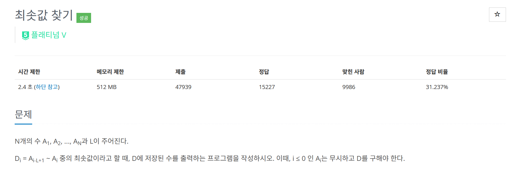

[상위 페이지 · 플래티넘](/study/algorithms/data-structure/platinum/)



## 문제 태그

- 자료구조
- 단조 덱

## 아이디어

1. 덱에 (인덱스,요소)쌍으로 데이터를 집어 넣는다
2. 만약 peek()의 인덱스가 [i-L+1,i]범위 밖을 벗어난다면 popleft()
3. 만약 들어올 값보다 top()의 값이 크다면 아닐때까지 pop()

## 정답

```python
from collections import deque

N,L = map(int,input().split())
arr = list(map(int,input().split()))

queue = deque()

for index,element in enumerate(arr):
    while queue and queue[0][0] <= index - L:
        queue.popleft()
    while queue and element < queue[-1][1]:
        queue.pop()
    queue.append((index,element))
    print(queue[0][1], end= " ")
```
