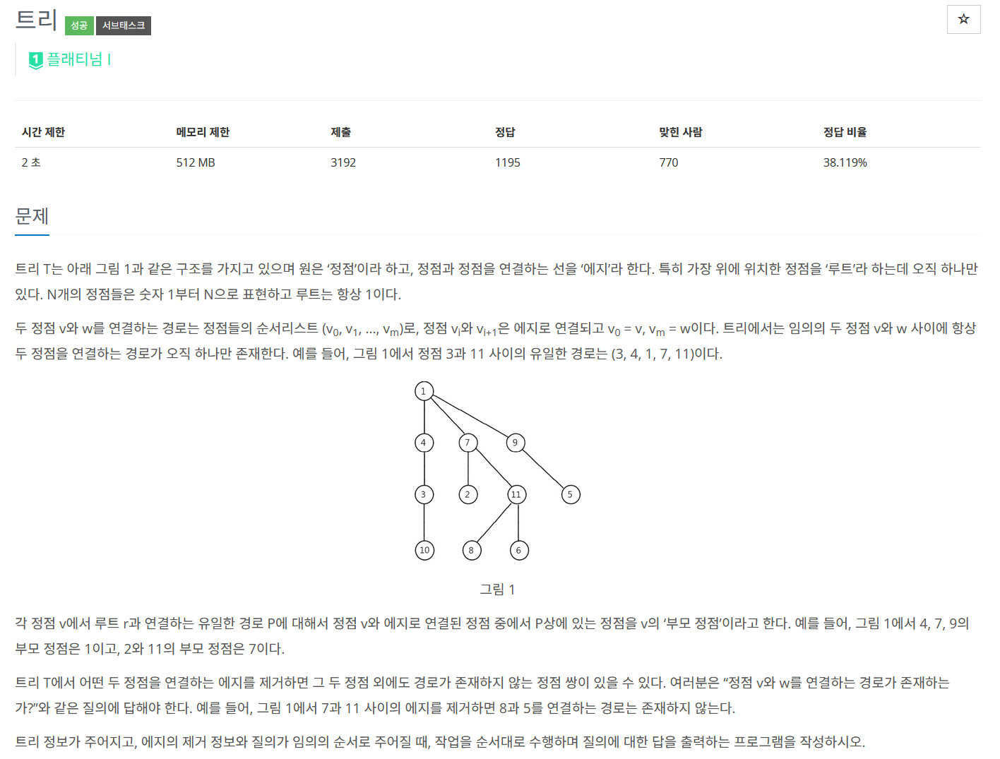

[상위 페이지 · 플래티넘](/study/algorithms/data-structure/platinum/)



## 문제 태그

- 자료구조
- 트리
- 세그먼트 트리
- 오일러 경로 테크닉
- HLD

## 아이디어

- 문제 태그를 보면 알 수 있듯이 이것은 HLD 문제이지만, 나는 이미 예전에 링크 컷 트리를 구현해 놓은 것이 있어서 그것을 사용했다.
- 링크 컷 트리에서 링크와 컷 연산을 진행한 후, 부모 노드를 가져오려면 자식 노드를 access한 다음 왼쪽 자식부터 시작해 오른쪽 자식이 존재할 때까지 오른쪽 자식을 따라가면 된다.

## 정답

```python
class LinkCutNode:
    def __init__(self, val=0):
        self.left = None
        self.right = None
        self.parent = None
        self.path_parent = None
        self.rev = False
        self.val = val
        self.sum = val

    def _is_root(self):
        return not self.parent or (self.parent.left is not self and self.parent.right is not self)

    def _update(self):
        self.sum = self.val
        if self.left:
            self.sum += self.left.sum
        if self.right:
            self.sum += self.right.sum

    def _push(self):
        if self.rev:
            self.left, self.right = self.right, self.left
            if self.left:
                self.left.rev ^= True
            if self.right:
                self.right.rev ^= True
            self.rev = False

    def _rotate(self):
        p = self.parent
        g = p.parent
        if not p._is_root():
            if g.left is p:
                g.left = self
            else:
                g.right = self
        self.parent = g
        if p.left is self:
            p.left = self.right
            if self.right:
                self.right.parent = p
            self.right = p
        else:
            p.right = self.left
            if self.left:
                self.left.parent = p
            self.left = p
        p.parent = self
        self.path_parent = p.path_parent
        p.path_parent = None
        p._update()
        self._update()

    def splay(self):
        stack = []
        node = self
        while True:
            stack.append(node)
            if node._is_root():
                break
            node = node.parent
        for n in reversed(stack):
            n._push()
        while not self._is_root():
            p = self.parent
            g = p.parent
            if not p._is_root():
                if (p.left is self) == (g.left is p):
                    p._rotate()
                else:
                    self._rotate()
            self._rotate()

    def access(self):
        last = None
        x = self
        while x:
            x.splay()
            if x.right:
                x.right.path_parent = x
                x.right.parent = None
            x.right = last
            if last:
                last.parent = x
            x._update()
            last = x
            x = x.path_parent
        self.splay()
        return last

    def make_root(self):
        self.access()
        self.rev ^= True
        self._push()

    def find_root(self):
        self.access()
        x = self
        while True:
            x._push()
            if x.left:
                x = x.left
            else:
                break
        x.splay()
        return x

    def connected(self, other):
        return self.find_root() is other.find_root()

    def link(self, other):
        self.make_root()
        if self.find_root() is not other.find_root():
            self.path_parent = other

    def cut(self):
        self.access()
        if self.left:
            self.left.parent = None
            self.left = None
            self._update()

    def query(self, other):
        self.make_root()
        other.access()
        return other.sum

    def update(self, value):
        self.access()
        self.val = value
        self._update()

    def get_parent(self):
        self.access()
        if not self.left:
            return None
        parent = self.left
        parent._push()
        while parent.right:
            parent = parent.right
            parent._push()
        parent.splay()
        return parent

N, Q = map(int, input().split())
vertices = [None] + [LinkCutNode() for _ in range(N)]
for i in range(2, N + 1):
    node = int(input())
    vertices[i].link(vertices[node])

result = []
for _ in range(Q):
    b, c, d = map(int, input().split())
    is_connected = vertices[b].connected(vertices[c])
    answer = "YES" if is_connected else "NO"
    if d == 1:
        node = b if is_connected else c
        parent = vertices[node].get_parent()
        if parent:
            vertices[node].cut()
    result.append(answer)

print("\n".join(result))
```
