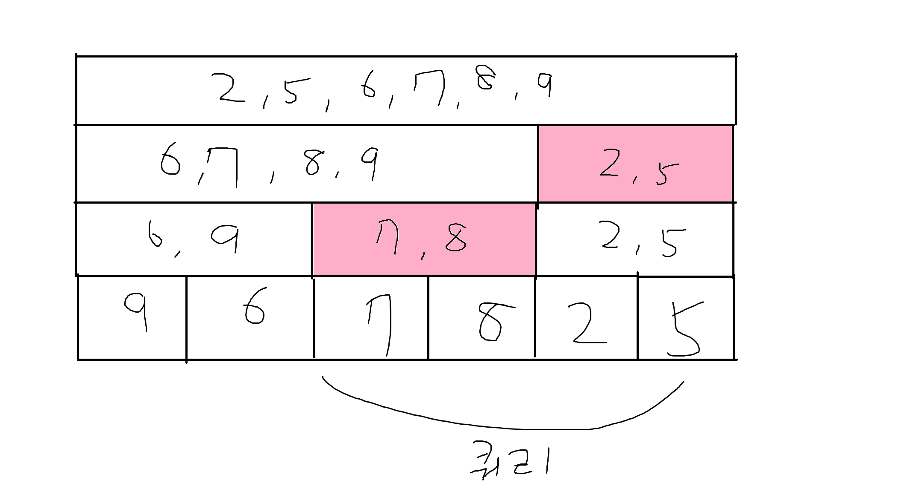

[상위 페이지 · Data Structure](/study/algorithms/data-structure/)


## 문제 태그

- 자료구조
- 머지 소트 트리

## 아이디어

1. 세그먼트 트리에 머지 소트 과정을 담는다.


1. 이 머지소트트리를 쿼리하면 이런 결과가 나온다



1. 각각의 리스트는 정렬이 되어 있으니 마음편히 bisect 함수를 사용하면 된다.

## 정답

```python
import bisect
import sys
sys.setrecursionlimit(1000000)
input = sys.stdin.readline

N = int(input())
seg_tree = [[] for _ in range(N*4)]
arr = list(map(int, input().split()))

def merge(left,right):
    ret = []
    l = len(left)
    r = len(right)
    i = j = 0
    while True:
        if i == l:
            for k in range(j, r):
                ret.append(right[k])
            break
        if j == r:
            for k in range(i, l):
                ret.append(left[k])
            break
        if left[i] < right[j]:
            ret.append(left[i])
            i += 1
        else:
            ret.append(right[j])
            j += 1
    return ret

def build(node = 1,start = 0,end = N-1):
    if start == end:
        seg_tree[node].append(arr[start])
        return
    mid = (end + start) // 2

    build(2 * node, start,mid)
    build(2 * node + 1, mid + 1,end)

    seg_tree[node] = merge(seg_tree[node * 2],seg_tree[node * 2 + 1])

def query(left,right,k,node = 1,start = 0,end = N-1):
    if right < start or left > end:
        return 0
    if left <= start and right >= end:
        return len(seg_tree[node]) - bisect.bisect_right(seg_tree[node], k)
    mid = (end + start) // 2
    return query(left,right,k,node * 2,start,mid) + query(left,right,k,node * 2 + 1,mid + 1,end)

build()

M = int(input())
for _ in range(M):
    i,j,k = map(int,input().split())
    print(query(i-1,j-1,k))
```
