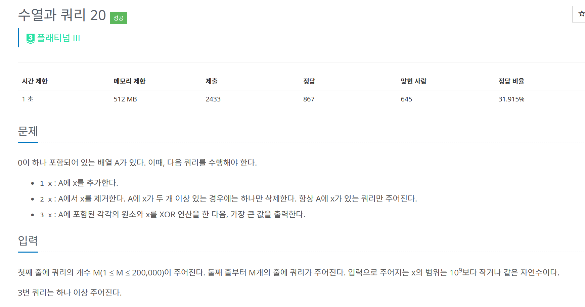
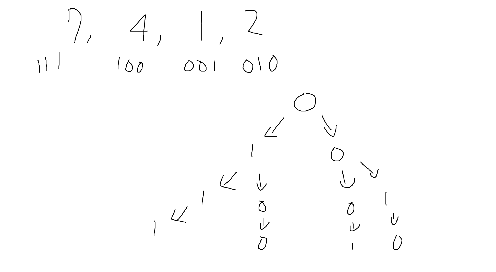

[상위 페이지 · 플래티넘](/study/algorithms/data-structure/platinum/)



## 문제 태그

- 자료구조
- 트라이

## 아이디어

1. 숫자를 비트로 생각하면 어떻게 저장해야할지 느낌이 온다
    
    
    
2. max xor을 탐색할때는 xor 특성상 피연산자의 비트와 다른 비트면 1임으로 자기와 다른 비트를 우선적으로 탐색하게 한다.

## 정답

```python
import sys
sys.setrecursionlimit(10**5)
input = sys.stdin.readline

class TrieNode:
    def __init__(self):
        self.child = {}
        self.cnt = 0

root = TrieNode()
MAX_BIT = 32

def insert(x):
    node = root
    node.cnt += 1
    for b in range(MAX_BIT, -1, -1):
        bit = (x >> b) & 1
        if bit not in node.child:
            node.child[bit] = TrieNode()
        node = node.child[bit]
        node.cnt += 1

def delete(x):
    node = root
    node.cnt -= 1
    stack = []
    for b in range(MAX_BIT, -1, -1):
        bit = (x >> b) & 1
        stack.append((node, bit))
        node = node.child[bit]
        node.cnt -= 1
    for parent, bit in reversed(stack):
        child = parent.child[bit]
        if child.cnt == 0:
            del parent.child[bit]
        else:
            break

def max_xor(x):
    node = root
    res = 0
    if node.cnt == 0:
        return 0
    for b in range(MAX_BIT, -1, -1):
        bit = (x >> b) & 1
        want = 1 - bit
        if want in node.child and node.child[want].cnt > 0:
            res |= (1 << b)
            node = node.child[want]
        elif bit in node.child:
            node = node.child[bit]
        else:
            break
    return res

insert(0)
M = int(input())
for _ in range(M):
    t, x = map(int, input().split())
    if t == 1:
        insert(x)
    elif t == 2:
        delete(x)
    else:
        print(max_xor(x))

```
