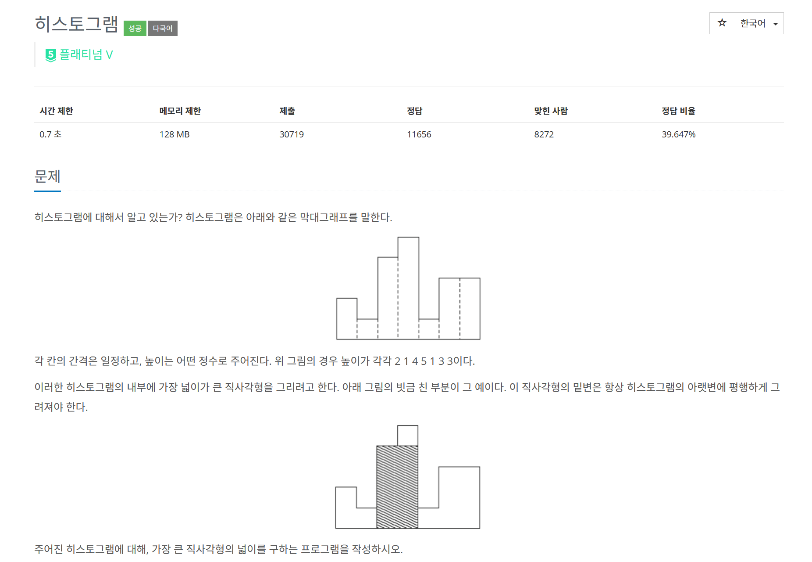

[상위 페이지 · 플래티넘](/study/algorithms/data-structure/platinum/)



## 문제 태그

- 자료구조
- 스택

## 아이디어

1. 스택에 자신보다 더 높거나 같은 높이가 들어오면 그건 자신도 아직 확장 될 가능성이 있다는것이기에 스택에 추가
2. 스택에 자신보다 더 낮은 높이가 들어오면 자신은 더 이상 확장 될 가능성이 없음 고로 pop을 하며 넓이를 계산함
    1. 너비는 지금까지 탐사한 index - pop해서 나온 i 만약 스택에 아무것도 없다면 그냥 현 index가 최대 넓이임
    2. 높이는 지금 꺼낸 블럭의 높이를 따라가면 됨

## 정답

```python
import sys
input = sys.stdin.readline

def largestRectangleArea(heights):
    stack = []
    max_area = 0
    heights.append(0)

    for i, h in enumerate(heights):
        while stack and heights[stack[-1]] > h:
            height = heights[stack.pop()]
            width = i if not stack else i - stack[-1] - 1
            max_area = max(max_area, height * width)
        stack.append(i)

    return max_area
while True:
    heights = list(map(int, input().split()))
    if heights == [0]:
        break
    print(largestRectangleArea(heights[1:]))

```
