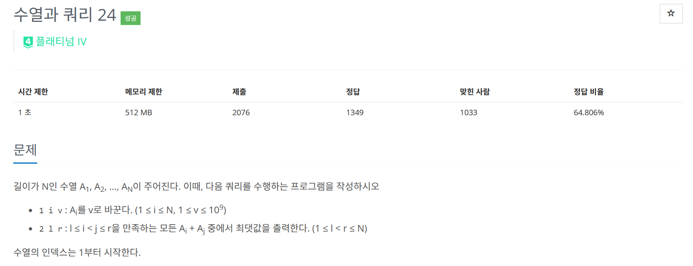

[상위 페이지 · Data Structure](/study/algorithms/data-structure/)



## 문제 태그

- 자료구조
- 세그먼트 트리

## 아이디어

1. 세그먼트 트리 쿼리를 (첫번째 큰 값, 두번째 큰값)을 계속 유지해준다
2. 왼쪽 오른쪽에서 올라오는 4개의 값들을 아래 코드와 같이 리턴
    
    ```python
     def merge(self, a, b):
            # 두 노드에서 상위 두 값 추출
            top = sorted([a[0], a[1], b[0], b[1]], reverse=True)
            return (top[0], top[1])
    ```
    

## 정답

```python
import sys
input = sys.stdin.readline

class SegmentTree:
    def __init__(self, data):
        self.N = len(data)
        self.tree = [(-1, -1)] * (4 * self.N)
        self.build(data, 1, 0, self.N - 1)
    
    def merge(self, a, b):
        # 두 노드에서 상위 두 값 추출
        top = sorted([a[0], a[1], b[0], b[1]], reverse=True)
        return (top[0], top[1])

    def build(self, data, node, l, r):
        if l == r:
            self.tree[node] = (data[l], -1)
            return
        mid = (l + r) // 2
        self.build(data, node * 2, l, mid)
        self.build(data, node * 2 + 1, mid + 1, r)
        self.tree[node] = self.merge(self.tree[node * 2], self.tree[node * 2 + 1])

    def update(self, index, value, node, l, r):
        if index < l or index > r:
            return
        if l == r:
            self.tree[node] = (value, -1)
            return
        mid = (l + r) // 2
        self.update(index, value, node * 2, l, mid)
        self.update(index, value, node * 2 + 1, mid + 1, r)
        self.tree[node] = self.merge(self.tree[node * 2], self.tree[node * 2 + 1])
    
    def query(self, ql, qr, node, l, r):
        if qr < l or ql > r:
            return (-1, -1)
        if ql <= l and r <= qr:
            return self.tree[node]
        mid = (l + r) // 2
        left = self.query(ql, qr, node * 2, l, mid)
        right = self.query(ql, qr, node * 2 + 1, mid + 1, r)
        return self.merge(left, right)

# 입력 처리
N = int(input())
A = list(map(int, input().split()))
M = int(input())
tree = SegmentTree(A)

for _ in range(M):
    q = input().split()
    if q[0] == '1':
        i, v = int(q[1]) - 1, int(q[2])
        tree.update(i, v, 1, 0, N - 1)
    else:
        l, r = int(q[1]) - 1, int(q[2]) - 1
        max1, max2 = tree.query(l, r, 1, 0, N - 1)
        print(max1 + max2)

```
