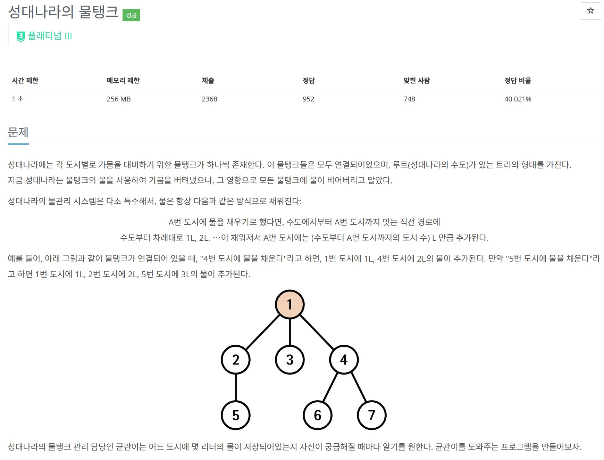
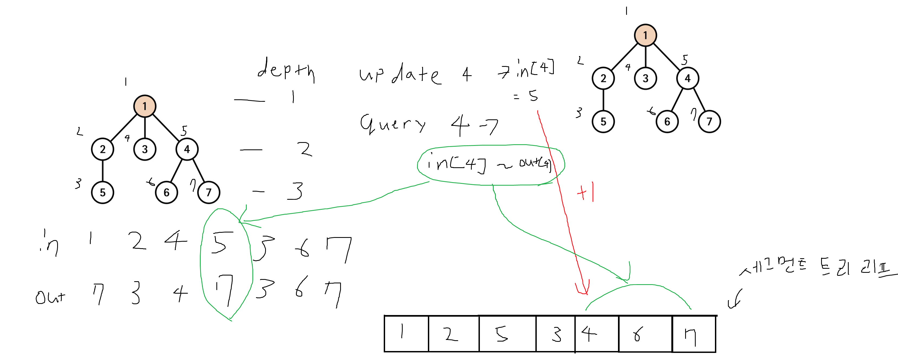

[상위 페이지 · 플래티넘](/study/algorithms/data-structure/platinum/)



## 문제 태그

- 자료구조
- 세그먼트 트리
- 오일러 경로 테크닉

## 아이디어



1. 이런 느낌으로 그래프를 세그먼트 트리처럼 바꾸어 활용할 수 있음
2. query를 해서 하위 노드에 몇번 물이 들어갔는지 알면 count * (depth + 1)로 물이 얼마나 들어갔는지 알 수 있음

## 정답

```python
import sys
sys.setrecursionlimit(10**7)
input = sys.stdin.readline

# 입력 처리: n, c (c는 사용 안 함)
n, c = map(int, input().split())
adj = [[] for _ in range(n+1)]
for _ in range(n-1):
    u, v = map(int, input().split())
    adj[u].append(v)
    adj[v].append(u)

# DFS로 tin/tout와 depth 계산
tin  = [0] * (n+1)
tout = [0] * (n+1)
depth = [0] * (n+1)
timer = 0

def dfs(u, p):
    global timer
    timer += 1
    tin[u] = timer
    for v in adj[u]:
        if v == p: continue
        depth[v] = depth[u] + 1
        dfs(v, u)
    tout[u] = timer

dfs(c, 0)

# 세그먼트 트리용 배열
tree = [0] * (4 * n)

def update(node, start, end, idx):
    if start == end:
        tree[node] += 1
        return
    mid = (start + end) // 2
    if idx <= mid:
        update(node*2, start, mid, idx)
    else:
        update(node*2+1, mid+1, end, idx)
    tree[node] = tree[node*2] + tree[node*2+1]

def query(node, start, end, l, r):
    if r < start or end < l:
        return 0
    if l <= start and end <= r:
        return tree[node]
    mid = (start + end) // 2
    return query(node*2, start, mid, l, r) + \
           query(node*2+1, mid+1, end, l, r)

# 쿼리 처리
q = int(input())
for _ in range(q):
    t, x = map(int, input().split())
    if t == 1:
        update(1, 1, n, tin[x])
    else:
        cnt = query(1, 1, n, tin[x], tout[x])
        print(cnt * (depth[x] + 1))

```
