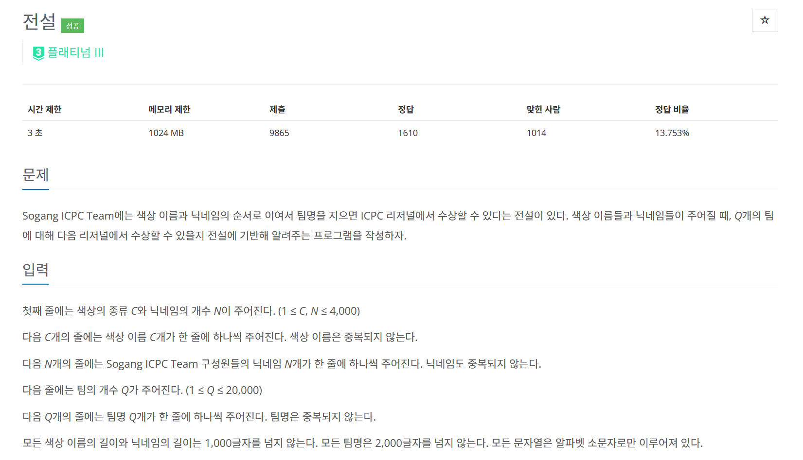

[상위 페이지 · 플래티넘](/study/algorithms/data-structure/platinum/)



## 문제 태그

- 트라이
- 자료구조

## 아이디어

1. 색을 기준으로 트라이를 구성함
2. search 과정에서 있는 색(단어의 마지막)이고 남은 문자열이 팀 네임에 속한다면 그건 우승 할 수 있는 팀임
3. list의 in과 다르게 set은 해쉬로 작동함으로 in이 O(N)이 아니라 O(1)로 작동함

## 정답

```python
N,M = map(int,input().split())
team_name = set()
class Node:
    def __init__(self):
        self.child = {}
        self.end_of_word = False

root_node = Node()

def insert(word):
    node = root_node
    for i in range(len(word)):
        char = word[i]
        if char not in node.child:
            node.child[char] = Node()
        node = node.child[char]
    node.end_of_word = True

def search(word):
    node = root_node
    for i,char in enumerate(word):
        if node.end_of_word and word[i:] in team_name:
            return True
        if char not in node.child:
            return False
        node = node.child[char]

for _ in range(N):
    word = input()
    insert(word)

for _ in range(M):
    word = input()
    team_name.add(word)

Q = int(input())

for i in range(Q):
    word = input()
    if search(word):
        print("Yes")
    else:
        print("No")
```
