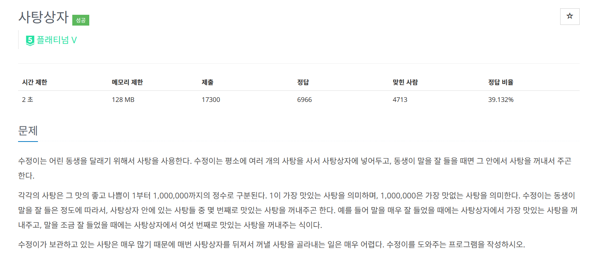

[상위 페이지 · Data Structure](/study/algorithms/data-structure/)



## 문제 태그

- 세그먼트 트리
- 이분탐색
- 자료구조

## 아이디어

1. 세그트리에 1~1,000,000까지 맛에 해당하는 인덱스로 개수를 넣어줄 것이다.
    1. seg[100] = 5 → 맛 100에 해당하는 사탕이 5개 있다는것
2. 문제가 애매하게 설명해놨지만 사탕 1,1,3,3이 있다면 2번째로 맛있는건 3이 아닌 1임
3. 사탕 랭크를 쿼리할때 중요한건
    1. 현재 찾으려는 랭크가 왼쪽에 있는지 오른쪽에 있는지 각 구역의 개수 합산으로 할 수 있음
    2. 예를 들어 1,2,3,5,8,10에서 3번째로 맛있는 사탕을 찾고 싶다면
    1~5 까지의 사탕 개수는 4, 6~10까지의 사탕개수는 2, 즉 왼쪽에 있는것
        
        다시 1~2까지의 사탕 개수는 2, 3~5까지의 사탕 개수는 , 즉 오른쪽에 있는것. 이때 중요한건 왼쪽에 있는걸 스킵한거기때문에 오른쪽 쿼리에서는 3번째로 맛있는 사탕이 아닌 왼쪽에서 스킵한 만큼 즉 3-2, 1번째로 맛있는 사탕을 찾아야함
        
4. 업데이트는 일반 세그트리랑 비슷함 추가로 넣고 빼는거니까 대입이 아닌 +=으로 해주면 됨.

## 정답

```python
import sys
sys.setrecursionlimit(10**6)
input = sys.stdin.readline
size = 10 ** 6 + 1
seg_tree = [0] * (4*size)

def update(node, start, end, index, value):
    if start == end:
        seg_tree[node] += value
        return
    mid = (start+end)//2
    if index <= mid:
        update(2*node,start,mid,index,value)
    else:
        update(2*node+1,mid+1,end,index,value)
    seg_tree[node] = seg_tree[node * 2] + seg_tree[node * 2 + 1]

def query(node, start, end, rank):
    if start == end:
        return start
    mid = (start+end)//2
    left = seg_tree[node * 2]
    if left >= rank:
        return query(2*node,start,mid,rank)
    else:
        return query(2*node + 1,mid + 1,end,rank - left)

for _ in range(int(input())):
    temp = list(map(int, input().split()))
    if temp[0] == 1:
        index = query(1,0,size-1,temp[1])
        print(index)
        update(1, 0, size - 1, index, -1)
    else:
        update(1,0,size-1,temp[1],temp[2])
```
