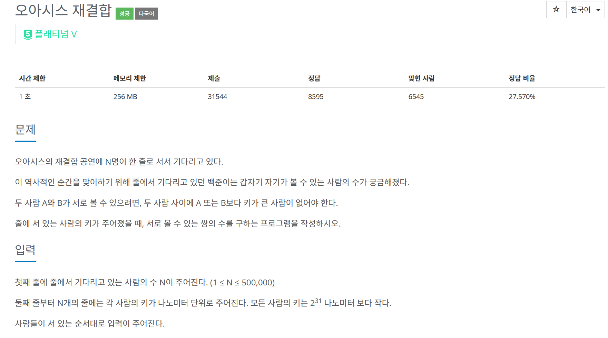

[상위 페이지 · Data Structure](/study/algorithms/data-structure/)



## 문제 태그

- 자료구조
- 스택

## 아이디어

 예시와 함께 이해하는것이 편함

```
7
2 4 1 2 2 5 1

```

### i = 0

- **현재 키:** 2이다
- **스택 상태 전:** (빈 스택)이다
- **처리:**
    - 스택이 비어 있으므로, 쌍을 형성할 대상이 없다
    - `(키=2, 개수=1)`을 스택에 push 한다
- **스택 상태 후:**| 키 = 2, 개수 = 1 |이다
- **쌍 형성:** 없다

---

### i = 1

- **현재 키:** 4이다
- **스택 상태 전:**| 키 = 2, 개수 = 1 |이다
- **처리:**
    - 스택 최상단의 키 2가 현재 키 4보다 작으므로 pop 된다
        - 이때, pop된 원소(키 2, 개수 1)와 현재 키 4가 한 쌍을 이루게 되어 쌍의 수가 **+1** 증가한다
    - 스택이 비게 되므로, 더 이상 추가 쌍은 생성되지 않는다
    - `(키=4, 개수=1)`을 스택에 push 한다
- **스택 상태 후:**| 키 = 4, 개수 = 1 |이다
- **쌍 형성:** (2,4) → **1쌍**이다

---

### i = 2

- **현재 키:** 1이다
- **스택 상태 전:**| 키 = 4, 개수 = 1 |이다
- **처리:**
    - 스택 최상단의 키 4가 현재 키 1보다 크므로 pop하지 않는다
    - 스택에 남아있는 원소(키 4, 개수 1)와 현재 사람이 서로 볼 수 있으므로 **+1** 쌍이 형성된다
    - `(키=1, 개수=1)`을 스택에 push 한다
- **스택 상태 후:**| 키 = 4, 개수 = 1 | 키 = 1, 개수 = 1 |이다
- **쌍 형성:** (4,1) → **1쌍**이다

---

### i = 3

- **현재 키:** 2이다
- **스택 상태 전:**| 키 = 4, 개수 = 1 | 키 = 1, 개수 = 1 |이다
- **처리:**
    - 먼저 스택 최상단의 키 1이 현재 키 2보다 작으므로 pop 한다
        - pop된 `(1, 1)`과 현재 키 2가 한 쌍을 이루어 **+1** 쌍이 발생한다
    - 이후 스택의 새 최상단인 키 4가 현재 키 2보다 크므로 while문이 종료된다
    - 스택에 남아 있는 최상단 (키 4, 개수 1)과 현재 사람이 한 쌍을 형성하여 **+1** 쌍이 추가된다
    - `(키=2, 개수=1)`을 스택에 push 한다
- **스택 상태 후:**| 키 = 4, 개수 = 1 | 키 = 2, 개수 = 1 |이다
- **쌍 형성:**
    - (1,2) pop 과정에서 **1쌍**이다
    - (4,2) 남은 스택과의 추가 형성에서 **1쌍**
        
        → 총 **2쌍**
        
        이다
        

---

### i = 4

- **현재 키:** 2이다
- **스택 상태 전:**| 키 = 4, 개수 = 1 | 키 = 2, 개수 = 1 |이다
- **처리:**
    - 스택 최상단의 키가 2로 현재 키와 동일하므로, pop 전에 누적한다
        - 동일한 높이의 그룹이 형성되어, `count`를 기존 1에서 **1** 더해 **2**가 된다
        - pop한 원소 `(2, 1)`와 현재 사람이 쌍을 이루므로 **+1** 쌍이 발생한다
    - while문을 탈출한 후, 스택에 남아 있는 최상단 (키 4, 개수 1)과 현재 사람은 서로 볼 수 있으므로 **+1** 쌍이 추가된다
    - `(키=2, 개수=2)`를 스택에 push 한다
- **스택 상태 후:**| 키 = 4, 개수 = 1 | 키 = 2, 개수 = 2 |이다
- **쌍 형성:**
    - 동일한 높이 (2,2) 그룹에서 **1쌍**이다
    - 스택 내의 (4,2)와의 연결에서 **1쌍**
        
        → 총 **2쌍**
        
        이다
        

---

### i = 5

- **현재 키:** 5이다
- **스택 상태 전:**| 키 = 4, 개수 = 1 | 키 = 2, 개수 = 2 |이다
- **처리:**
    - 스택 최상단의 키 2 (개수 2)가 현재 키 5보다 작으므로 pop 한다
        - pop된 그룹 (키 2, 개수 2)와 현재 키 5는 서로 볼 수 있어 **+2** 쌍이 형성된다
    - 그 후 스택의 최상단은 키 4 (개수 1)인데, 4도 현재 키 5보다 작으므로 pop 한다
        - pop된 `(4, 1)`과 현재 키 5가 한 쌍을 이루어 **+1** 쌍이 발생한다
    - 스택이 비게 되었으므로 추가 쌍은 없다
    - `(키=5, 개수=1)`을 스택에 push 한다
- **스택 상태 후:**| 키 = 5, 개수 = 1 |이다
- **쌍 형성:**
    - (2,5)에서 **2쌍**이다
    - (4,5)에서 **1쌍**
        
        → 총 **3쌍**
        
        이다
        

---

### i = 6

- **현재 키:** 1이다
- **스택 상태 전:**| 키 = 5, 개수 = 1 |이다
- **처리:**
    - 스택 최상단의 키 5가 현재 키 1보다 크므로 pop하지 않는다
    - 스택에 남아 있는 `(5, 1)`과 현재 사람이 서로 볼 수 있어 **+1** 쌍이 형성된다
    - `(키=1, 개수=1)`을 스택에 push 한다
- **스택 상태 후:**| 키 = 5, 개수 = 1 | 키 = 1, 개수 = 1 |이다
- **쌍 형성:** (5,1) → **1쌍**이다

## 정답

직관적으로 이해가 안돼서 주석도 달음

```python
import sys
input = sys.stdin.readline

N = int(input())
stack = []
answer = 0

for _ in range(N):
    height = int(input())
    count = 1
    while stack and stack[-1][0] <= height:
        # 스택의 꼭대기 요소(이전에 본 사람의 키)가 현재 사람의 키보다 작거나 같다면,
        # 현재 사람은 그 사람들과 모두 볼 수 있다.
        if stack[-1][0] == height:
            # 만약 높이가 같은 경우라면, 이전에 같은 높이로 연속된 사람들의 개수를 합산한다.
            count += stack[-1][1]
        # 스택의 꼭대기 요소에 해당하는 사람들과의 쌍을 현재 사람이 형성하므로,
        # 그 사람들의 개수(stack[-1][1])만큼 answer에 더해준다.
        answer += stack[-1][1]
        # 현재 사람보다 작거나 같은 키인 사람들은 더 이상 이후에 현재 사람과 연결될 수 없으므로 pop한다.
        stack.pop()
    # while문 종료 후 스택에 남아 있다면,
    # 남아 있는 스택의 꼭대기는 현재 사람보다 큰 키를 갖고 있으므로,
    # 현재 사람은 그 사람과 한 쌍(즉, 양쪽에서 서로 볼 수 있는 관계)을 이룰 수 있다.
    if stack:
        answer += 1
    # 현재 사람을 (height, count) 형태로 스택에 push한다.
    # 여기서 count는 동일한 높이의 연속된 사람들을 하나의 그룹으로 처리하기 위해 사용된다.
    stack.append((height, count))
print(answer)

```
