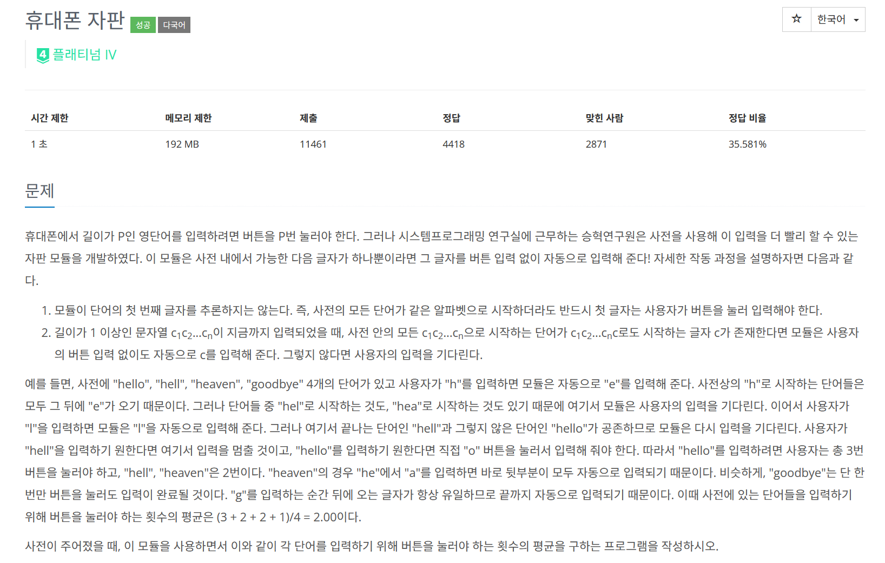

[상위 페이지 · Data Structure](/study/algorithms/data-structure/)



## 문제 태그

- 문자열
- 트라이

## 아이디어

1. 문제의 말은 한마디로 트라이를 통해 자료구조를 구성했을 때 분기가 나뉘는 개수를 세라는것
2. 분기가 나뉘는 조건은
    1. 자식의 개수가 두개 이상일때 or 단어의 마지막일때(이때는 자식이 남아있더라도 더 입력할지 말지 사용자가 정해야함)

## 정답

```python
import sys
input = sys.stdin.readline
class Node:
    def __init__(self):
        self.child = {}
        self.endOfWord = False
root_node = Node()

def insert(words):
    for word in words:
        node = root_node
        for i in range(len(word)):
            char = word[i]
            if char not in node.child:
                node.child[char] = Node()
            node = node.child[char]
        node.endOfWord = True

def search(words):
    result = 0
    for word in words:
        node = root_node.child[word[0]]
        temp = 1
        for i in range(1,len(word)):
            char = word[i]
            if len(node.child) != 1 or node.endOfWord:
                temp += 1
            node = node.child[char]
        result += temp
    return result

while True:
    line = input()
    if not line:
        break
    N = line.strip()
    if N == "":
        continue
    temp = list()
    N = int(N)
    root_node = Node()
    for _ in range(N):
        temp.append(input().strip())
    insert(temp)
    print('%.2f' % (search(temp)/N))

```
