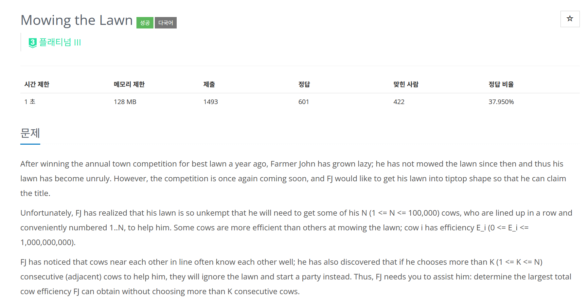

[상위 페이지 · 플래티넘](/study/algorithms/data-structure/platinum/)



## 문제 요약

1. N(1≤N≤100,000)개의 요소가 있음
2. 각 요소는 E(0≤E≤1,000,000,000)의 값을 가짐
3. 요소를 연속하여 K(1≤K≤N)개 초과하여 선택하지 않고 최대를 구하여라
    1. arr = {1,2,3,4,5} K = 2라면 1,2,3을 동시에 선택할 수 없고 {1,2},{4,5} 이런식으로 선택하여야함

## 문제 태그

- DP
- 자료구조
- 단조 덱을 이용한 DP 최적화
- 구간 합

## 아이디어

1. 구간합 3..5 까지 구하는것은 Psum[5] - Psum[2]임
2. 점화식은 dp[i] = Psum[i] + max(dp[j-1] - Psum[j]) 단 i-k≤j≤i
    1. 구간 i~(j+1)까지 새로운 구간으로 잡았다면 dp[j-1]의 값(한칸 떨어진 값)을 가져오는것
        
        
        
3. 단조 덱과 1.a 성질을 이용하여 max(dp[j-1] - Psum[j])을 관리 할 수 있음.
    
     [11003. 최소값 찾기](/study/algorithms/data-structure/platinum/boj-11003/) 와 비슷함
    

## 정답

```python
import sys
from collections import deque

input = sys.stdin.readline
N,K = map(int,input().split())
arr = list()
for _ in range(N):
    arr.append(int(input()))

Psum = list()
sum_temp = 0
for i in arr:
    Psum.append(sum_temp+i)
    sum_temp += i
dp = [0] * (N+1)
queue = deque()
def get_value(index):
    return dp[index - 1] - Psum[index]

for index in range(N):
    while queue and queue[0] < index - K:
        queue.popleft()
    while queue and get_value(queue[-1]) < get_value(index):
        queue.pop()
    queue.append(index)
    dp[index] = Psum[index] + get_value(queue[0])
    if index < K:
        dp[index] = Psum[index]

print(dp[N-1])

```
