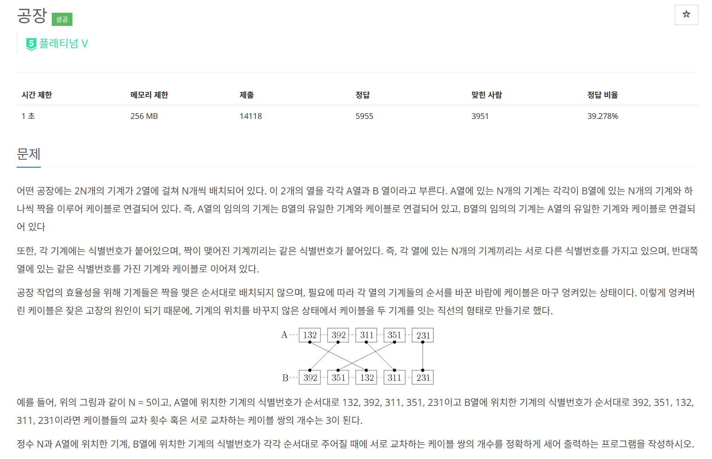

[상위 페이지 · Data Structure](/study/algorithms/data-structure/)



## 문제 태그

- 자료구조
- 세그먼트 트리

## 아이디어

1. 세그먼트 트리의 숙련도 문제로 도저히 답이 생각 안나서 아이디어만 봄
2. 요지는 a→b일때  현재 a의 인덱스보다 작은 a로부터 구간 [b+1,N]까지 이어진 선분이 몇개 존재하느냐였음.
3. A 0번부터 천천히 선분을 하나씩 그어보면 이미 그어진 선들은 현재 a의 인덱스보다 작으니 앞전제는 볼필요가 없음 고로 구간 [b+1,N]사이에 선분이 몇개 존재하는지만 관리하면 됨
4. 이를 세그먼트 트리로 관리

번외.


생각해보니 첫아이디어가 좀 엇나간건 있지만 틀리지 않은듯?

## 정답

```python
import sys
input = sys.stdin.readline

N = int(input())
a_pos = list(map(int,input().split()))
b_pos = {}
for i,element in enumerate(list(map(int,input().split()))):
    b_pos[element] = i

seg_tree = [0] * (4*N)

def build(node, start, end):
    if start == end:
        seg_tree[node] = 0
        return
    mid = (start+end)//2
    build(2*node,start, mid)
    build(2*node + 1,mid+1, end)
    seg_tree[node] = seg_tree[node * 2] + seg_tree[node * 2 + 1]

def query(node, start, end, left, right):
    if left > end or right < start:
        return 0
    if left <= start and end <= right:
        return seg_tree[node]
    mid = (start+end)//2
    return query(2*node,start,mid,left,right) + query(2*node+1,mid+1,end,left,right)

def update(node, start, end, index, value):
    if start == end:
        seg_tree[node] = value
        return
    mid = (start+end)//2
    if index <= mid:
        update(2*node,start,mid,index,value)
    else:
        update(2*node+1,mid+1,end,index,value)
    seg_tree[node] = seg_tree[node * 2] + seg_tree[node * 2 + 1]

build(1,0,N-1)
answer = 0
for i in range(N):
    pos = b_pos[a_pos[i]]
    answer += query(1,0,N-1,pos,N-1)
    update(1,0,N-1,pos,1)
print(answer)
```
