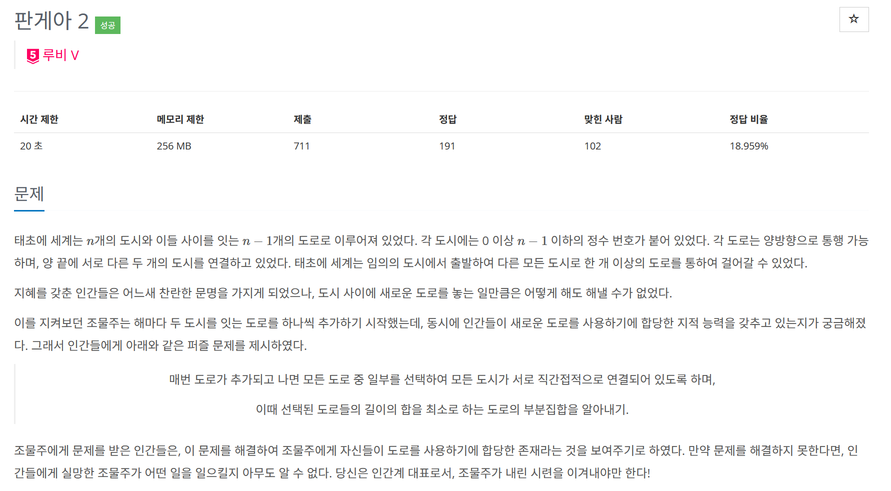

[상위 페이지 · 루비](/study/algorithms/data-structure/ruby/)



## 문제 태그

- 그래프 이론
- 트리
- 최소 스패닝 트리
- 링크 컷 트리

## 아이디어

링크 컷 트리에 max 속성을 추가하여 동적 MST를 효율적으로 관리할 수 있다. 비록 링크 컷 트리는 기본적으로 간선 정보를 저장하지 않지만 MST의 특성상 두 노드 사이에 간선이 최대 하나만 존재한다는 점을 활용할 수 있다. 이러한 특성을 이용해 자식 노드의 weight 값을 통해 마치 간선에 정보가 있는 것처럼 처리할 수 있다.

> **u→v 로 가는 간선 c를 건설한다.**
> 
1. u→v로 가는 간선이 존재하지 않는다면 새로 링크해주면 된다.
2. u→v로 가는 간선이 이미 존재한다면, u를 access하여 루트로 끌어올린 후 v를 access하여 LCA를 구성한다. 이때 v의 max value는 u→v path 사이의 가장 큰 간선 가중치를 의미한다. 만약 c < maxvalue인 경우, 해당 간선을 컷하고 dummy c 노드를 생성하여 u→c→v path를 만들어준다.
3. MST 값은 링크 컷 트리 내부에서 집계하기보다 외부에서 동적으로 관리하는 것이 더 효율적이다.

## 정답

```python
class LinkCutNode:
    def __init__(self, val=0):
        self.left = None
        self.right = None
        self.parent = None
        self.path_parent = None
        self.rev = False
        self.val = val
        self.maxvalue = val
        self.sum = val
        self.size = 1

    def _is_root(self):
        return not self.parent or (self.parent.left is not self and self.parent.right is not self)

    def _update(self):
        self.sum = self.val
        self.size = 1
        self.maxvalue = self.val
        if self.left:
            self.sum += self.left.sum
            self.size += self.left.size
            self.maxvalue = max(self.left.maxvalue, self.maxvalue)
        if self.right:
            self.sum += self.right.sum
            self.size += self.right.size
            self.maxvalue = max(self.right.maxvalue, self.maxvalue)

    def _push(self):
        if self.rev:
            self.left, self.right = self.right, self.left
            if self.left:
                self.left.rev ^= True
            if self.right:
                self.right.rev ^= True
            self.rev = False

    def _rotate(self):
        p = self.parent
        g = p.parent
        if not p._is_root():
            if g.left is p:
                g.left = self
            else:
                g.right = self
        self.parent = g
        if p.left is self:
            p.left = self.right
            if self.right:
                self.right.parent = p
            self.right = p
        else:
            p.right = self.left
            if self.left:
                self.left.parent = p
            self.left = p
        p.parent = self
        self.path_parent = p.path_parent
        p.path_parent = None
        p._update()
        self._update()

    def splay(self):
        stack = []
        node = self
        while True:
            stack.append(node)
            if node._is_root():
                break
            node = node.parent
        for n in reversed(stack):
            n._push()
        while not self._is_root():
            p = self.parent
            g = p.parent
            if not p._is_root():
                if (p.left is self) == (g.left is p):
                    p._rotate()
                else:
                    self._rotate()
            self._rotate()

    def access(self):
        last = None
        x = self
        while x:
            x.splay()
            if x.right:
                x.right.path_parent = x
                x.right.parent = None
            x.right = last
            if last:
                last.parent = x
            x._update()
            last = x
            x = x.path_parent
        self.splay()
        return last

    def make_root(self):
        self.access()
        self.rev ^= True
        self._push()

    def find_root(self):
        self.access()
        x = self
        while True:
            x._push()
            if x.left:
                x = x.left
            else:
                break
        x.splay()
        return x

    def connected(self, other):
        return self.find_root() is other.find_root()

    def link(self, other):
        self.make_root()
        if self.find_root() is other.find_root():
            return
        self.path_parent = other

    def cut_parent(self):
        parent = self.get_parent()
        if not parent:
            return
        self.access()
        if self.left:
            self.left.parent = None
            self.left = None
            self._update()

    def cut(self, other):
        self.make_root()
        other.access()
        if other.left is self and not self.right:
            other.left.parent = None
            other.left = None
            other._update()

    def query(self, other):
        self.make_root()
        other.access()
        return other.sum

    def update(self, value):
        self.access()
        self.val = value
        self._update()

    def get_parent(self):
        self.access()
        if not self.left:
            return None
        parent = self.left
        parent._push()
        while parent.right:
            parent = parent.right
            parent._push()
        parent.splay()
        return parent

    def get_depth(self):
        self.access()
        if self.left:
            return self.left.size
        return 0

    def get_LCA(self, other):
        if not self.connected(other):
            return None
        self.access()
        last = other.access()
        self.splay()
        if self == last:
            return self
        return last

    def _find_max_node(self):
        target_max = self.maxvalue
        node = self
        while True:
            node._push()
            if node.left and node.left.maxvalue == target_max:
                node = node.left
            elif node.val == target_max:
                node.splay()
                return node
            else:
                node = node.right

    def query_max(self,other):
        self.make_root()
        other.access()
        return other.maxvalue

T = int(input())
for _ in range(T):
    n,m = map(int, input().split())
    vertices = [LinkCutNode(0) for i in range(n)]
    current_sum = 0
    for i in range(1, n):
        v,c = map(int, input().split())
        dummy = LinkCutNode(c)
        vertices[i].link(dummy)
        dummy.link(vertices[v])
        current_sum += c
    answer = 0
    for _ in range(m):
        u,v,w = map(int, input().split())
        u_node = vertices[u]
        v_node = vertices[v]
        if not u_node.connected(v_node):
            dummy = LinkCutNode(w)
            u_node.link(dummy)
            v_node.link(dummy)
            current_sum += w
        else:
            w_max = u_node.query_max(v_node)
            if w < w_max:
                v_node.access()
                heavy = v_node._find_max_node()
                if heavy:
                    heavy.splay()
                    if heavy.left:
                        heavy.left.parent = None
                        heavy.left = None
                    if heavy.right:
                        heavy.right.parent = None
                        heavy.right = None
                    heavy.parent = None
                    heavy.path_parent = None
                    heavy._update()
                    current_sum -= w_max
                    dummy = LinkCutNode(w)
                    u_node.link(dummy)
                    v_node.link(dummy)
                    current_sum += w
        answer ^= current_sum
    print(answer)
```
