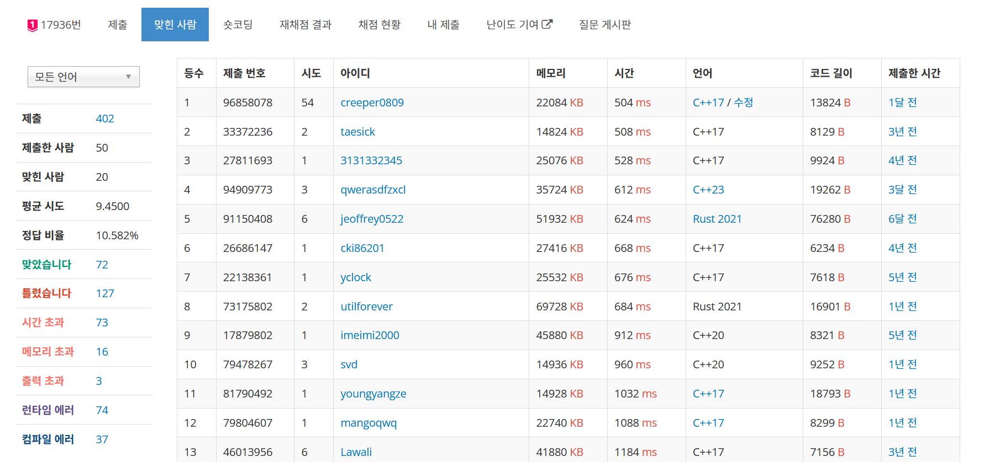
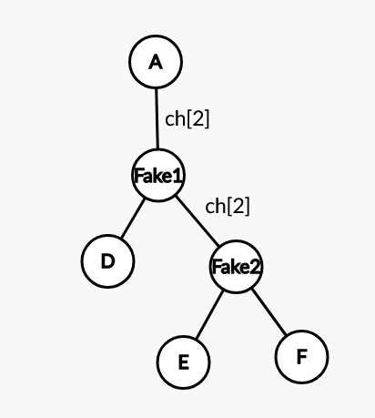

[상위 페이지 · 루비](/study/algorithms/data-structure/ruby/)




어쩌다 보니 1등

## 문제 태그

- 자료구조
- 트리
- 탑 트리
- 링크 컷 트리

## 아이디어

- 본문을 읽기 전 [Top Tree](/study/algorithms/data-structure/top-tree/) 자료구조에 대한 이해가 있어야 이해하기 수월할것이다.
- 링크 컷 트리는 기본적으로 경로 쿼리를 효율적으로 처리한다. 여기서는 탑트리 클러스터 개념을 응용해 서브트리 쿼리를 구현하는 방법을 설명한다.
- 가장 중요한 개념은 노드가 가지는 정보를 두 종류로 분리하는 것이다
    - path: 오직 선호 경로(Heavy path) 상의 정보만을 집계한다
    - sub: 비선호 경로(Light path)상의 정보만을 집계한다
    - 예 A노드)
        - A.path: B-A-C라고 가정했을 때 B.path + A.val + C.path 값이다
        - A.sub: A와 연결된 서브트리 D,E의 서브트리 정보를 담는다. D.all + E.all 값이다
        - A.all: A가 책임지는 모든 정보의 합이다. A.path + A.sub 값이다
- 이제 링크 컷 트리가 비선호 경로를 관리하는 방법을 알아본다. 링크 컷 트리에서 노드 A가 비선호자식 한두개가 아닌 3개 이상을 가질 수 있다. 이때 가상노드 개념을 도입하여 val이 없는 순수 데이터 집계용 노드를 만들어 집계한다.
    
    예)
    
    
    
    A가 비선호 자식 D,E,F를 가지는 구조라면 D,E,F는 실제 노드이고 Fake1,Fake2는 이들을 묶기 위한 가상노드이다. 서브트리를 만들 때 ch[2]와 ch[3]가 비어있다면 그냥 연결하고, 꽉 차 있으면 새로운 가상 노드를 만들어 기존 자식과 잇는다.
    
- access 연산도 달라져야 한다. access가 진행되면서 노드 p와 그 자식 u의 관계가 변할 수 있다
    - 경로 → 서브트리 (Heavy → Light)
        - access 이전에 p의 선호자식이 u가 아니었다면, u가 p의 선호자식이 되면서 기존 선호자식인 v가 서브트리로 옮겨가야 한다.
        - 서브트리에 v를 추가하여 ch[2], ch[3]에 추가한다
        - v의 all 데이터는 이제 p의 path가 아닌 sub에 기여하게 된다
    - 서브트리 → 경로 (Light → Heavy)
        - access 이전에 u가 p의 비선호 자식이었다면, u가 새로운 선호 경로에 포함되면서 p는 u와 Heavy 하게 이어져야 한다.
        - u는 p의 비선호 자식 트리에서 제거되며 p의 새로운 선호 자식으로 연결된다
- Lazy propagation은 탑트리에서 설명하는 것과 같이 서브트리에 add하는 것은 path와 sub 모두에 전파를 하고, path add는 path에만 add를 한다. 이는 서브트리 전체와 경로만 구분해서 연산하기 위한 중요한 최적화 방법이다.

## 정답

- C++(pypy는 동일 로직임에도 TLE)
    
    ```python
    #include <iostream>
    #include <vector>
    #include <stack>
    #include <algorithm>
    #include <climits>
    using namespace std;
    
    class LinkCutTree {
    private:
        static const int MAX_NODES = 200000;
        
        struct Lazy;
        
        struct Data {
            int total_sum;
            int min_val;
            int max_val;
            int size;
            
            Data(int value = 0) {
                if (value == 0) {
                    total_sum = 0;
                    min_val = INT_MAX;
                    max_val = INT_MIN;
                    size = 0;
                } else {
                    total_sum = value;
                    min_val = value;
                    max_val = value;
                    size = 1;
                }
            }
            
            Data operator+(const Data& other) const {
                Data result;
                result.total_sum = total_sum + other.total_sum;
                result.min_val = min(min_val, other.min_val);
                result.max_val = max(max_val, other.max_val);
                result.size = size + other.size;
                return result;
            }
            
            void apply_data_internal(const Data& other) {
                Data temp = *this + other;
                *this = temp;
            }
            
            void apply_lazy_internal(const Lazy& lazy) {
                if (size > 0) {
                    total_sum = total_sum * lazy.is_set + size * lazy.val;
                    min_val = min_val * lazy.is_set + lazy.val;
                    max_val = max_val * lazy.is_set + lazy.val;
                }
            }
            
            void apply_data(const Data& other) {
                apply_data_internal(other);
            }
            
            void apply_data(const Lazy& lazy) {
                apply_lazy_internal(lazy);
            }
        };
        
        struct Lazy {
            int is_set;
            int val;
            
            Lazy(bool set = false, int value = 0) {
                is_set = set ? 0 : 1;
                val = value;
            }
            
            bool is_lazy() const {
                return is_set != 1 || val != 0;
            }
            
            Lazy& operator+=(const Lazy& other) {
                is_set = is_set * other.is_set;
                val = val * other.is_set + other.val;
                return *this;
            }
        };
        
        struct Node {
            int p;
            int ch[4];
            int val;
            Data path;
            Data sub;
            Data all;
            Lazy path_lazy;
            Lazy sub_lazy;
            bool flipped;
            bool is_fake;
            
            Node(int value = INT_MIN) {
                p = 0;
                fill(ch, ch + 4, 0);
                val = 0;
                path = Data();
                sub = Data();
                all = Data();
                path_lazy = Lazy();
                sub_lazy = Lazy();
                flipped = false;
                is_fake = true;
                
                if (value != INT_MIN) {
                    val = value;
                    path = Data(value);
                    all = Data(value);
                    is_fake = false;
                }
            }
        };
        
        vector<Node> vertices;
        stack<int> free_node_ids;
        int root;
        
        int apply_lazy_to_value(int value, const Lazy& lazy) {
            return value * lazy.is_set + lazy.val;
        }
        
        void propagate_flip(int u) {
            if (!u) return;
            swap(vertices[u].ch[0], vertices[u].ch[1]);
            vertices[u].flipped = !vertices[u].flipped;
        }
        
        void propagate_path(int u, const Lazy& lazy) {
            if (!u || vertices[u].is_fake) return;
            vertices[u].val = apply_lazy_to_value(vertices[u].val, lazy);
            vertices[u].path.apply_data(lazy);
            vertices[u].all = vertices[u].path + vertices[u].sub;
            vertices[u].path_lazy += lazy;
        }
        
        void propagate_sub(int u, bool apply_to_path, const Lazy& lazy) {
            if (!u) return;
            vertices[u].sub.apply_data(lazy);
            vertices[u].sub_lazy += lazy;
            if (!vertices[u].is_fake && apply_to_path) {
                propagate_path(u, lazy);
            } else {
                vertices[u].all = vertices[u].path + vertices[u].sub;
            }
        }
        
        void propagate(int u) {
            if (!u) return;
            
            if (vertices[u].flipped) {
                propagate_flip(vertices[u].ch[0]);
                propagate_flip(vertices[u].ch[1]);
                vertices[u].flipped = false;
            }
            
            if (vertices[u].path_lazy.is_lazy()) {
                propagate_path(vertices[u].ch[0], vertices[u].path_lazy);
                propagate_path(vertices[u].ch[1], vertices[u].path_lazy);
                vertices[u].path_lazy = Lazy();
            }
            
            if (vertices[u].sub_lazy.is_lazy()) {
                propagate_sub(vertices[u].ch[0], false, vertices[u].sub_lazy);
                propagate_sub(vertices[u].ch[1], false, vertices[u].sub_lazy);
                propagate_sub(vertices[u].ch[2], true, vertices[u].sub_lazy);
                propagate_sub(vertices[u].ch[3], true, vertices[u].sub_lazy);
                vertices[u].sub_lazy = Lazy();
            }
        }
        
        void update(int u) {
            if (!vertices[u].is_fake) {
                Data l = vertices[vertices[u].ch[0]].path;
                Data value(vertices[u].val);
                Data r = vertices[vertices[u].ch[1]].path;
                vertices[u].path = l + value + r;
            }
            
            Data sub_l = vertices[vertices[u].ch[0]].sub;
            Data sub_r = vertices[vertices[u].ch[1]].sub;
            vertices[u].sub = sub_l + sub_r + 
                             vertices[vertices[u].ch[2]].all + 
                             vertices[vertices[u].ch[3]].all;
            vertices[u].all = vertices[u].path + vertices[u].sub;
        }
        
        void attach_child(int p, int dir, int ch) {
            vertices[p].ch[dir] = ch;
            if (ch) {
                vertices[ch].p = p;
            }
            update(p);
        }
        
        int get_dir(int ch, int dir) {
            int p = vertices[ch].p;
            if (vertices[p].ch[dir] == ch) {
                return dir;
            } else if (vertices[p].ch[dir + 1] == ch) {
                return dir + 1;
            }
            return -1;
        }
        
        void rotate(int ch, int dir) {
            int p = vertices[ch].p;
            int grand_p = vertices[p].p;
            int ch_dir = get_dir(ch, dir);
            int p_dir = get_dir(p, dir);
            
            if (p_dir == -1 && dir == 0) {
                p_dir = get_dir(p, 2);
            }
            
            attach_child(p, ch_dir, vertices[ch].ch[ch_dir ^ 1]);
            attach_child(ch, ch_dir ^ 1, p);
            
            if (p_dir != -1) {
                attach_child(grand_p, p_dir, ch);
            } else {
                vertices[ch].p = grand_p;
            }
        }
        
        void splay(int u, int dir) {
            propagate(u);
            while (get_dir(u, dir) != -1 && 
                   (dir == 0 || vertices[vertices[u].p].is_fake)) {
                int p = vertices[u].p;
                int grand_p = vertices[p].p;
                
                propagate(grand_p);
                propagate(p);
                propagate(u);
                
                int child_dir = get_dir(u, dir);
                int parent_dir = get_dir(p, dir);
                
                if (parent_dir != -1 && 
                    (dir == 0 || vertices[grand_p].is_fake)) {
                    if (child_dir == parent_dir) {
                        rotate(p, dir);
                    } else {
                        rotate(u, dir);
                    }
                }
                rotate(u, dir);
            }
        }
        
        void add_subtree(int p, int ch) {
            if (!ch) return;
            
            for (int i = 2; i < 4; i++) {
                if (!vertices[p].ch[i]) {
                    attach_child(p, i, ch);
                    return;
                }
            }
            
            int new_node = free_node_ids.top();
            free_node_ids.pop();
            vertices[new_node] = Node();  // fake node
            
            attach_child(new_node, 2, vertices[p].ch[2]);
            attach_child(new_node, 3, ch);
            attach_child(p, 2, new_node);
        }
        
        void push_down(int u) {
            if (vertices[u].is_fake) {
                push_down(vertices[u].p);
            }
            propagate(u);
        }
        
        void remove_subtree(int ch) {
            int p = vertices[ch].p;
            push_down(p);
            
            if (vertices[p].is_fake) {
                int grandparent_id = vertices[p].p;
                attach_child(grandparent_id, get_dir(p, 2), 
                            vertices[p].ch[get_dir(ch, 2) ^ 1]);
                if (vertices[grandparent_id].is_fake) {
                    splay(grandparent_id, 2);
                }
                free_node_ids.push(p);
            } else {
                attach_child(p, get_dir(ch, 2), 0);
            }
            vertices[ch].p = 0;
        }
        
        int get_parent(int u) {
            int p = vertices[u].p;
            if (!vertices[p].is_fake) {
                return p;
            }
            splay(p, 2);
            return vertices[p].p;
        }
        
        int access(int node_id) {
            int prev = node_id;
            splay(node_id, 0);
            add_subtree(node_id, vertices[node_id].ch[1]);
            attach_child(node_id, 1, 0);
            
            while (vertices[node_id].p) {
                prev = get_parent(node_id);
                splay(prev, 0);
                remove_subtree(node_id);
                add_subtree(prev, vertices[prev].ch[1]);
                attach_child(prev, 1, node_id);
                splay(node_id, 0);
            }
            return prev;
        }
        
    public:
        LinkCutTree(int n) {
            vertices.resize(MAX_NODES);
            for (int i = 0; i < MAX_NODES; i++) {
                vertices[i] = Node();
            }
            for (int i = MAX_NODES - 1; i >= n + 1; i--) {
                free_node_ids.push(i);
            }
            root = 0;
        }
        
        void change_root(int node_id) {
            root = node_id;
        }
        
        void evert(int node_id) {
            access(node_id);
            propagate_flip(node_id);
        }
        
        void link(int node_u, int node_v) {
            evert(node_u);
            access(node_v);
            add_subtree(node_v, node_u);
        }
        
        void cut(int node_u, int node_v) {
            evert(node_u);
            access(node_v);
            vertices[node_v].ch[0] = vertices[node_u].p = 0;
            update(node_v);
        }
        
        void set_vertex_weight(int node_id, int value) {
            vertices[node_id] = Node(value);
        }
        
        Data subtree_query(int target_node) {
            evert(root);
            access(target_node);
            Data result(vertices[target_node].val);
            for (int i = 2; i < 4; i++) {
                result = result + vertices[vertices[target_node].ch[i]].all;
            }
            return result;
        }
        
        void _subtree_update(int u, int value, bool is_set) {
            evert(root);
            access(u);
            Lazy lazy(is_set, value);
            vertices[u].val = apply_lazy_to_value(vertices[u].val, lazy);
            for (int i = 2; i < 4; i++) {
                propagate_sub(vertices[u].ch[i], true, lazy);
            }
        }
        
        void subtree_add(int u, int value) {
            _subtree_update(u, value, false);
        }
        
        void subtree_set(int u, int value) {
            _subtree_update(u, value, true);
        }
        
        Data path_query(int start_node, int end_node) {
            evert(start_node);
            access(end_node);
            return vertices[end_node].path;
        }
        
        void _path_update(int u, int v, int value, bool is_set) {
            evert(u);
            access(v);
            Lazy lazy(is_set, value);
            propagate_path(v, lazy);
        }
        
        void add_path(int u, int v, int value) {
            _path_update(u, v, value, false);
        }
        
        void set_path(int u, int v, int value) {
            _path_update(u, v, value, true);
        }
        
        void change_parent(int node_x, int node_y) {
            evert(root);
            access(node_y);
            if (access(node_x) != node_x) {
                vertices[node_x].ch[0] = vertices[vertices[node_x].ch[0]].p = 0;
                update(node_x);
                access(node_y);
                add_subtree(node_y, node_x);
            }
        }
    };
    
    int main() {
        ios_base::sync_with_stdio(false);
        cin.tie(NULL);
        
        int N, M;
        cin >> N >> M;
        
        LinkCutTree lct(N);
        
        vector<pair<int, int>> edge_list;
        for (int i = 0; i < N - 1; i++) {
            int u, v;
            cin >> u >> v;
            edge_list.push_back({u, v});
        }
        
        for (int i = 1; i <= N; i++) {
            int weight;
            cin >> weight;
            lct.set_vertex_weight(i, weight);
        }
        
        for (auto& edge : edge_list) {
            lct.link(edge.first, edge.second);
        }
        
        int root;
        cin >> root;
        lct.change_root(root);
        
        for (int i = 0; i < M; i++) {
            int k;
            cin >> k;
            
            if (k == 1) {
                int r;
                cin >> r;
                lct.change_root(r);
            } else if (k == 3 || k == 4 || k == 11) {
                int x;
                cin >> x;
                auto result = lct.subtree_query(x);
                if (k == 3) {
                    cout << result.min_val << '\n';
                } else if (k == 4) {
                    cout << result.max_val << '\n';
                } else if (k == 11) {
                    cout << result.total_sum << '\n';
                }
            } else if (k == 0) {
                int x, y;
                cin >> x >> y;
                lct.subtree_set(x, y);
            } else if (k == 5) {
                int x, y;
                cin >> x >> y;
                lct.subtree_add(x, y);
            } else if (k == 7 || k == 8 || k == 10) {
                int x, y;
                cin >> x >> y;
                auto result = lct.path_query(x, y);
                if (k == 7) {
                    cout << result.min_val << '\n';
                } else if (k == 8) {
                    cout << result.max_val << '\n';
                } else if (k == 10) {
                    cout << result.total_sum << '\n';
                }
            } else if (k == 2) {
                int x, y, z;
                cin >> x >> y >> z;
                lct.set_path(x, y, z);
            } else if (k == 6) {
                int x, y, z;
                cin >> x >> y >> z;
                lct.add_path(x, y, z);
            } else {
                int x, y;
                cin >> x >> y;
                lct.change_parent(x, y);
            }
        }
        return 0;
    }
    ```
    

```python
import sys
import math

class LinkCutTree:
    __slots__ = ['MAX', 'vertices', 'free_node_ids', 'root']
    def __init__(self, n, max_nodes=150005):
        self.MAX = max_nodes
        self.vertices = [self.Node() for _ in range(max_nodes)]
        self.free_node_ids = list(range(n + 1, max_nodes))
        self.root = None

    class Data:
        __slots__ = ['total_sum', 'min_val', 'max_val', 'size']
        def __init__(self, value=0):
            self.total_sum = value
            self.min_val = value if value else math.inf
            self.max_val = value if value else -math.inf
            self.size = 1 if value else 0

        def __add__(self, other):
            data = LinkCutTree.Data()
            data.total_sum = self.total_sum + other.total_sum
            data.min_val = min(self.min_val, other.min_val)
            data.max_val = max(self.max_val, other.max_val)
            data.size = self.size + other.size
            return data

        def _apply_data(self, data):
            temp = self + data
            self.total_sum = temp.total_sum
            self.min_val = temp.min_val
            self.max_val = temp.max_val
            self.size = temp.size

        def _apply_lazy(self, data):
            if self.size:
                self.total_sum = self.total_sum * data.is_set + self.size * data.val
                self.min_val = self.min_val * data.is_set + data.val
                self.max_val = self.max_val * data.is_set + data.val

        def apply_data(self, other):
            if isinstance(other, LinkCutTree.Data):
                self._apply_data(other)
            else:
                self._apply_lazy(other)
            return self

    class Lazy:
        __slots__ = ['is_set', 'val']
        def __init__(self, is_set=False, val=0):
            self.is_set = 0 if is_set else 1
            self.val = val

        def is_lazy(self):
            return self.is_set != 1 or self.val != 0

        def __iadd__(self, other):
            self.is_set = self.is_set * other.is_set
            self.val = self.val * other.is_set + other.val
            return self

    class Node:
        __slots__ = ['p', 'ch', 'val', 'path', 'sub', 'all', 'path_lazy', 'sub_lazy', 'flipped', 'is_fake']
        def __init__(self, value=None):
            self.p = 0
            self.ch = [0] * 4
            self.val = 0
            self.path = LinkCutTree.Data()
            self.sub = LinkCutTree.Data()
            self.all = LinkCutTree.Data()
            self.path_lazy = LinkCutTree.Lazy()
            self.sub_lazy = LinkCutTree.Lazy()
            self.flipped = False
            self.is_fake = True
            if value is not None:
                self.val = value
                self.path = LinkCutTree.Data(value)
                self.all = LinkCutTree.Data(value)
                self.is_fake = False

    def apply_lazy_to_value(self, value, lazy):
        return value * lazy.is_set + lazy.val

    def propagate_flip(self, u):
        if not u:
            return
        self.vertices[u].ch[0], self.vertices[u].ch[1] = \
            self.vertices[u].ch[1], self.vertices[u].ch[0]
        self.vertices[u].flipped = not self.vertices[u].flipped

    def propagate_path(self, u, lazy):
        if not u or self.vertices[u].is_fake:
            return
        self.vertices[u].val = self.apply_lazy_to_value(self.vertices[u].val, lazy)
        self.vertices[u].path.apply_data(lazy)
        self.vertices[u].all = self.vertices[u].path + self.vertices[u].sub
        self.vertices[u].path_lazy += lazy

    def propagate_sub(self, u, apply_to_path, lazy):
        if not u:
            return
        self.vertices[u].sub.apply_data(lazy)
        self.vertices[u].sub_lazy += lazy
        if not self.vertices[u].is_fake and apply_to_path:
            self.propagate_path(u, lazy)
        else:
            self.vertices[u].all = self.vertices[u].path + self.vertices[u].sub

    def propagate(self, u):
        if not u:
            return
        if self.vertices[u].flipped:
            self.propagate_flip(self.vertices[u].ch[0])
            self.propagate_flip(self.vertices[u].ch[1])
            self.vertices[u].flipped = False
        if self.vertices[u].path_lazy.is_lazy():
            self.propagate_path(self.vertices[u].ch[0], self.vertices[u].path_lazy)
            self.propagate_path(self.vertices[u].ch[1], self.vertices[u].path_lazy)
            self.vertices[u].path_lazy = self.Lazy()
        if self.vertices[u].sub_lazy.is_lazy():
            self.propagate_sub(self.vertices[u].ch[0], False, self.vertices[u].sub_lazy)
            self.propagate_sub(self.vertices[u].ch[1], False, self.vertices[u].sub_lazy)
            self.propagate_sub(self.vertices[u].ch[2], True, self.vertices[u].sub_lazy)
            self.propagate_sub(self.vertices[u].ch[3], True, self.vertices[u].sub_lazy)
            self.vertices[u].sub_lazy = self.Lazy()

    def update(self, u):
        if not self.vertices[u].is_fake:
            l = self.vertices[self.vertices[u].ch[0]].path
            value = self.Data(self.vertices[u].val)
            r = self.vertices[self.vertices[u].ch[1]].path
            self.vertices[u].path = l + value + r
        sub_l = self.vertices[self.vertices[u].ch[0]].sub
        sub_r = self.vertices[self.vertices[u].ch[1]].sub
        self.vertices[u].sub = (sub_l + sub_r
                                + self.vertices[self.vertices[u].ch[2]].all
                                + self.vertices[self.vertices[u].ch[3]].all)
        self.vertices[u].all = self.vertices[u].path + self.vertices[u].sub

    def attach_child(self, p, dir, ch):
        self.vertices[p].ch[dir] = ch
        if ch:
            self.vertices[ch].p = p
        self.update(p)

    def get_dir(self, ch, dir):
        p = self.vertices[ch].p
        if self.vertices[p].ch[dir] == ch:
            return dir
        elif self.vertices[p].ch[dir + 1] == ch:
            return dir + 1
        return -1

    def rotate(self, ch, dir):
        p = self.vertices[ch].p
        grand_p = self.vertices[p].p
        ch_dir = self.get_dir(ch, dir)
        p_dir = self.get_dir(p, dir)
        if p_dir == -1 and dir == 0:
            p_dir = self.get_dir(p, 2)
        self.attach_child(p, ch_dir, self.vertices[ch].ch[ch_dir ^ 1])
        self.attach_child(ch, ch_dir ^ 1, p)
        if p_dir != -1:
            self.attach_child(grand_p, p_dir, ch)
        else:
            self.vertices[ch].p = grand_p

    def splay(self, u, dir):
        self.propagate(u)
        while (self.get_dir(u, dir) != -1 and
               (dir == 0 or self.vertices[self.vertices[u].p].is_fake)):
            p = self.vertices[u].p
            grand_p = self.vertices[p].p
            self.propagate(grand_p)
            self.propagate(p)
            self.propagate(u)
            child_dir = self.get_dir(u, dir)
            parent_dir = self.get_dir(p, dir)
            if (parent_dir != -1 and
                    (dir == 0 or self.vertices[grand_p].is_fake)):
                if child_dir == parent_dir:
                    self.rotate(p, dir)
                else:
                    self.rotate(u, dir)
            self.rotate(u, dir)

    def add_subtree(self, p, ch):
        if not ch:
            return
        for i in range(2, 4):
            if not self.vertices[p].ch[i]:
                self.attach_child(p, i, ch)
                return
        new_node = self.free_node_ids.pop()
        self.vertices[new_node] = self.Node()  # fake node 초기화
        self.attach_child(new_node, 2, self.vertices[p].ch[2])
        self.attach_child(new_node, 3, ch)
        self.attach_child(p, 2, new_node)

    def push_down(self, u):
        if self.vertices[u].is_fake:
            self.push_down(self.vertices[u].p)
        self.propagate(u)

    def remove_subtree(self, ch):
        p = self.vertices[ch].p
        self.push_down(p)
        if self.vertices[p].is_fake:
            grandparent_id = self.vertices[p].p
            self.attach_child(grandparent_id,
                              self.get_dir(p, 2),
                              self.vertices[p].ch[self.get_dir(ch, 2) ^ 1])
            if self.vertices[grandparent_id].is_fake:
                self.splay(grandparent_id, 2)
            self.free_node_ids.append(p)
        else:
            self.attach_child(p, self.get_dir(ch, 2), 0)
        self.vertices[ch].p = 0

    def get_parent(self, u):
        p = self.vertices[u].p
        if not self.vertices[p].is_fake:
            return p
        self.splay(p, 2)
        return self.vertices[p].p

    def access(self, node_id):
        prev = node_id
        self.splay(node_id, 0)
        self.add_subtree(node_id, self.vertices[node_id].ch[1])
        self.attach_child(node_id, 1, 0)
        while self.vertices[node_id].p:
            prev = self.get_parent(node_id)
            self.splay(prev, 0)
            self.remove_subtree(node_id)
            self.add_subtree(prev, self.vertices[prev].ch[1])
            self.attach_child(prev, 1, node_id)
            self.splay(node_id, 0)
        return prev

    def change_root(self,node_id):
        self.root = node_id

    def evert(self, node_id):
        self.access(node_id)
        self.propagate_flip(node_id)

    def link(self, node_u, node_v):
        self.evert(node_u)
        self.access(node_v)
        self.add_subtree(node_v, node_u)

    def cut(self, node_u, node_v):
        self.evert(node_u)
        self.access(node_v)
        self.vertices[node_v].ch[0] = self.vertices[node_u].p = 0
        self.update(node_v)

    def set_vertex_weight(self, node_id, value):
        self.vertices[node_id] = self.Node(value)

    def subtree_query(self, target_node):
        self.evert(self.root)
        self.access(target_node)
        result = self.Data(self.vertices[target_node].val)
        for i in range(2, 4):
            result = result + self.vertices[self.vertices[target_node].ch[i]].all
        return result

    def _subtree_update(self, u, value, is_set):
        self.evert(self.root)
        self.access(u)
        lazy = self.Lazy(is_set, value)
        self.vertices[u].val = self.apply_lazy_to_value(
            self.vertices[u].val, lazy)
        for i in range(2, 4):
            self.propagate_sub(self.vertices[u].ch[i], True, lazy)

    def subtree_add(self, u, value):
        self._subtree_update(u, value, False)

    def subtree_set(self, u, value):
        self._subtree_update(u, value, True)

    def path_query(self, start_node, end_node):
        self.evert(start_node)
        self.access(end_node)
        data = self.vertices[end_node].path
        return data

    def _path_update(self, u, v, value, is_set):
        self.evert(u)
        self.access(v)
        lazy = self.Lazy(is_set=is_set, val=value)
        self.propagate_path(v, lazy)

    def add_path(self, u, v, value):
        self._path_update(u, v, value, False)

    def set_path(self, u, v, value):
        self._path_update(u, v, value, True)

    def change_parent(self, node_x, node_y):
        self.evert(self.root)
        self.access(node_y)
        if self.access(node_x) != node_x:
            self.vertices[node_x].ch[0] = self.vertices[self.vertices[node_x].ch[0]].p = 0
            self.update(node_x)
            self.access(node_y)
            self.add_subtree(node_y, node_x)

def main():
    input = sys.stdin.readline
    N, M = map(int, input().split())
    lct = LinkCutTree(N)

    edge_list = []
    for _ in range(N - 1):
        u, v = map(int, input().split())
        edge_list.append((u, v))

    for i in range(1, N + 1):
        weight = int(input())
        lct.set_vertex_weight(i, weight)

    for u, v in edge_list:
        lct.link(u, v)

    lct.change_root(int(input()))
    answer = []

    for _ in range(M):
        k, *arg = map(int, input().split())
        if k == 1:
            r = arg[0]
            lct.change_root(r)
        elif k in [3, 4, 11]:
            x = arg[0]
            result = lct.subtree_query(x)
            if k == 3:
                answer.append(result.min_val)
            elif k == 4:
                answer.append(result.max_val)
            elif k == 11:
                answer.append(result.total_sum)
        elif k == 0:
            x,y = arg
            lct.subtree_set(x, y)
        elif k == 5:
            x, y = arg
            lct.subtree_add(x, y)
        elif k in [7, 8, 10]:
            x,y = arg
            result = lct.path_query(x, y)
            if k == 7:
                answer.append(result.min_val)
            elif k == 8:
                answer.append(result.max_val)
            elif k == 10:
                answer.append(result.total_sum)
        elif k == 2:
            x, y, z = arg
            lct.set_path(x, y, z)
        elif k == 6:
            x, y, z = arg
            lct.add_path(x, y, z)
        else:
            x, y = arg
            lct.change_parent(x, y)

    print("\n".join(map(str, answer)))

if __name__ == "__main__":
    main()
```
