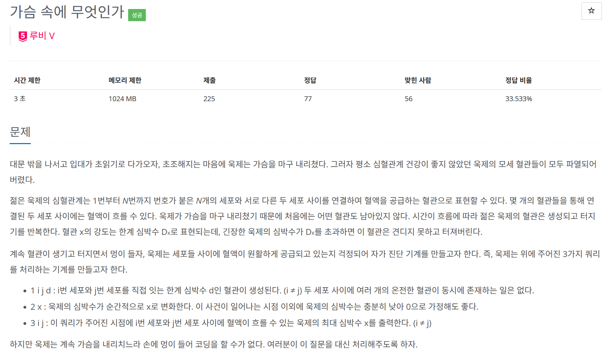

[상위 페이지 · 루비](/study/algorithms/data-structure/ruby/)



## 문제 태그

- 그래프 이론
- 트리
- 최소 스패닝 트리
- 링크 컷 트리

## 아이디어

- 1번 쿼리
    - 새로운 혈관을 추가하는 쿼리이다만 단순히 추가하는것이 아닌 최대 신장 트리를 유지해야한다
    - [10724. 판게아 2](/study/algorithms/data-structure/ruby/boj-10724/) 와 같이 최대 신장 트리를 유지하면 된다.
- 2번 쿼리
    - 모든 엣지를 맵에 저장하고 존재하는 모든 혈관을 순회하여 x보다 낮은 값의 엣지를 모든 Cut 한다
- 3번 쿼리
    - i→j 경로를 쿼리하여 그 경로의 maxvalue를 출력한다.

## 정답

```cpp
#include <bits/stdc++.h>
using namespace std;

typedef long long ll;
const ll INF = 1LL << 60;

struct hash_pair {
    template <class T1, class T2>
    size_t operator()(const pair<T1, T2>& p) const {
        size_t hash1 = hash<T1>{}(p.first);
        size_t hash2 = hash<T2>{}(p.second);
        return hash1 ^ (hash2 + 0x9e3779b9 + (hash1 << 6) + (hash1 >> 2));
    }
};

struct Node {
    Node *left, *right, *parent, *path_parent;
    bool rev;
    ll val, minvalue;
    pair<int, int> original_nodes;
    Node(ll v = INF, pair<int, int> orig = {0, 0}) : left(nullptr), right(nullptr), parent(nullptr), path_parent(nullptr),
                                                     rev(false), val(v), minvalue(v), original_nodes(orig) {}
};

bool is_root(Node *node) {
    return !node->parent || (node->parent->left != node && node->parent->right != node);
}

void update(Node *node) {
    node->minvalue = node->val;
    if (node->left) node->minvalue = min(node->minvalue, node->left->minvalue);
    if (node->right) node->minvalue = min(node->minvalue, node->right->minvalue);
}

void push(Node *node) {
    if (node->rev) {
        swap(node->left, node->right);
        if (node->left) node->left->rev ^= true;
        if (node->right) node->right->rev ^= true;
        node->rev = false;
    }
}

void rotate(Node *node) {
    Node *p = node->parent;
    Node *g = p->parent;
    if (!is_root(p)) {
        if (g->left == p) g->left = node;
        else g->right = node;
    }
    node->parent = g;
    if (p->left == node) {
        p->left = node->right;
        if (node->right) node->right->parent = p;
        node->right = p;
    } else {
        p->right = node->left;
        if (node->left) node->left->parent = p;
        node->left = p;
    }
    p->parent = node;
    node->path_parent = p->path_parent;
    p->path_parent = nullptr;
    update(p);
    update(node);
}

void splay(Node *node) {
    vector<Node*> stack;
    Node *cur = node;
    while (true) {
        stack.push_back(cur);
        if (is_root(cur)) break;
        cur = cur->parent;
    }
    for (auto it = stack.rbegin(); it != stack.rend(); ++it) {
        push(*it);
    }
    while (!is_root(node)) {
        Node *p = node->parent;
        Node *g = p->parent;
        if (!is_root(p)) {
            if ((p->left == node) == (g->left == p)) {
                rotate(p);
            } else {
                rotate(node);
            }
        }
        rotate(node);
    }
}

Node* access(Node *node) {
    Node *last = nullptr;
    Node *x = node;
    while (x) {
        splay(x);
        if (x->right) {
            x->right->path_parent = x;
            x->right->parent = nullptr;
        }
        x->right = last;
        if (last) last->parent = x;
        update(x);
        last = x;
        x = x->path_parent;
    }
    splay(node);
    return last;
}

void make_root(Node *node) {
    access(node);
    node->rev ^= true;
    push(node);
}

Node* find_root(Node *node) {
    access(node);
    Node *x = node;
    while (true) {
        push(x);
        if (x->left) x = x->left;
        else break;
    }
    splay(x);
    return x;
}

bool connected(Node *a, Node *b) {
    if (a == b) return true;
    access(a);
    access(b);
    return a->parent != nullptr;
}

void link(Node *a, Node *b) {
    make_root(a);
    a->path_parent = b;
}

void cut_edge(Node *node) {
    access(node);
    if (node->left) node->left->parent = nullptr;
    node->left = nullptr;
    update(node);
}

Node* lca(Node* u, Node* v) {
    access(u);
    return access(v);
}

ll query_path_capacity(Node *a, Node *b) {
    make_root(a);
    access(b);
    return b->minvalue;
}

Node *find_min_node_on_path(Node *u, Node *v) {
    make_root(u);
    access(v);
    Node *cur = v;
    ll min_val = v->minvalue;
    while (true) {
        push(cur);
        if (cur->left && cur->left->minvalue == min_val) {
            cur = cur->left;
        } else if (cur->val == min_val) {
            splay(cur);
            return cur;
        } else {
            cur = cur->right;
        }
    }
}

int main() {
    ios_base::sync_with_stdio(false);
    cin.tie(NULL);
    int N, Q;
    cin >> N >> Q;
    vector<Node*> vertices(N + 1);
    for (int i = 1; i <= N; ++i) {
        vertices[i] = new Node();
    }
    unordered_map<pair<int, int>, Node*, hash_pair> edge_map;

    for (int q_idx = 0; q_idx < Q; ++q_idx) {
        int type;
        cin >> type;
        if (type == 1) {
            int i, j, d;
            cin >> i >> j >> d;
            if (i > j) swap(i, j);
            if (edge_map.count({i, j})) continue;

            if (find_root(vertices[i]) == find_root(vertices[j])) {
                ll path_min = query_path_capacity(vertices[i], vertices[j]);
                if (d > path_min) {
                    Node* weakest_edge = find_min_node_on_path(vertices[i], vertices[j]);
                    cut_edge(weakest_edge);
                    edge_map.erase(weakest_edge->original_nodes);
                } else {
                    continue;
                }
            }
            Node *edge = new Node(d, {i, j});
            edge_map[{i, j}] = edge;
            link(vertices[i], edge);
            link(edge, vertices[j]);
        } else if (type == 2) {
            int x;
            cin >> x;
            vector<pair<int, int>> to_remove;
            for(auto const& [key, val_node] : edge_map){
                if(val_node->val < x){
                    to_remove.push_back(key);
                }
            }
            for(auto const& key : to_remove){
                cut_edge(edge_map[key]);
                edge_map.erase(key);
            }
        } else { // type 3
            int i, j;
            cin >> i >> j;
            if (find_root(vertices[i]) != find_root(vertices[j])) {
                cout << 0 << "\n";
            } else {
                cout << query_path_capacity(vertices[i], vertices[j]) << "\n";
            }
        }
    }
    return 0;
}
```
