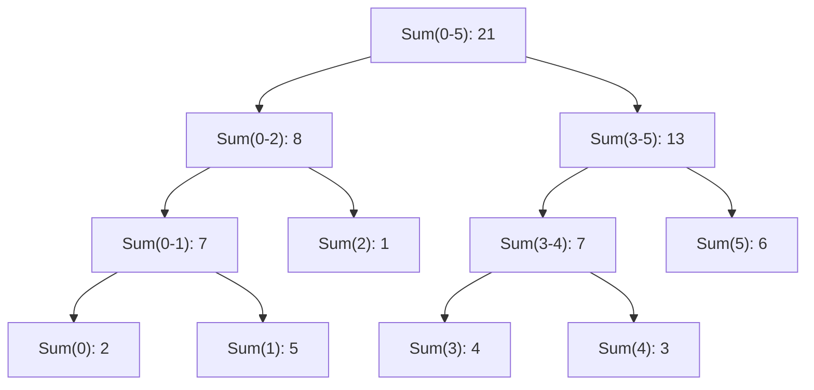
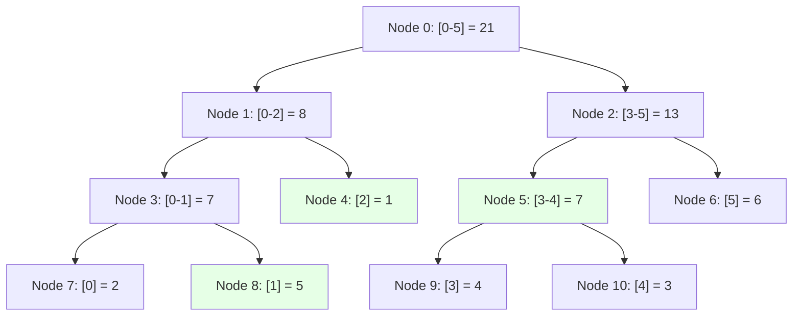
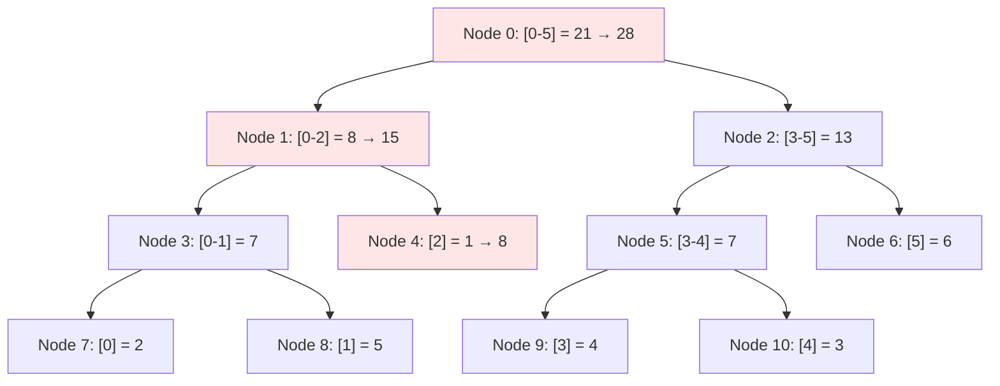

[상위 페이지 · Data Structure](/study/algorithms/data-structure/)

## 구간 합(Range Sum)이란?

구간 합은 배열의 특정 구간에 있는 원소들의 합을 구하는 연산이다. 예를 들어, 배열 [2, 5, 1, 4, 3, 6]에서 인덱스 1부터 4까지의 구간 합은 5 + 1 + 4 + 3 = 13이다.

## 예시

다음 배열을 예시로 구간합을 구해보겠다:

| 인덱스 | 0 | 1 | 2 | 3 | 4 | 5 |
| --- | --- | --- | --- | --- | --- | --- |
| 값 | 2 | 5 | 1 | 4 | 3 | 6 |

여러 구간 합의 예시:

- [0, 2] 구간 합: 2 + 5 + 1 = 8
- [1, 4] 구간 합: 5 + 1 + 4 + 3 = 13
- [3, 5] 구간 합: 4 + 3 + 6 = 13

## 구간 합을 구하는 방법

### 1. 단순 반복문 방식

```python
def range_sum(arr, start, end):
    sum = 0
    for i in range(start, end + 1):
        sum += arr[i]
    return sum
```

시간 복잡도: O(n), 여기서 n은 구간의 길이

### 2. 누적 합 배열 방식

단순 반복문의 방식을 이용하면 구간 합을 많이 구해야할때 시간복잡도가 O(nm), (여기서 m은 쿼리 개수)만큼 증가한다

이를 방지하기 위해 미리 누적 합 배열을 만들어 해결한다

### 예시

다음과 같은 배열이 있다

| 인덱스 | 0 | 1 | 2 | 3 | 4 | 5 |
| --- | --- | --- | --- | --- | --- | --- |
| 값 | 2 | 5 | 1 | 4 | 3 | 6 |

이에 대한 모든 누적 합을 구해준다

| 인덱스 | 0 (0~0) | 1 (0~1) | 2 (0~2) | 3 (0~3) | 4 (0~4) | 5 (0~5) |
| --- | --- | --- | --- | --- | --- | --- |
| 값 | 2 | 7 | 8 | 12 | 15 | 21 |

이 누적 합 배열을 이용해 구간 합을 구하면 전처리 과정 O(N)으로 쿼리의 개수와는 상관이 없이 구해진다

만약 구간 3~5의 구간합을 구해야한다면 Psum[5] - Psum[2]로 구하는것이다

```python
# 누적 합 배열 생성
prefix_sum = [0] * (n + 1)
for i in range(n):
    prefix_sum[i + 1] = prefix_sum[i] + arr[i]

# 구간 합 구하기
def range_sum(start, end):
    return prefix_sum[end + 1] - prefix_sum[start]
```

시간 복잡도: O(1) 쿼리, O(n) 전처리

## 세그먼트 트리

세그먼트 트리는 구간 합이나 구간 최소값, 최대값 등을 효율적으로 구할 수 있는 자료구조이다. 특히 배열의 특정 구간에 대한 연산을 빠르게 처리할 수 있으며, 값의 업데이트도 효율적으로 수행할 수 있다.

### 세그먼트 트리의 특징

- 이진 트리 구조를 사용하여 구간을 분할하여 저장
- 구간 쿼리를 O(log N) 시간에 처리 가능
- 특정 값 업데이트도 O(log N) 시간에 가능
- 공간 복잡도는 O(N)이지만, 실제로는 4N 정도의 크기가 필요

### 세그먼트 트리의 구조

예시 배열 [2, 5, 1, 4, 3, 6]에 대한 세그먼트 트리:



## 세그먼트 트리 구현

**전체 코드:**

```python
class SegmentTree:
    def __init__(self, arr):
        self.n = len(arr)
        self.tree = [0] * (4 * self.n)  # 트리 크기는 배열 크기의 4배
        self.build(arr, 1, 0, self.n - 1)
    
    def build(self, arr, node, start, end):
        if start == end:
            self.tree[node] = arr[start]
            return
        
        mid = (start + end) // 2
        self.build(arr, 2*node, start, mid)
        self.build(arr, 2*node + 1, mid + 1, end)
        self.tree[node] = self.tree[2*node] + self.tree[2*node + 1]
    
    def query(self, node, start, end, left, right):
        if left > end or right < start:
            return 0
        if left <= start and end <= right:
            return self.tree[node]
        
        mid = (start + end) // 2
        return (self.query(2*node, start, mid, left, right) + 
                self.query(2*node + 1, mid + 1, end, left, right))
    
    def update(self, node, start, end, idx, val):
        if start == end:
            self.tree[node] = val
            return
        
        mid = (start + end) // 2
        if idx <= mid:
            self.update(2*node, start, mid, idx, val)
        else:
            self.update(2*node + 1, mid + 1, end, idx, val)
        self.tree[node] = self.tree[2*node] + self.tree[2*node + 1]
```

## 세그먼트 트리 구현 상세 설명

세그먼트 트리의 구현은 크게 세 가지 주요 함수로 이루어진다:

### 1. 생성자 (**init**)

세그먼트 트리를 초기화하는 함수이다.

```python
def __init__(self, arr):
    self.n = len(arr)  # 원본 배열의 길이
    self.tree = [0] * (4 * self.n)  # 세그먼트 트리 배열 (4*N 크기)
    self.build(arr, 1, 0, self.n - 1)  # 트리 생성
```

세그먼트 트리의 배열 크기가 원본 배열의 4배가 되는 이유는 다음과 같다:

**1. 필요한 공간 계산**

예를 들어, 길이가 8인 배열의 경우:

- 리프 노드의 개수: 8개 (원본 배열의 각 요소)
- 리프 노드의 부모 노드: 4개
- 그 위 레벨의 노드: 2개
- 루트 노드: 1개

총 필요한 노드의 수: 8 + 4 + 2 + 1 = 15개

**2. 4배 공간이 필요한 이유**

1. 원본 배열의 크기를 N이라고 할 때, 세그먼트 트리의 높이는 ⌈log₂N⌉이다.
2. 완전 이진 트리에서 필요한 총 노드의 수는 $$2^{h+1} - 1$$이다. (h는 트리의 높이)
3. 이를 계산해보면 대략 4N에 가까운 크기가 필요하다.
4. 실제 구현에서는 여유 공간을 두기 위해 4N을 사용한다.

따라서 원본 배열의 4배 크기로 트리 배열을 선언하면, 어떤 크기의 입력에 대해서도 안전하게 세그먼트 트리를 구성할 수 있다.

### 2. 트리 생성 (build)

재귀적으로 세그먼트 트리를 구축하는 함수이다.

```python
def build(self, arr, node, start, end):
    # 리프 노드인 경우
    if start == end:
        self.tree[node] = arr[start]
        return
    
    # 중간 지점을 계산하여 왼쪽, 오른쪽 서브트리로 분할
    mid = (start + end) // 2
    
    # 왼쪽 서브트리 생성 (2*node)
    self.build(arr, 2*node, start, mid)
    # 오른쪽 서브트리 생성 (2*node + 1)
    self.build(arr, 2*node + 1, mid + 1, end)
    
    # 현재 노드의 값은 양쪽 자식 노드의 합
    self.tree[node] = self.tree[2*node] + self.tree[2*node + 1]
```

### 3. 구간 합 조회 (query)

특정 구간의 합을 조회하는 함수이다.

```python
def query(self, node, start, end, left, right):
    # 범위를 벗어난 경우
    if left > end or right < start:
        return 0
    
    # 현재 노드의 범위가 구하고자 하는 범위에 완전히 포함되는 경우
    if left <= start and end <= right:
        return self.tree[node]
    
    # 부분적으로 겹치는 경우, 양쪽 서브트리 탐색
    mid = (start + end) // 2
    left_sum = self.query(2*node, start, mid, left, right)
    right_sum = self.query(2*node + 1, mid + 1, end, left, right)
    
    return left_sum + right_sum
```

### 4. 값 업데이트 (update)

특정 인덱스의 값을 업데이트하는 함수이다.

```python
def update(self, node, start, end, idx, val):
    # 리프 노드에 도달한 경우
    if start == end:
        self.tree[node] = val
        return
    
    mid = (start + end) // 2
    
    # 업데이트할 인덱스가 왼쪽 서브트리에 있는 경우
    if idx <= mid:
        self.update(2*node, start, mid, idx, val)
    # 업데이트할 인덱스가 오른쪽 서브트리에 있는 경우
    else:
        self.update(2*node + 1, mid + 1, end, idx, val)
    
    # 현재 노드의 값 업데이트
    self.tree[node] = self.tree[2*node] + self.tree[2*node + 1]
```

### 사용 예시

```python
# 세그먼트 트리 생성
arr = [2, 5, 1, 4, 3, 6]
seg_tree = SegmentTree(arr)

# 구간 합 조회 (인덱스 1부터 4까지)
result = seg_tree.query(1, 0, len(arr)-1, 1, 4)  # 결과: 13

# 값 업데이트 (인덱스 2의 값을 8로 변경)
seg_tree.update(1, 0, len(arr)-1, 2, 8)
```

**start node가 0이 아닌 1인 이유**

세그먼트 트리는 완전 이진 트리 형태를 가지며, 각 노드는 두 개의 자식 노드를 가질 수 있다.

- 부모 노드의 인덱스가 i일 때:
- 왼쪽 자식 노드의 인덱스: 2i
- 오른쪽 자식 노드의 인덱스: 2i + 1
- 노드가 1인 자식 노드는 2,3 | 노드가 2인 자식 노드는 4,5|노드가 3인 자식 노드는 6,7 …

이러한 특성을 사용하기 위함

### 시간 복잡도

- 트리 생성: O(N)
- 구간 합 쿼리: O(log N)
- 값 업데이트: O(log N)

### 세그먼트 트리의 장단점

장점:

- 구간 쿼리와 업데이트를 모두 효율적으로 처리
- 다양한 연산(최소값, 최대값, 합 등)에 적용 가능
- 동적으로 값이 변하는 상황에서도 효율적

단점:

- 구현이 상대적으로 복잡
- 메모리 사용량이 큼 (원본 배열의 4배)
- 단순한 구간 합만 필요한 경우 누적 합 배열이 더 효율적

## 세그먼트 트리 쿼리와 업데이트 예시

### 1. 구간 합 쿼리 (Query) 과정

배열 [2, 5, 1, 4, 3, 6]에서 구간 [1, 4]의 합을 구하는 과정:



녹색으로 표시된 노드들이 구간 [1, 4]의 합을 계산하기 위해 방문하는 노드이다.

결과: 5 + 1 + 7 = 13

### 2. 값 업데이트 (Update) 과정

인덱스 2의 값을 1에서 8로 변경하는 과정:



빨간색으로 표시된 노드들이 값 업데이트 시 변경되는 노드들입니다. 리프 노드에서 루트까지 올라가며 모든 부모 노드들의 값이 갱신된다.

### 시간 복잡도 분석

- 쿼리 연산: 트리의 높이에 비례하여 O(log N)개의 노드만 방문
- 업데이트 연산: 리프에서 루트까지의 경로만 갱신하므로 O(log N)

이러한 효율적인 연산 때문에 세그먼트 트리는 동적인 구간 쿼리에서 매우 유용하다.

## 세그먼트 트리 시뮬레이션

[크기 0.5x로 하는것을 추천. 너무 작다면 원본가서 실행해보길 바람](https://codepen.io/Creeper0809/pen/myeMpeX)

크기 0.5x로 하는것을 추천. 너무 작다면 원본가서 실행해보길 바람

## 세그먼트 트리의 응용

세그먼트 트리는 꼭 구간합이 아닌 구간의 최소값, 최대값, 구간 곱등등에 사용할 수 있다고 했다

```python
class SegmentTree:
    def __init__(self, arr):
        self.n = len(arr)
        self.tree = [0] * (4 * self.n)  # 트리 크기는 배열 크기의 4배
        self.build(arr, 1, 0, self.n - 1)
    
    def build(self, arr, node, start, end):
        if start == end:
            self.tree[node] = arr[start]
            return
        
        mid = (start + end) // 2
        self.build(arr, 2*node, start, mid)
        self.build(arr, 2*node + 1, mid + 1, end)
        self.tree[node] = min(self.tree[2*node], self.tree[2*node + 1])
    
    def query(self, node, start, end, left, right):
        if left > end or right < start:
            return -1
        if left <= start and end <= right:
            return self.tree[node]
        
        mid = (start + end) // 2
        
        lmin = self.query(2*node, start, mid, left, right)
        rmin = self.query(2*node + 1, mid + 1, end, left, right)
        
        if lmin == -1:
	        return rmin
	      elif rmin == -1:
		      return lmin
		    else:
	        return min(lmin,rmin)
    
    def update(self, node, start, end, idx, val):
        if start == end:
            self.tree[node] = val
            return
        
        mid = (start + end) // 2
        if idx <= mid:
            self.update(2*node, start, mid, idx, val)
        else:
            self.update(2*node + 1, mid + 1, end, idx, val)
        self.tree[node] = min(self.tree[2*node], self.tree[2*node + 1])
```

이는 간단하게 모든 + 부분을 자신이 원하는대로 바꿔주면 된다.

## 세그먼트 트리 고급 기술

- [**Segement Tree with Lazy Propagation**](/study/algorithms/data-structure/segment-tree/segement-tree-with-lazy-propagation/)

- [Fenwick Tree](/study/algorithms/data-structure/segment-tree/fenwick-tree/)

- [PST(**Persistent Segment Tree)**](/study/algorithms/data-structure/segment-tree/pst-persistent-segment-tree/)

- [Merge Sort Tree](/study/algorithms/data-structure/segment-tree/merge-sort-tree/)

- [Segment Tree Beats](/study/algorithms/data-structure/segment-tree/segment-tree-beats/)

- [2D Segment Tree](/study/algorithms/data-structure/segment-tree/2d-segment-tree/)

- [Dynamic Segement Tree](/study/algorithms/data-structure/segment-tree/dynamic-segement-tree/)

- [**Li Chao Tree**](/study/algorithms/data-structure/segment-tree/li-chao-tree/)

- [**Kinetic Segment Tree**](/study/algorithms/data-structure/segment-tree/kinetic-segment-tree/)
