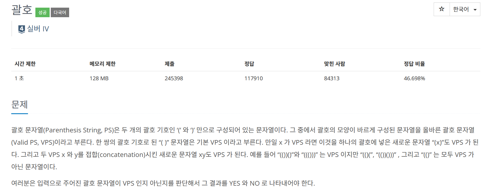

[상위 페이지 · Data Structure](/study/algorithms/data-structure/)



## 문제 태그

- 자료구조
- 스택

## 아이디어

1. ( << 면 그냥 스택에 집어넣기
2. ) << 스택에 있다면 빼고 없다면 False 리턴하기
3. 문자열 끝까지 다 돌았는데 스택에 뭐가 남아있다면 False 깨끗하다면 True

## 정답

```python
T = int(input())
def is_perfect(words):
    stack = []
    for word in arr:
        if word == "(":
            stack.append(word)
        elif word == ")":
            if not stack:
                return False
            stack.pop()
    return not stack

for _ in range(T):
    arr = input()
    if is_perfect(arr):
        print("YES")
    else:
        print("NO")
```
