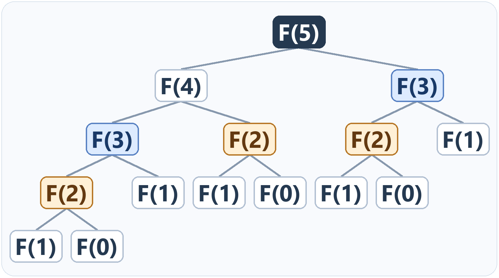
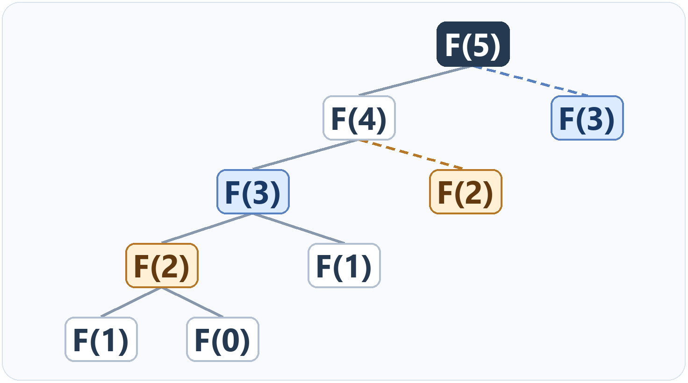

[상위 페이지 · 알고리즘](/study/algorithms/)

## 동적 계획법이란?

동적 계획법(DP)은 문제를 작은 부분 문제로 나누고, 계산한 값을 저장해 다시 사용하는 방법이다. 피보나치 수열에서는 $$F(k)$$가 하나의 부분 문제이고, 어떤 항을 구하는지 나타내는 $$k$$가 상태다.

예를 들어, 피보나치 수열을 계산하는 문제에서 동적 계획법을 사용할 수 있다. 피보나치 수열은 다음과 같이 정의된다.

$$
F(n) = \begin{cases}
0 &\text{if } n = 0 \\
1 &\text{if } n = 1 \\
F(n-1) + F(n-2) &\text{if } n > 1
\end{cases}
$$

이를 재귀적으로 구현하면 다음과 같이 나온다.

```python
def fibonacci(n):
    if n == 0:
        return 0
    elif n == 1:
        return 1
    else:
        return fibonacci(n-1) + fibonacci(n-2)
```

### 피보나치 재귀 호출 트리

`fibonacci(5)`를 호출하면 아래 트리가 생긴다. 같은 숫자가 여러 곳에 나오면 그 항을 다시 계산한 것이다.

{: width="736" height="410"}

왼쪽의 `F(4)`를 구하는 도중에 `F(3)`을 이미 계산한다. 그런데 오른쪽에서 `F(3)`을 다시 호출하면 `F(2)`와 `F(1)`까지 다시 계산한다. 트리 전체에서 `F(3)`은 두 번, `F(2)`는 세 번 나온다. 이렇게 서로 다른 가지에서 같은 값을 요구하는 것을 **부분 문제가 겹친다**고 한다.

### 메모이제이션으로 중복 계산 줄이기

`F(3)`은 어느 가지에서 호출하든 값이 `2`다. 처음 계산할 때 `memo[3] = 2`를 저장해 두면, 다음 호출은 `2`를 바로 반환하고 그 아래로 내려가지 않아도 된다. 이렇게 계산 결과를 저장해 뒀다가 다시 쓰는 방법이 **메모이제이션**이다. `F(n)`부터 시작해 필요한 작은 항을 재귀로 구하므로 탑다운 방식이라고도 한다.

```python
def fibonacci_memo(n):
    memo = {0: 0, 1: 1}

    def solve(k):
        if k not in memo:
            memo[k] = solve(k - 1) + solve(k - 2)
        return memo[k]

    return solve(n)
```

위 코드로 `F(5)`를 구하면 호출 트리가 이렇게 달라진다.

{: width="736" height="410"}

점선으로 이어진 `F(2)`와 `F(3)`은 왼쪽 가지에서 이미 계산한 값이다. 두 번째 호출에서는 저장된 값을 바로 반환하므로 그 아래 가지가 생기지 않는다. `F(0)`과 `F(1)`도 처음부터 넣어 둔 기본값을 바로 반환한다.

`F(5)`를 구할 때 전체 호출은 단순 재귀에서 15번, 메모이제이션을 적용하면 9번이다. 이때 `F(2)`부터 `F(5)`까지 각 항의 덧셈은 한 번씩만 한다. 메모이제이션은 `0`부터 `n`까지의 상태를 한 번씩 계산하고, 각 계산에서 두 항만 조회하므로 시간 복잡도가 $$O(n)$$이다.

### 바텀업으로 작은 항부터 채우기

이전 두 항만 있으면 다음 항을 구할 수 있으니, `F(0)`과 `F(1)`에서 출발해 배열을 앞에서부터 채워도 된다. 작은 부분 문제부터 순서대로 푸는 바텀업 방식이다.

```python
def fibonacci_bottom_up(n):
    if n == 0:
        return 0
    elif n == 1:
        return 1
    else:
        fib = [0, 1]
        for i in range(2, n+1):
            fib.append(fib[i-1] + fib[i-2])
        return fib[n]
```

배열의 각 칸을 한 번씩 채우므로 이 방식도 시간 복잡도가 $$O(n)$$이다. 탑다운과 바텀업은 같은 점화식을 사용하고, 값을 구하는 순서가 다르다.

### 집합으로 채우는 DP 예시 · N으로 표현

피보나치의 `dp[k]`에는 `k`번째 항 하나가 들어간다. **N으로 표현**에서는 숫자 `N`을 `k`번 썼을 때 여러 값을 만들 수 있으므로, `dp[k]`를 **`N`을 정확히 `k`번 사용해서 만들 수 있는 정수의 집합**으로 둔다. 목표값이 처음 들어 있는 집합의 번호가 필요한 최소 사용 횟수다. [프로그래머스 N으로 표현](https://school.programmers.co.kr/learn/courses/30/lessons/42895)

**작은 집합부터 채우기**

`N = 5`라면 `dp[1]`에는 `5`만 들어간다. 두 번 쓸 때는 `5`와 `5`를 사칙연산으로 조합하고, 두 자리를 붙여 만든 `55`도 넣는다. 그래서 `dp[2]`는 `{0, 1, 10, 25, 55}`가 된다.

`dp[k]`를 채울 때는 식의 마지막 연산을 기준으로 왼쪽에서 `i`번, 오른쪽에서 `k - i`번 쓴 경우를 생각한다. `dp[i]`에서 값 `a`를, `dp[k - i]`에서 값 `b`를 하나씩 골라 `a + b`, `a - b`, `a * b`, `a / b`의 결과를 넣는다. 예를 들어 `dp[4]`는 `1 + 3`, `2 + 2`, `3 + 1`로 나눠 채운다. 뺄셈과 나눗셈은 순서에 따라 값이 달라지므로 좌우 순서를 모두 확인한다. 숫자만 이어 붙인 `5555`도 `dp[4]`에 따로 넣는다.

| 5를 쓴 횟수 | 만들 수 있는 값의 개수 | 값이 만들어지는 예 |
| --- | ---: | --- |
| 1 | 1 | `5` |
| 2 | 5 | `55` 또는 `5 + 5 = 10` |
| 3 | 18 | `dp[2]`의 `55`와 `dp[1]`의 `5`를 더해 `60` |
| 4 | 65 | `dp[3]`의 `60`을 `dp[1]`의 `5`로 나눠 `12` |

`12`는 `dp[4]`에서 처음 나온다. 식으로 쓰면 `(55 + 5) / 5`다. `55`에 5가 두 번, 더하는 수와 나누는 수에 한 번씩 들어가므로 답은 `4`다.

**왜 식 대신 값만 저장할까**

`5 * (5 - 5)`와 `(5 - 5) * 5`는 모두 5를 세 번 써서 `0`을 만든다. 나중에 어떤 값과 조합하더라도 두 식은 같은 `0`으로 계산되므로, `dp[3]`에 `0`을 한 번만 저장하면 된다. 횟수가 다른 집합은 따로 관리한다. 예를 들어 `dp[1]`의 `{5}`에는 `5`가 있고 `dp[2]`에는 `5`가 없다. 표에서 개수가 늘어난 건 각 횟수로 새로 계산한 결과다.

```python
def solution(N, number):
    dp = [set() for _ in range(9)]

    for k in range(1, 9):
        values = dp[k]
        values.add(int(str(N) * k))

        for i in range(1, k):
            for a in dp[i]:
                for b in dp[k - i]:
                    values.update((a + b, a - b, a * b))
                    if b != 0:
                        quotient = abs(a) // abs(b)
                        values.add(-quotient if (a < 0) != (b < 0) else quotient)

        if number in values:
            return k

    return -1
```

나누는 수가 `0`이면 건너뛴다. 나눗셈의 결과는 소수점 아래를 버린다. 음수도 0 쪽으로 자르기 위해 절댓값을 먼저 나눈 뒤 부호를 붙인다. `dp[1]`부터 차례로 만들기 때문에 `number`를 처음 찾았을 때 바로 사용 횟수를 반환할 수 있다.

### 예시1 : 계단 오르기

예시 1에서 다루는 계단 오르기 문제는 동적 계획법(Dynamic Programming)의 대표적인 예시 중 하나이다. 계단 오르기 문제는 n개의 계단을 오를 때, 1개 또는 2개의 계단씩 오를 수 있을 때, 계단을 오르는 방법의 수를 구하는 문제이다.

예를 들어, 3개의 계단을 오르는 방법은 다음과 같이 3가지가 있다.

- 1계단, 1계단, 1계단
- 1계단, 2계단
- 2계단, 1계단

이 문제를 동적 계획법으로 해결하면, n-1번째 계단에서 1개의 계단을 오르거나, n-2번째 계단에서 2개의 계단을 오르는 방법을 더한 값이 n번째 계단을 오르는 방법의 수가 된다.

아래 코드는 위와 같은 방법으로 계단 오르기 문제를 해결하는 동적 계획법 코드이다.

```python
def climbStairs(n: int) -> int:
    if n == 1:
        return 1
    dp = [0] * (n + 1)
    dp[1], dp[2] = 1, 2
    for i in range(3, n + 1):
        dp[i] = dp[i - 1] + dp[i - 2]
    return dp[n]
```

위 코드에서,

- 입력값 n이 1일 경우 1을 반환한다.
- dp라는 길이가 n+1인 배열을 만든다. 이 배열은 계단을 오르는 방법의 수를 저장한다다.
- dp[1]은 계단이 1개일 경우 1이므로 1로 초기화한다다.
- dp[2]는 계단이 2개일 경우 2가지 방법(1계단, 1계단 또는 2계단)이 있으므로 2로 초기화한다.
- i가 3부터 n까지 반복하면서, dp[i]를 dp[i-1]과 dp[i-2]를 더한 값으로 갱신한다. 이때 dp[i-1]은 n-1번째 계단을 오르는 방법의 수를, dp[i-2]는 n-2번째 계단을 오르는 방법의 수를 나타낸다.
- 마지막으로, dp[n]을 반환한다.

이 코드의 시간 복잡도는 $$O(n)$$ 이다.

### 예시 2: 최대 부분 배열

최대 부분 배열 문제는 주어진 배열에서 가장 큰 합을 가지는 연속 부분 배열을 찾는 문제이다. 예를 들어, 배열 [-2, 1, -3, 4, -1, 2, 1, -5, 4]에서 최대 부분 배열은 [4, -1, 2, 1]이다.

이 문제를 해결하기 위해 다음과 같은 동적 계획법 알고리즘을 사용할 수 있다.

```python
def maxSubArray(nums: List[int]) -> int:
    dp = [0] * len(nums)
    dp[0] = nums[0]
    for i in range(1, len(nums)):
        dp[i] = max(nums[i], nums[i] + dp[i-1])
    return max(dp)
```

1. 배열 dp를 생성한다. dp[i]는 배열 nums의 i번째 수까지 포함한 최대 부분 배열의 합이다.
2. dp[0]를 nums[0]으로 초기화한다.
3. 반복문을 이용해 dp[i]를 계산한다. dp[i]는 nums[i]와 dp[i-1] + nums[i] 중 큰 값을 선택한다. 이때, dp[i-1]은 이전까지의 최대 부분 배열의 합이다.
4. dp 배열에서 가장 큰 값을 반환한다.

위 코드에서 dp[i]는 반드시 nums[i]를 포함하는 최대 부분 배열의 합이 아니다. dp[i]는 nums[i]를 포함할 수도 있고, 포함하지 않을 수도 있다. 이는 dp[i-1] + nums[i]와 nums[i] 중 큰 값을 선택하기 때문이다.

예시 코드에서 dp 배열의 크기는 nums 배열과 동일하다. 이는 dp[i]가 nums[i]를 포함하는 최대 부분 배열의 합임을 나타내게 된다.

시간 복잡도는 $$O(n)$$ 이다.

### 예시 3: 배낭 문제

예시 3에서 다루는 배낭 문제는 동적 계획법(Dynamic Programming)의 대표적인 예시 중 하나이다. 배낭 문제는 정해진 용량을 가진 배낭에 물건을 넣을 때, 가치의 합이 최대가 되도록 물건을 선택하는 문제이다. 예를 들어, 배낭의 용량이 50이고 물건의 가치와 무게가 다음과 같을 때,

| 물건 | 가치 | 무게 |
| --- | --- | --- |
| 1 | 60 | 10 |
| 2 | 100 | 20 |
| 3 | 120 | 30 |

최대 가치는 220이다.

이 문제를 해결하기 위해 다음과 같은 동적 계획법 알고리즘을 사용할 수 있다.

```python
def knapsack(W: int, wt: List[int], val: List[int], n: int) -> int:
    dp = [[0 for x in range(W + 1)] for x in range(n + 1)]

    for i in range(n + 1):
        for j in range(W + 1):
            if i == 0 or j == 0:
                dp[i][j] = 0
            elif wt[i-1] <= j:
                dp[i][j] = max(val[i-1] + dp[i-1][j-wt[i-1]],  dp[i-1][j])
            else:
                dp[i][j] = dp[i-1][j]
    return dp[n][W]
```

위 코드에서,

- W는 배낭의 용량, wt는 물건의 무게, val은 물건의 가치, n은 물건의 개수이다.
- dp라는 n+1행 W+1열의 2차원 배열을 만든다. 이 배열은 물건을 선택할 때마다 가치의 합을 저장한다.
- dp[0][j]는 배낭의 용량이 0일 때 가치의 합이므로 0으로 초기화한다.
- dp[i][0]는 물건을 선택하지 않을 때 가치의 합이므로 0으로 초기화한다.
- wt[i-1] <= j일 때, 즉 배낭의 용량이 물건의 무게보다 크거나 같을 때, dp[i][j]는 다음과 같이 갱신된다.
    
    dp[i][j] = max(val[i-1] + dp[i-1][j-wt[i-1]],  dp[i-1][j])
    
    - val[i-1] + dp[i-1][j-wt[i-1]]는 물건을 선택한 경우, 즉 물건의 가치와 배낭의 용량에서 물건의 무게를 뺀 나머지 용량을 가지고 이전에 선택된 물건들의 가치의 합을 더한 값이다.
    - dp[i-1][j]는 물건을 선택하지 않은 경우, 즉 이전에 선택된 물건들의 가치의 합이다.
    - 두 값을 비교하여 더 큰 값을 dp[i][j]에 저장한다.
- wt[i-1] > j일 때, 즉 배낭의 용량이 물건의 무게보다 작을 때, dp[i][j]는 다음과 같이 갱신된다.
    
    dp[i][j] = dp[i-1][j]
    
    - 이전에 선택된 물건들의 가치의 합을 그대로 dp[i][j]에 저장한다.
- 마지막으로, dp[n][W]를 반환한다.

이 코드의 시간 복잡도는 $$O(nW)$$ 이다.

## 팁

메모이제이션으로 사용되는 리스트의 인덱스는 각 상태일 가능성이 높다

예)

계단 오르기에서 dp[계단 칸수]

가방문제에서는 dp[물건의 개수][물건의 용량] = 가치

동적계획법은 매우 어려운 알고리즘임으로 많은 훈련이 필요하다.

## 최적화 기법

- [소수 모듈러 Subset Sum 최적화](/study/algorithms/dynamic-programming/sosu-modyulreo-subset-sum-coejeoghwa/)

## 문제 해결

<details id="ruby" markdown="1">
<summary>루비</summary>

- [18792. N의 배수 (3)](/study/algorithms/dynamic-programming/ruby/boj-18792/)
- [25448. N의 배수 (4)](/study/algorithms/dynamic-programming/ruby/boj-25448/)

</details>

<details id="diamond" markdown="1">
<summary>다이아몬드</summary>

- [4008. 특공대](/study/algorithms/dynamic-programming/diamond/boj-4008/)
- [3319. 전령들](/study/algorithms/dynamic-programming/diamond/boj-3319/)
- [6171. 땅따먹기](/study/algorithms/dynamic-programming/diamond/boj-6171/)
- [14240. **부분 수열의 점수**](/study/algorithms/dynamic-programming/diamond/boj-14240/)

</details>

<details id="platinum" markdown="1">
<summary>플래티넘</summary>

- [25378. 조약돌](/study/algorithms/dynamic-programming/platinum/boj-25378/)
- [2256. 젓가락](/study/algorithms/dynamic-programming/platinum/boj-2256/)
- [14517. **팰린드롬 개수 구하기 (Large)**](/study/algorithms/dynamic-programming/platinum/boj-14517/)
- [2673. **교차하지 않는 원의 현들의 최대집합**](/study/algorithms/dynamic-programming/platinum/boj-2673/)
- [1126. 같은 탑](/study/algorithms/dynamic-programming/platinum/boj-1126/)
- [13263. 나무 자르기](/study/algorithms/dynamic-programming/platinum/boj-13263/)
- [24505. **blobhyperthink**](/study/algorithms/dynamic-programming/platinum/boj-24505/)
- [**1648. 격자판 채우기**](/study/algorithms/dynamic-programming/platinum/boj-1648/)
- [**18251. 내 생각에 A번인 단순 dfs 문제가 이 대회에서 E번이 되어버린 건에 관하여 (Easy)**](/study/algorithms/dynamic-programming/platinum/boj-18251/)
- [**2419. 사수아탕**](/study/algorithms/dynamic-programming/platinum/boj-2419/)

</details>

<details id="gold-level-3" markdown="1">
<summary>골드 / 레벨 3</summary>

- [7570번 줄 세우기](/study/algorithms/dynamic-programming/gold-level-3/boj-7570/)
- [P3.정수삼각형](/study/algorithms/dynamic-programming/gold-level-3/p3-jeongsusamgaghyeong/)
- [P3.등굣길](/study/algorithms/dynamic-programming/gold-level-3/p3-deunggyosgil/)
- [10942. 팰린드롬?](/study/algorithms/dynamic-programming/gold-level-3/boj-10942/)

</details>

- [17626. **Four Squares**](/study/algorithms/dynamic-programming/silver/boj-17626/)
