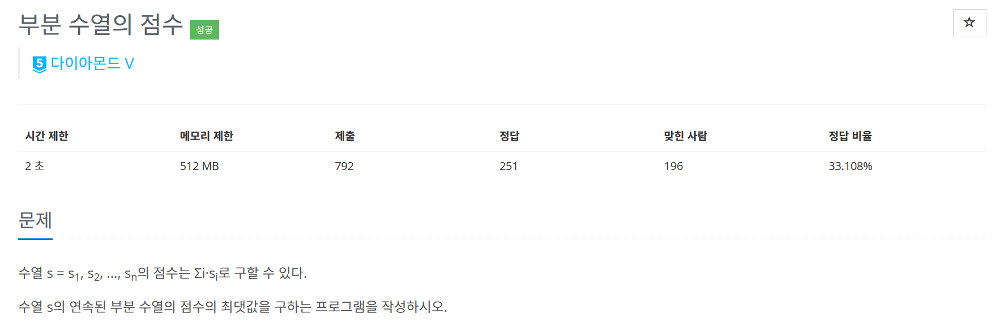

[상위 페이지 · 다이아](/study/algorithms/dynamic-programming/diamond/)



## 문제 태그

- CHT
- 누적합

## 아이디어

- B[i] = 1부터 i까지의 일반 누적합
- A[i] = 1부터 i까지의 가중치 누적
- 이 A와 B 배열을 이용하면 수식이 간단하게 나타내짐

$$
Score(i,j) = (A[k] -A[j-1]) - (j-1) *(B[k]  - B[j-1])
$$

- 여기서 j-1을 기울기 m, B[k]를 x, (A[j-1] - (j-1)B[j-1])를 b로 보면 기울기가 감소하는 직선의 방전식이 나옴 → CHT 적용

## 정답

```python
import sys
from collections import deque

input = sys.stdin.readline
class ConvexHullTrick:
    def __init__(self):
        self.hull = deque()

    def check(self, l1, l2, l3):
        return (l2[1] - l1[1]) * (l2[0] - l3[0]) <= (l3[1] - l2[1]) * (l1[0] - l2[0])

    def add(self, m, b):
        line = (m, b)
        while len(self.hull) >= 2 and self.check(self.hull[-2], self.hull[-1], line):
            self.hull.pop()
        self.hull.append(line)

    def get(self, line, x):
        return line[0] * x + line[1]

    def query(self, x):
        if not self.hull:
            return float('inf')
        l, r = 0, len(self.hull) - 1
        while l < r:
            mid = (l + r) // 2
            if self.get(self.hull[mid], x) > self.get(self.hull[mid + 1], x):
                l = mid + 1
            else:
                r = mid
        return self.get(self.hull[l], x)

def solve():
    n = int(input())
    s = list(map(int, input().split()))

    s_one_based = [0] + s

    A = [0] * (n + 1)
    B = [0] * (n + 1)
    for i in range(1, n + 1):
        B[i] = B[i - 1] + s_one_based[i]
        A[i] = A[i - 1] + i * s_one_based[i]

    cht = ConvexHullTrick()

    max_score = 0

    cht.add(0, 0)

    for k in range(1, n + 1):
        min_val = cht.query(B[k])
        current_max = A[k] - min_val
        max_score = max(max_score, current_max)

        m = k
        b = A[k] - k * B[k]
        cht.add(m, b)

    print(max_score)

if __name__ == "__main__":
    solve()
```
