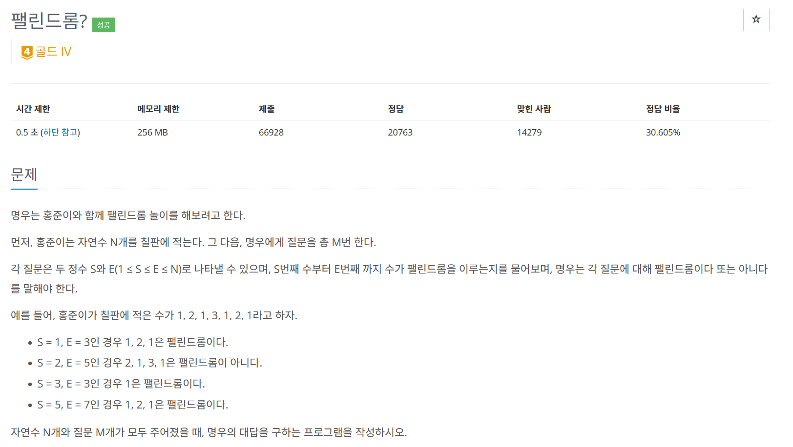

[상위 페이지 · 골드/레벨 3](/study/algorithms/dynamic-programming/gold-level-3/)



## 문제 태그

- DP

## 아이디어

1. 팰린드롬이려면  s[i] == s[j]일때 s[i+1]~s[j-1]도 팰린드롬이여야함 이를 dp로 작성하면 됨
2. 길이가 1이라면 무조건 팰린드롬임
3. 길이가 2까지는 dp를 사용할 필요 없이 바로바로 찾을 수 있음

## 정답

```python
import sys
input = sys.stdin.readline

N = int(input())
arr = list(map(int, input().split()))
dp = [[0] * N for _ in range(N)]

for i in range(N):
    dp[i][i] = 1

for i in range(N - 1):
    if arr[i] == arr[i + 1]:
        dp[i][i + 1] = 1

for length in range(3, N + 1):
    for start in range(N - length + 1):
        end = start + length - 1
        if arr[start] == arr[end] and dp[start + 1][end - 1]:
            dp[start][end] = 1

M = int(input())
for _ in range(M):
    s, e = map(int, input().split())
    print(dp[s - 1][e - 1])

```
