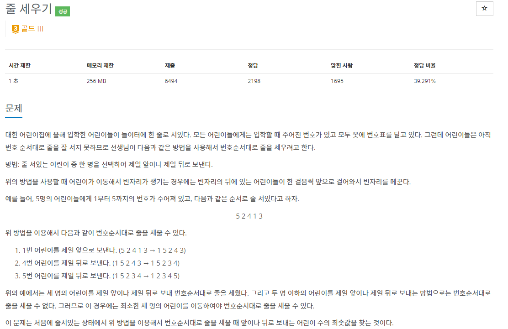

[상위 페이지 · Dynamic Programming](/study/algorithms/dynamic-programming/)

[https://www.acmicpc.net/problem/7570](https://www.acmicpc.net/problem/7570)



## 아이디어

문제는 1~N까지 주어진 숫자를 오름차순 정렬을 하는것이다. 여기서 조건은

1. 선택한 숫자를 맨 뒤나 맨 앞으로 보내야한다.
2. $$A_n = A_{n-1} +1$$ 이어야 한다.

한번 직접 해보자

집합 {5,2,4,1,3}이 있다면

1. 1번을 앞으로 → {1,5,2,4,3}
2. 4번을 맨 뒤로 → {1,5,2,3,4}
3. 5번을 맨 뒤로 → {1,2,3,4,5}

뭔가 보인다 한번만 더 해보자.

집합 {4,1,2,3,5}

1. 4번을 맨 뒤로 → {1,2,3,5,4}
2. 5번을 맨 뒤로 → {1,2,3,4,5}

공통점이 보인다. {5,2,4,1,3} , {4,1,2,3,5} 즉 연속된 수열이라면 그것을 제외하고 나머지만 움직이면 되는것이다.

이것을 최장 증가 부분 수열이라고 하며 최장 증가 부분 수열중 $$A_n = A_{n-1} +1$$ 이라는 조건이 걸린것이다.

[최장 증가 부분 수열(LIS)](/study/algorithms/math/coejang-jeungga-bubun-suyeol-lis/) ← LIS 설명

이제 해답을 알았으니 코드를 작성해야 한다.

## 정답

```python
N = int(input())
arr = list(map(int,input().split()))

dp = [0] * (N+1)

for i in arr:
    dp[i] = dp[i-1]+1
# {5,2,4,1,3} 예시
# dp[5] = dp[4] + 1 == [0,0,0,0,1]
# dp[2] = dp[1] + 1 == [0,1,0,0,1]
# dp[4] = dp[3] + 1 == [0,1,0,1,1]
# dp[1] = dp[0] + 1 == [1,1,0,1,1]
# dp[3] = dp[2] + 1 == [1,1,2,1,1]
# dp를 사용하여 자기 앞에 n-1의 수열 길이를 확인하여 + 1해준다. 
```
