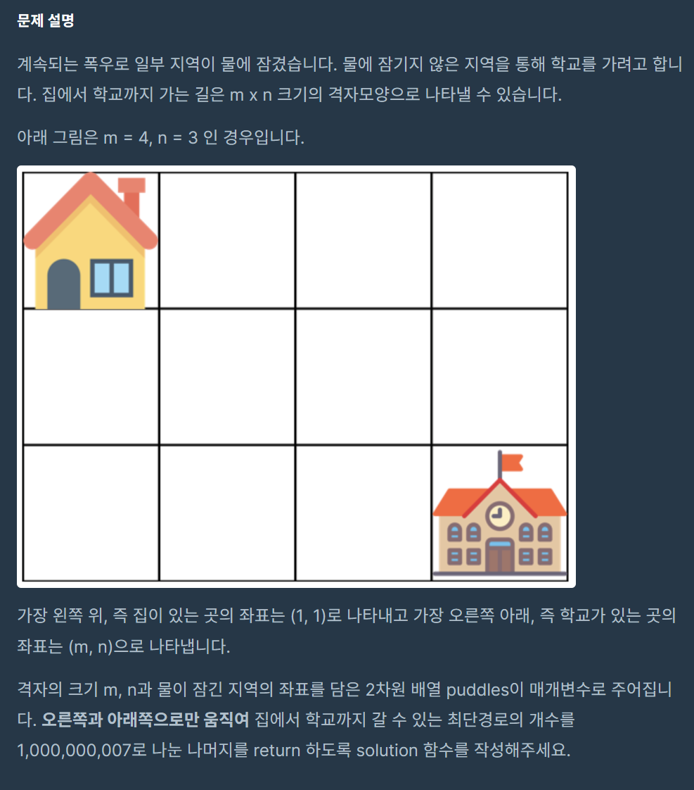

[상위 페이지 · 골드/레벨 3](/study/algorithms/dynamic-programming/gold-level-3/)



## 문제 태그

- DP

## 아이디어

1. 점화식은 dp[x][y] = dp[x-1][y] + dp[x][y-1]
2. puddles만 잘 피해서 계산해주면 된다
3. [모듈러 성질](/study/algorithms/math/modyulreo-yeonsan/)에 따라 ((a%mod) + (b%mod))%mod == (a+b) % mod 와 같다 고로 파이썬은 문제가 되지 않지만 다른 언어는 오버플로우가 날 수 있음으로 전자의 식을 이용하는것이 좋다

## 정답

### 탑다운

```python
def solution(m, n, puddles):
    mod = 1000000007
    dp = [[-1 for _ in range(m + 1)] for _ in range(n + 1)]
    dp[n][m] = 1
    def dfs(x,y):
        if dp[x][y] != -1:
            return dp[x][y]
        count = 0
        for dx,dy in [[0,1],[1,0]]:
            ddx = dx + x
            ddy = dy + y
            if ddx<=n and ddy<=m and [ddy,ddx] not in puddles:
                count += dfs(ddx,ddy)
        dp[x][y] = count
        return dp[x][y]
    dfs(1,1)
    return dp[1][1] % mod
```

### 바텀탑

```python
def solution(m, n, puddles):
    mod = 1000000007
    dp = [[0 for _ in range(m + 1)] for _ in range(n + 1)]
    dp[1][1] = 1
    for x,y in puddles:
        dp[y][x] = -1
    for i in range(1,n+1):
        for j in range(1,m+1):
            if (i == 1 and j == 1) or dp[i][j] == -1:
                continue
            if dp[i - 1][j] != -1:
                dp[i][j] += dp[i - 1][j] % mod

            if dp[i][j - 1] != -1:
                dp[i][j] += dp[i][j - 1] % mod
            dp[i][j] %= mod
    return dp[n][m] % mod
```
