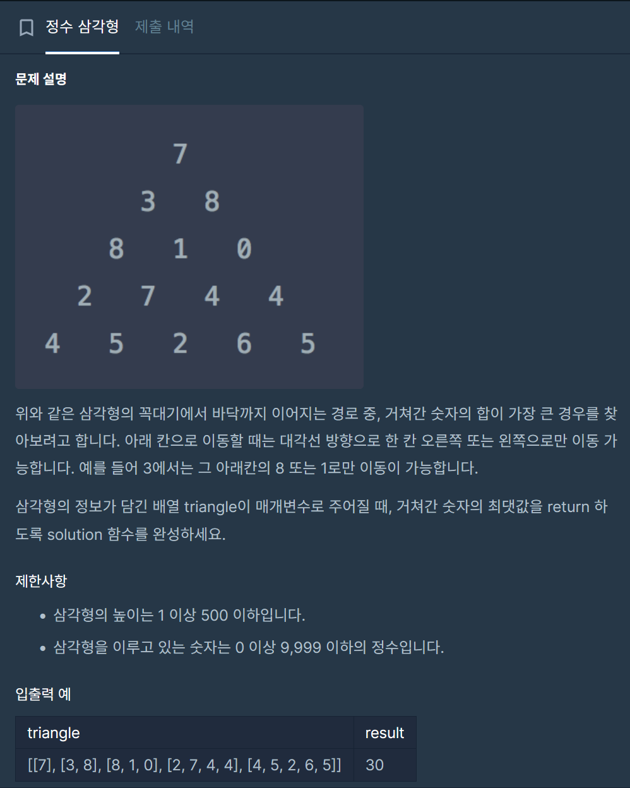

[상위 페이지 · 골드/레벨 3](/study/algorithms/dynamic-programming/gold-level-3/)



## 문제 태그

- DP

## 아이디어

1. 기본적인 점화식은 dp[i][j] = max(dp[i-1][j-1],dp[i-1][j]) + now 이다
2. 문제는 각 행의 처음과 마지막 요소
    1. 처음 요소는 자기 바로 위의 값하고 바로 덧셈
    2. 마지막 요소는 자기 -1의 위치 값하고 바로 덧셈

## 정답

```python
def solution(triangle):
    dp = [[0 for _ in range(len(triangle))] for _ in range(len(triangle))]
    dp[0][0] = triangle[0][0]
    for i in range(1,len(triangle)):
        temp_list = triangle[i]
        for j in range(len(temp_list)):
            if j == 0:
                dp[i][j] = dp[i-1][j] + temp_list[j]
                continue
            elif j == len(temp_list) - 1:
                dp[i][j] = dp[i-1][j-1] + temp_list[j]
                continue
            dp[i][j] = max(dp[i-1][j],dp[i-1][j-1]) + temp_list[j]
    return max(dp[-1])
```
