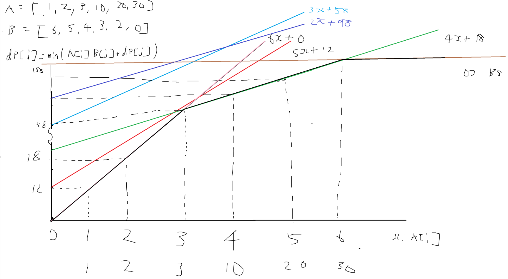

[상위 페이지 · Dynamic Programming](/study/algorithms/dynamic-programming/)


## 문제 태그

- DP
- 볼록 껍질을 이용한 DP 최적화

## 아이디어

1. 예제 1번 dp식을 이용해서 각 i에 해당할 때 
    
    
    
    처음부터 끝까지 전기톱 전력 5를 유지하는게 나음
    
2. 예제 2의 DP식을 그래프로 그렸을 때 검은 선으로 표시된 함수가 최솟값을 나타내는데, 그래프를 그리는 방법은 다음과 같다: 0부터 i번까지 그래프를 하나씩 그리고, 이때 B[j]가 기울기이며, x좌표 j에서의 여러 그래프 중 최소 y값이 절편이다. 각 i마다 0부터 (i-1)개의 그래프가 존재하므로, i일 때는 존재하는 그래프들 중 가장 작은 y값을 선택하면 된다. 



검은 줄을 따라가면 됨.

## 정답

```python
import sys

input = sys.stdin.readline

MAX = 100000

class LinearFunc:
    def __init__(self, a=1, b=0, s=0):
        self.a = a  # 기울기
        self.b = b  # 절편
        self.s = s  # 시작하는 x좌표 (유효구간 시작점)

def cross(f, g):
    return (g.b - f.b) / (f.a - g.a)

def main():
    N = int(input())
    A = list(map(int, input().split()))
    B = list(map(int, input().split()))

    dp = [0] * N
    f = []
    top = 0

    for i in range(1, N):
        g = LinearFunc(B[i-1], dp[i-1])

        while top > 0:
            g.s = cross(f[top-1], g)
            if f[top-1].s < g.s:
                break
            top -= 1
            f.pop()

        f.append(g)
        top = len(f)

        x = A[i]
        fpos = top - 1
        if x < f[top-1].s:
            lo, hi = 0, top - 1
            while lo + 1 < hi:
                mid = (lo + hi) // 2
                if x < f[mid].s:
                    hi = mid
                else:
                    lo = mid
            fpos = lo

        dp[i] = f[fpos].a * x + f[fpos].b

    print(dp[N-1])

if __name__ == "__main__":
    main()

```
