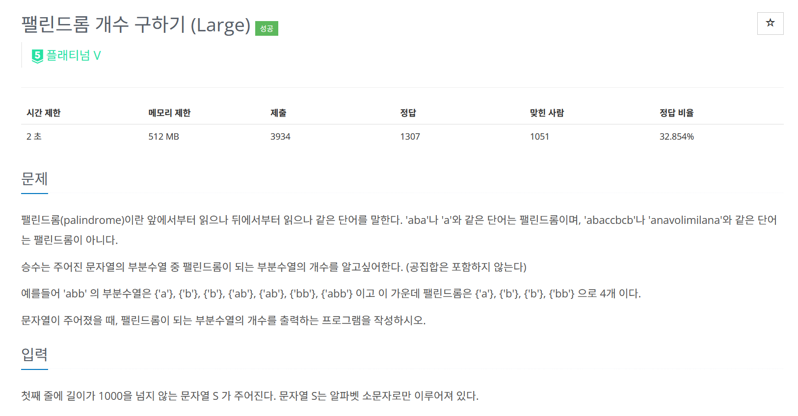

[상위 페이지 · Dynamic Programming](/study/algorithms/dynamic-programming/)



## 문제 태그

- DP
- 포함배제원리

## 아이디어

1. 무지성 브루트포스 
    
    abba
    
    | 구간i\j | 0 | 1 | 2 | 3 |
    | --- | --- | --- | --- | --- |
    | 0 | 1 | 2 | 4 | 9 |
    | 1 |  | 1 | 3 | 4 |
    | 2 |  |  | 1 | 2 |
    | 3 |  |  |  | 1 |
    
    abb
    
    |  | 0 | 1 | 2 |
    | --- | --- | --- | --- |
    | 0 | 1 | 2 | 4 |
    | 1 |  | 1 | 3 |
    | 2 |  |  | 1 |
    
    cabbac
    

|  | 0 | 1 | 2 | 3 | 4 | 5 |
| --- | --- | --- | --- | --- | --- | --- |
| 0 | 1 | 2 | 3 | 5 | 10 | 21 |
| 1 |  | 1 | 2 | 4 | 9 | 10 |
| 2 |  |  | 1 | 3 | 4 | 5 |
| 3 |  |  |  | 1 | 2 | 3 |
| 4 |  |  |  |  | 1 | 2 |
| 5 |  |  |  |  |  | 1 |
|  |  |  |  |  |  |  |

손으로 브루트포스해보면 규칙성이 보인다

$$
dp[i][j]=
\begin{cases}
dp[i+1][j] + dp[i][j-1] - dp[i+1][j-1] & s[i] != s[j]\\
dp[i+1][j] + dp[i][j-1] + 1  & s[i] = s[j]
\end{cases}
$$

1. 간단하게 설명하면 s[i] ≠ s[j] 일때 즉 abc 같은 상황일때 a~c까지 구하려면 ab구간과 bc구간에 팰린드롬이 몇개 있는지 보면 된다. 하지만 이때 b구간이 겹치기에 b구간을 빼준다
2. s[i] = s[j]일때 즉 aba같은 상황일때 위와 동일하지만 a~a 이는 존재 자체로 팰린드롬이기에 내부에 존재하는 팰린드롬을 감싸 하나의 팰린드롬으로 만들 수 있다
    
    원래는 $$dp[i+1][j] + dp[i][j-1] - dp[i+1][j-1] + dp[i+1][j-1] + 1$$의 식이지만 중간에 겹치는 부분을 생략한것이다
    

## 정답

```python
import sys
sys.setrecursionlimit(10**6)
string = input()
string_len = len(string)
mod = 10**4 + 7
dp = [[-1] * string_len  for _ in range(string_len)]

def solve(i, j):
    if dp[i][j] != -1:
        return dp[i][j] % mod
    if i == j:
        return 1
    elif i > j:
        return 0
    dp[i][j] = (solve(i+1, j) + solve(i, j-1) - solve(i+1, j-1))%mod
    if string[i] == string[j]:
        dp[i][j] = (dp[i][j] + solve(i+1, j-1) + 1)%mod
    return dp[i][j]
print(solve(0, string_len-1) % mod)
```
