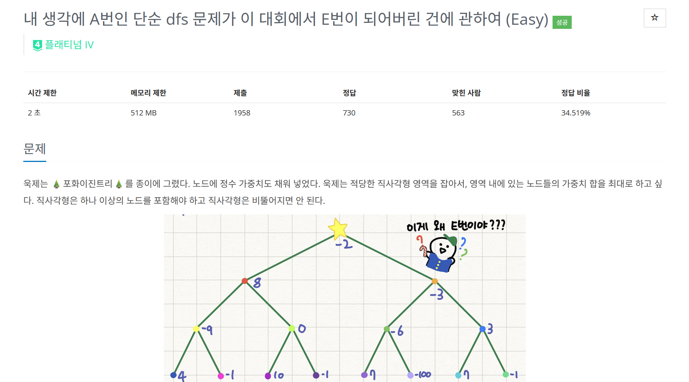
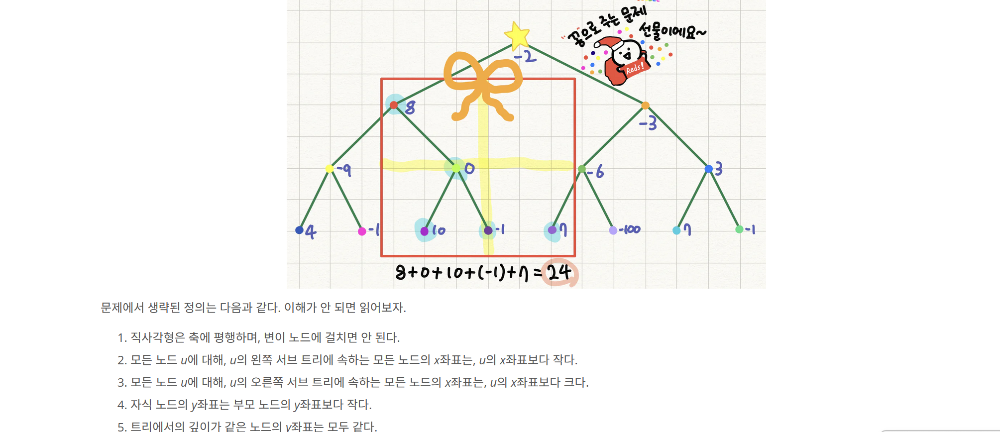

[상위 페이지 · 플레티넘](/study/algorithms/dynamic-programming/platinum/)





## 문제 태그

- DP
- 그래프 이론
- 스위핑
- 카데인 알고리즘

## 아이디어

1. **트리 좌표화**
    - 루트부터 DFS로 탐색하면서 `(x, y)` 위치에 노드를 배치
    - 왼쪽 서브트리 → 현재 x부터 시작
    - 오른쪽 서브트리 → 왼쪽을 끝낸 x 기준으로 진행
    - 이렇게 하면 인오더 순회하면서 자연스럽게 2D 위치가 생김
2. **슬라이스 + Kadane (최대 부분합)**
    - 깊이 `i~j` (y값의 구간)로 슬라이스를 설정
    - 해당 y범위에 들어가는 노드만 골라 x순으로 나열 후 가중치 배열로 만듦
    - 이 배열에 대해 **Kadane 알고리즘**을 적용해 최대 연속합을 계산
    - 모든 i~j 쌍에 대해 반복하여 최대값을 찾음

## 정답

```python
import sys
import math

sys.setrecursionlimit(10 ** 5)
input = sys.stdin.readline

N = int(input().strip())
weight = list(map(int, input().split()))
nodes = []
length = int(math.log2(N)) + 1
def DFS(idx, x, y):
    if idx * 2 <= N:
        x = DFS(idx * 2, x, y + 1)
    nodes.append([x, y, weight[idx - 1]])
    if idx * 2 + 1 <= N:
        x = DFS(idx * 2 + 1, x + 1, y + 1)
    return x + 1
DFS(1,0,0)
ans = nodes[0][2]
for i in range(length):
    for j in range(i, length):
        s = 0
        for n in nodes:
            if n[1] < i or j < n[1]:
                continue
            if s + n[2] < 0:
                ans = max(ans, n[2])
                s = 0
            else:
                s += n[2]
                ans = max(ans, s)
print(ans)
```
