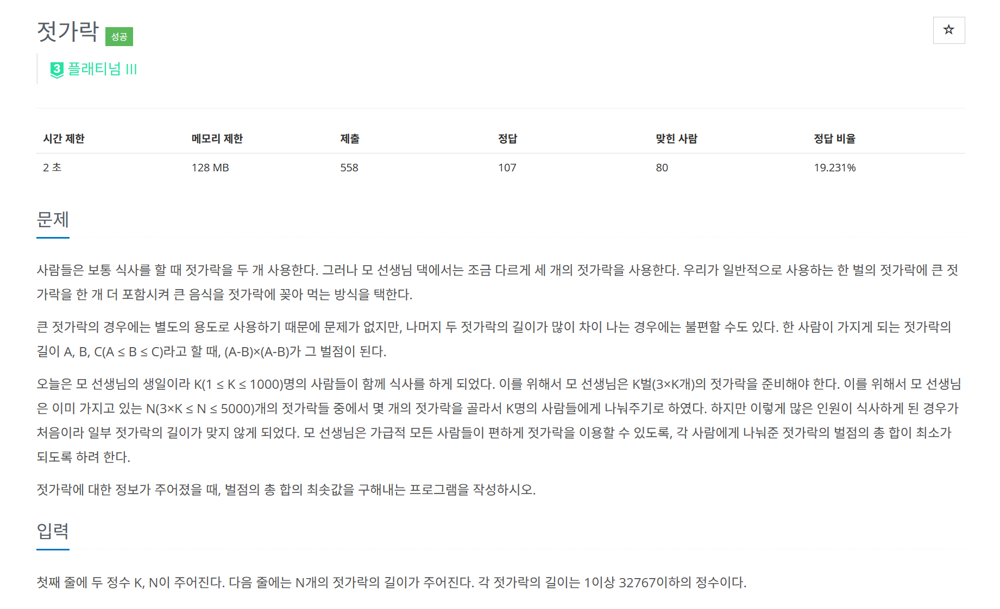

[상위 페이지 · 플레티넘](/study/algorithms/dynamic-programming/platinum/)



## 문제 태그

- DP

## 아이디어

1. 젓가락을 정렬하면 그 인접한것들끼리의 벌점이 최소임은 자명한 사실이다.
2. dp 식은 다음과 같음
    - dp[i][j] = i번째 세트를 만들고 현재 j만큼 젓가락을 봤을때의 벌점
    - dp[i][j+1] = i번째 젓가락을 선택하지 않음
    - $$dp[i-1][j+2] + |chopstick[j] - chopstick[j+1]|^2$$ = i번째 젓가락을 선택

$$
dp[i][j] = min(dp[i][j+1],dp[i-1][j+2] + |chopstick[j] - chopstick[j+1]|^2
$$

1. 젓가락을 큰 순서대로 보고 j의 시작 위치를 n-(3*i)로 잡으면 C 젓가락은 알아서 선택 됨. 대충 9 8 7 6 5 4의 젓가락이 있다면 9~8까지는 젓가락 세트를 만들기 부족함으로 어차피 선택 못함 << 선택못한것들이 C가 됨

## 정답

```python
import sys
input = sys.stdin.readline

def solve():
    k, n = map(int, input().split())
    chopstick = list()
    for _ in range(n):
        chopstick.append(int(input()))
    chopstick.sort()
    INF = 10 ** 18
    dp = [[INF] * (n + 2) for _ in range(k + 1)]
    for j in range(n + 2):
        dp[0][j] = 0
    for i in range(1, k + 1):
        max_j = n - (3 * i)
        for j in range(max_j, -1, -1):
            cost = (chopstick[j + 1] - chopstick[j]) ** 2
            dp[i][j] = min(dp[i][j + 1], dp[i - 1][j + 2] + cost)
    print(dp[k][0])
solve()

```
