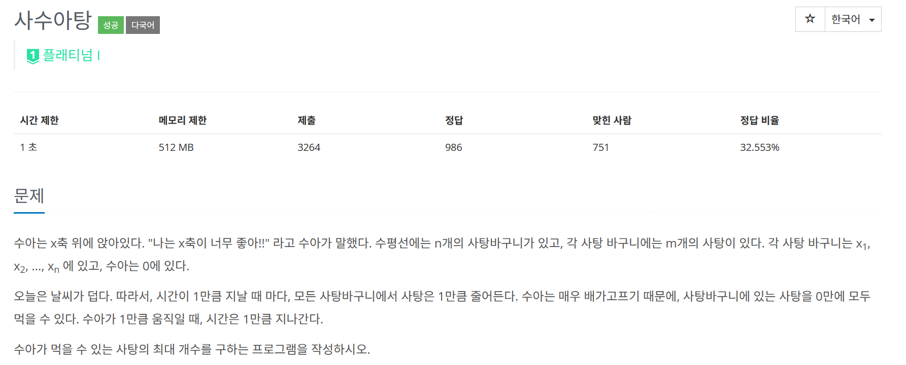

[상위 페이지 · 플레티넘](/study/algorithms/dynamic-programming/platinum/)



## 문제 태그

- DP

## 아이디어

- 현재 위치에서 l-1 or r-1을 선택하는것이 당연히 최선
- 어느 방향으로 가던 바구니에 담기는 사탕의 개수가 적어짐
- 사탕바구니 k를 선택하여 x개를 먹는것은 m*k개의 사탕에서 줄어들 사탕 y를 최소화 하는것
- DP 식
    
    $$
    dp[dir][l][r] = min(cnt *((w==1?p[r]:p[l])-p[l-1]) + dp[0][l-1][r],
    \\
    cnt*(p[r+1]-(w==1?p[r]:p[l])) + dp[1][l][r+1])
    $$
    

## 정답

```cpp
#include <bits/stdc++.h>
using namespace std;

typedef long long ll;

int main() {
    ios::sync_with_stdio(false);
    cin.tie(NULL);

    int n, m;
    cin >> n >> m;

    vector<int> positions;
    bool has_zero = false;
    for (int i = 0; i < n; i++) {
        int x;
        cin >> x;
        positions.push_back(x);
        if (x == 0) has_zero = true;
    }

    if (!has_zero) {
        positions.push_back(0);
    }

    sort(positions.begin(), positions.end());
    int num_positions = positions.size();
    int start_idx = lower_bound(positions.begin(), positions.end(), 0) - positions.begin();

    const ll INF = 1LL << 60;

    ll max_candies = 0;
    if (has_zero) {
        max_candies = m;
    }

    int max_extra = n;
    if (has_zero) max_extra = n - 1;

    for (int extra_visits = (has_zero ? 1 : 0); extra_visits <= max_extra; extra_visits++) {
        vector<vector<vector<ll>>> dp(num_positions, vector<vector<ll>>(num_positions, vector<ll>(2, INF)));
        dp[start_idx][start_idx][0] = 0;
        dp[start_idx][start_idx][1] = 0;

        for (int visited_count = 1; visited_count <= extra_visits; visited_count++) {
            for (int left = max(0, start_idx - visited_count); left <= start_idx; left++) {
                int right = left + visited_count;
                if (right >= num_positions) continue;

                dp[left][right][0] = INF;
                dp[left][right][1] = INF;

                // 왼쪽으로 확장한 경우 (dir=0)
                int prev_left = left + 1;
                int prev_right = right;
                if (prev_left <= prev_right) {
                    for (int prev_dir = 0; prev_dir < 2; prev_dir++) {
                        ll prev_cost = dp[prev_left][prev_right][prev_dir];
                        if (prev_cost == INF) continue;
                        int dist = positions[(prev_dir == 1 ? prev_right : prev_left)] - positions[left];
                        ll add_cost = (ll)(extra_visits - visited_count + 1) * dist;
                        dp[left][right][0] = min(dp[left][right][0], prev_cost + add_cost);
                    }
                }

                // 오른쪽으로 확장한 경우 (dir=1)
                prev_left = left;
                prev_right = right - 1;
                if (prev_left <= prev_right) {
                    for (int prev_dir = 0; prev_dir < 2; prev_dir++) {
                        ll prev_cost = dp[prev_left][prev_right][prev_dir];
                        if (prev_cost == INF) continue;
                        int dist = positions[right] - positions[(prev_dir == 1 ? prev_right : prev_left)];
                        ll add_cost = (ll)(extra_visits - visited_count + 1) * dist;
                        dp[left][right][1] = min(dp[left][right][1], prev_cost + add_cost);
                    }
                }
            }
        }

        ll min_cost = INF;
        for (int left = max(0, start_idx - extra_visits); left <= start_idx; left++) {
            int right = left + extra_visits;
            if (right >= num_positions) continue;
            min_cost = min(min_cost, dp[left][right][0]);
            min_cost = min(min_cost, dp[left][right][1]);
        }

        if (min_cost < INF) {
            int total_baskets = extra_visits + (has_zero ? 1 : 0);
            ll current_candies = (ll)total_baskets * m - min_cost;
            max_candies = max(max_candies, current_candies);
        }
    }

    cout << max_candies << endl;

    return 0;
}
```
