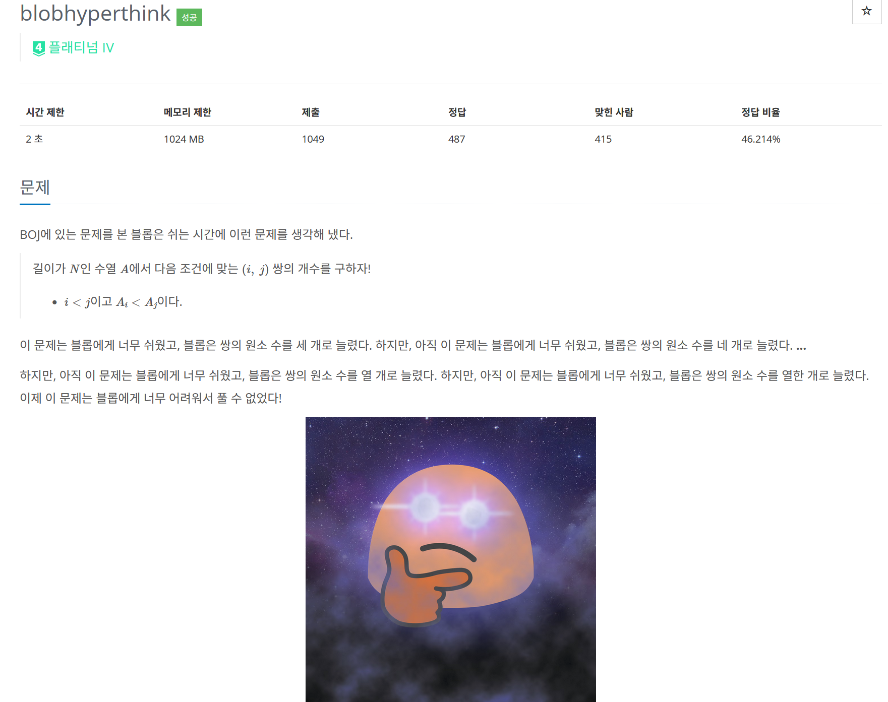

[상위 페이지 · Dynamic Programming](/study/algorithms/dynamic-programming/)




## 문제 태그

- DP
- 세그먼트 트리

## 아이디어

1. 길이가 k인 증가 부분 수열을 만들기 위해서는, 그 앞에 길이 k-1인 증가 부분 수열이 존재해야 하며, 그 마지막 원소는 현재 원소 $$a_i$$보다 작아야 한다.
2. 즉, 길이 k의 증가 수열의 개수는 현재 값 $$a_i$$보다 작은 모든 값들로 끝나는 길이 k-1 수열의 개수의 합이다.
    
    이를 식으로 정리하면:
    

$$
dp[k][a_i]=\sum_{x<a_i}dp[k-1][x]
$$

1. 이는 결국 $$dp[k][a_i] = dp[k-1]$$에서 $$a_i$$보다 작은 인덱스들의 누적합으로 표현
2. 이는 펜윅 트리로 빠르게 계산할 수 있다.

## 정답

```python
import sys
input = sys.stdin.readline

MOD = 10**9+7
N = int(input())
nums = list(map(int, input().split()))
K = 10  # depth 최대값

# bit[d][i] 는 depth=d 에서 위치 i 의 Fenwick Tree
bit = [[0]*(N+1) for _ in range(K+1)]

def add(b, i, v):
    while i <= N:
        b[i] = (b[i] + v) % MOD
        i += i & -i

def query(b, i):
    s = 0
    while i > 0:
        s = (s + b[i]) % MOD
        i -= i & -i
    return s

for x in nums:
    # depth = 0 에서 1 추가
    add(bit[0], x, 1)
    if x > 1:
        # depth = j 에서 dp[x] = sum_{d=j-1}[1..x-1]
        for j in range(1, K+1):
            cnt = query(bit[j-1], x-1)
            add(bit[j], x, cnt)

# 전체 depth=K 의 합
print(query(bit[K], N))

```
