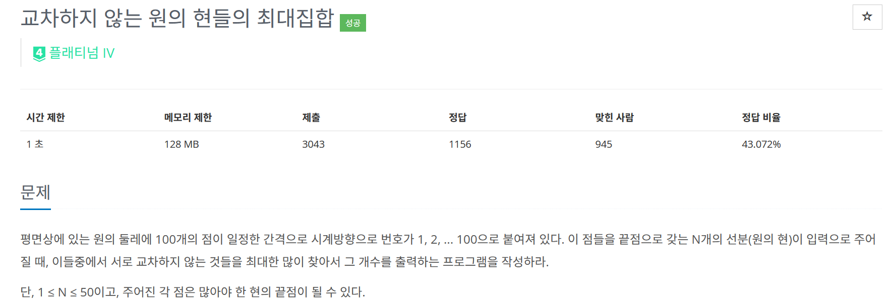

[상위 페이지 · 플레티넘](/study/algorithms/dynamic-programming/platinum/)



## 문제 태그

- DP

## 아이디어

1. 교차라는 뜻은 구간 [a,b]의 현이 있다면 구간[i,j]중 한 점이 a~b안에 속해있다는것임.


1. dp 점화식은 오프셋 k에 대해
    1. dp[a][b] = max(dp[a][b], dp[a][k] + dp[k+1][b] + line[a][b])
    2. line(a,b) = a,b현이 있다면 1 없으면 0


1. dp[1][100]이 정답

## 정답

```python
N = int(input())

has_line = [[0]*101 for _ in range(101)]
dp = [[0]*101 for _ in range(101)]

for _ in range(N):
    a, b = map(int, input().split())
    has_line[a][b] = 1
    has_line[b][a] = 1
    dp[a][b] = 1

# dp[i][j] = max(dp[i][j] < 선택 X, dp[i][k] + dp[k][j] + has_line[i][j] )
for L in range(2, 100):
    for i in range(1, 101-L):
        j = i + L
        for k in range(i, j):
            dp[i][j] = max(dp[i][j], dp[i][k] + dp[k + 1][j] + has_line[k][j])

print(dp[1][100])

```
